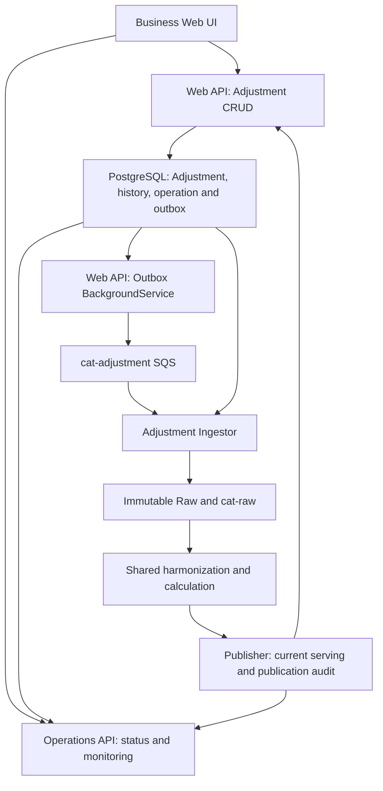
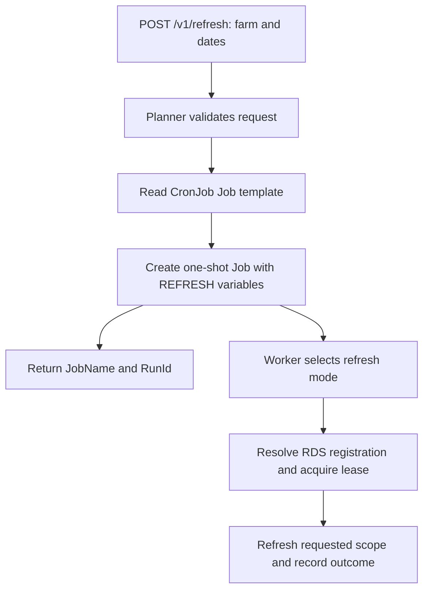
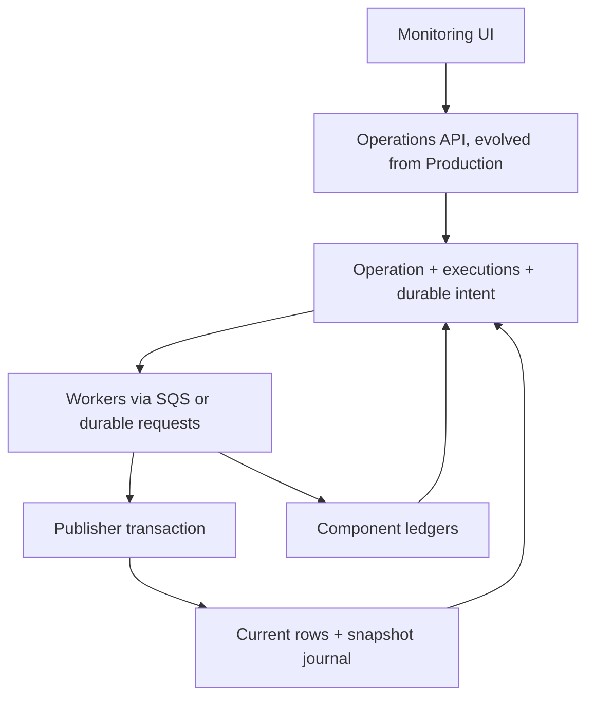

# Distributed Loss Calculation and Metrics Platform — Architecture Plan v13

> **Version 13 — 2 October 2026.** Supersedes v12 where this version differs. Domain terminology is WTG throughout: `WtgId`, `WtgName`, WTG-Day, and `WtgDayInputState`. The generic `CalculationWorkItem` and `SummaryWorkItem` names remain because they are queue work records, not turbine identities. PostgreSQL becomes the current application serving plane for daily summaries and event views; calculated 10-minute detail remains in immutable Parquet and is not copied into the API serving database. Sections 2, 3, 4.9, 5, 6.4, 11, 12, 13.1.2, 13.3, 16.3, 16.8 and 20–26 describe the serving handoff, lineage, history, contracts, coordinated manual refresh, restoration, and delivery. The 3 October amendment below sets PostgreSQL as the target for all platform relational state, including Adjustment and downstream control; the 4 October amendment separates API responsibilities and makes Adjustment ingestion SQS-driven. The document is a target design, not a claim that code or migrations are already deployed.

> **V13 amendment — 3 October 2026.** Incorporates the supplied architecture discussion summary. Evolve the existing Production API into the centralized Operations API; introduce one operation per business trigger, windfarm/source executions, durable progress and end-to-end correlation. PostgreSQL owns platform control, Adjustment authoring/audit/outbox, metadata and current serving state; Azure SQL is no longer a target platform dependency. Sections 12.8, 13.4, 14.8 and 27 define catalog mappings, operation semantics, retention and reconciliation of the new ideas. Source systems may still use SQL Server behind ingestor adapters. This is an architecture amendment, not evidence of a completed database migration.

> **V13 amendment — 4 October 2026.** Incorporates `loss_platform_architecture_discussion_summary_updated(1).md`. The business Web API owns serving queries and Adjustment CRUD; the centralized Operations API evolves from the Production API and owns refresh/backfill/reprocess/restore/status/monitoring. The Web API commits Adjustment + complete revision history + operation/execution + `outbox_message` atomically. Its Outbox Dispatcher is a BackgroundService that sends identifiers to `cat-adjustment-<env>`; a separately hosted, long-running Adjustment Ingestor reads authoritative PostgreSQL data, records `extraction_run`, writes immutable Raw and publishes to `cat-raw-<env>`. Normal Adjustment ingestion has no `extraction_cursor`. The topology now has six main SQS queues plus six DLQs. Sections 3–7, 13, 20–23, 25–28 align these decisions and end-to-end publication-based tracking. This amendment supersedes the earlier combined API host and combined Adjustment outbox/Raw processor design; it does not claim implementation or deployment.

> **Priority and migration.** V13's normative sections supersede older historical notes (including the previously disabled orchestration API) and old v12 statements about Synapse as the normal serving engine and about having no operational Fan-Out batch/dispatch rows. The existing Fan-Out implementation may keep bounded operational dispatch/batch records with its six-month retention policy; those rows are not the permanent data-lineage store. Existing Raw paths without `mode=` remain readable. Change producers only after compatible consumers are deployed. Preserve live checkpoints, tokens, run history, WTG-Day revisions, and published data during schema migration.

> **Ingestion revision — 24 September 2026.** One valid pod owner per `(source_type, windfarm_id)`; calendar-month `LastUpdatedDate` windows execute with bounded parallelism inside that pod. Retain two ingestion tables: `extraction_cursor` for registration/ownership/progress and `extraction_run` for audit. No new ingestion work table or coordinator service. Production incremental Raw preserves queried changed rows in bounded Parquet parts directly beneath `extraction=<LeaseToken>/`, named `window-{start}-to-{end}-part-{number}.parquet`. One fenced checkpoint commit follows success of every window's Raw/queue handoff; restart replays the uncommitted range. Sections 4, 5, 8.4, 8.6, 15.1, 16.3 and 26 incorporate the associated consumer and recovery requirements. Companion specification: [CAT_Ingestor_Design.md](CAT_Ingestor_Design.md). This revision updates documentation; repository implementation has not been verified.

> **Schema correction — 23 September 2026.** Retain the existing `(source_type, windfarm_id)` cursor primary/unique key for every applicable ingestor. This also defines registration, eligibility, lease ownership and fenced checkpoint updates. Source-system information is adapter/routing metadata, not a replacement cursor key. No key migration or further schema-choice confirmation is required. This correction supersedes the conflicting key guidance in earlier copies of v12 and the Production-only implementation brief.

> **Version 12 — 23 September 2026.** Regenerated from the current v11(3), preserving downstream architecture while consolidating the settled ingestion design. Section 4.2 defines two ingestion tables, time-based scheduled selection, derived eligibility and sequential farm claiming with bounded parallel windows inside each farm execution. Section 13.1.1 documents the Production refresh controller and Kubernetes Job trigger supplied by the user. Historical refresh remains separate from scheduled ingestion; new RunNow and all-farm API endpoints are outside the current delivery. Section 26 records settled decisions and implementation checks. This is the implementation baseline, not a certification that the repository already implements it.

> **Reading priority.** V13 normative sections take precedence over the historical version notes below and the earlier Production-only Copilot implementation brief wherever they differ. V13 retains administrator-seeded cursor registrations, sequential due-work claiming and eligibility calculated from incremental outcome/completion times. Do not add a persisted `next_eligible_utc` column for this implementation. No database or API code has been modified by regenerating this document.

> **Version 10 update:** retains all Version 9 refinements and adds the event-serving model agreed during review: canonical monthly event files for outage, alarm, curtailment and adjustment; Windfarm-Day daily event-reference projections so long/open events are discoverable from any overlapping day; nullable event end times; explicit separation between source/canonical event data in Harmonized and calculated loss values in Calculated; and Synapse query rules that combine daily event references with additive WTG-Day calculated summaries without copying calculated loss into Harmonized. It further closes the open-event materialization gap with `EventMaterializationState` and a clock-driven Event Lifecycle Coordinator (Section 6.11), splits calculation materialization from current-day event serving at `CalculationProcessableDate`, and adds `SummaryType = HarmonizedEventReference` with its own `WindfarmDayEventReferenceState`.
>
> **Version 10.1 update — ingestion-path simplification.** The Platform Orchestration API is switched off for this solution's container, and with it the `RawDispatch`, `RawFanOut`, `RawFanOutWorkItem` ledgers and the Harmonization Dispatcher are removed. The extraction pod now owns Raw write and queue publication directly, under a **fenced extraction lease**; the original daily Raw addressing from this historical note is superseded by the direct extraction-folder layout in Section 4.9; `WtgDayInputState` becomes both revision authority **and** readiness state, carrying `Failed`, `AttemptCount` and `LastError`; a reconciliation sweep retries failed WTG-Days; and a three-class failure taxonomy (WTG / batch / poison batch) plus a `FanOutFailure` record covers the pre-fan-out window where no WTG-Day identity exists yet. The Adjustment outbox is explicitly retained.

> **Terminology note.** "Fan-out" now refers only to the in-process enumeration of a Raw file into WTG-Day batches by the Raw Fan-out Coordinator. It no longer implies a durable SQL child ledger.

> **Version 10.2 update — historical refresh, event-footprint reconciliation and queue portability.** Adds a complete `RefreshAndRecalculate` path for rebuilding a selected range from authoritative sources without deleting immutable Harmonized/Calculated history; tightens event-correction semantics so each `(EventId, WtgId)` reconciles its actual materialized footprint against the new canonical footprint even when old and new intervals partially overlap or are completely disjoint; defaults empty WTG-Day components to authoritative logical-empty revisions (`Status = Complete`, `RecordCount = 0`, `path = null`) with ordinary canonical hashing and optional physical zero-row Parquet only when justified; and introduces a provider-neutral work-queue contract so AWS SQS remains an infrastructure adapter rather than a business-state dependency.

> **Historical v11(3) clarification — 22 September 2026.** Added RDS-driven startup for all scheduled ingestors, kept Kubernetes free of normal wind-farm selection, and retained the Adjustment outbox. Its separate assignment model and default bounded parallelism are superseded by v12 Section 4.2. This remains an ingestion-scope revision, not a migration of every database or analytical query engine elsewhere in the document.

## 1. Purpose

This document defines the target architecture for a distributed loss-calculation and metrics platform.

The design evolves the existing single integration-and-calculation application into a staged, event-driven architecture that separates:

- Source extraction
- Raw data retention
- Data harmonization
- Calculation orchestration
- Parallel calculation
- Publication
- UI serving and metrics
- Backfill, recalculation, resilience, and observability

The platform supports approximately thousands of WTGs and multi-year data ranges.

Primary calculation inputs are:

1. 10-minute production data
   - Actual production
   - Possible production
   - Active power and other measurements

2. Outage data
   - Can be shorter than one minute
   - Can last multiple days or weeks

3. Curtailment data

4. Alarm data
   - Primarily used to explain outage conditions

5. User adjustments
   - Created or changed through the UI
   - Stored in PostgreSQL
   - Can affect the calculation and trigger recalculation

The normal processing direction is:

```text
Raw → Harmonized → Calculated → Serving
```

Each downstream zone contains everything required by the next stage.

Normal processing should not repeatedly look backward to earlier zones.

---

## 2. Core Architecture Principles

### 2.1 Forward-only normal processing

```text
Raw → Harmonized → Calculated → Publisher → PostgreSQL current serving → Web API → Web UI
Historical/detail: exact retained Parquet → query-provider adapter → Web API → Web UI
```

The Raw Zone is retained for audit, recovery, replay, and rebuilding downstream zones if processing logic changes.

Pure recalculation reads from the Harmonized Zone and does not reread Raw.

---

### 2.2 Complete partition replacement

Recalculation replaces a complete logical partition rather than applying untracked deltas.

For normal processing, the preferred logical unit is:

```text
WtgId + CalculationDate
```

Large historical requests may be grouped by `WtgId + Month` as an orchestration/dispatch batching envelope, but such a group is always expanded into WTG-Day work items before worker execution. A calculation worker never executes a month as a single unit.

---

### 2.3 Package-driven calculation and published-result state

Calculation input identity and published-result identity are tracked separately.

```text
RequestedPackageRevision
RunningPackageRevision
CommittedPackageRevision   (on CalculatedPartition / published result state)
```

A package revision identifies the exact Harmonized component revisions plus configuration and calculation-code version. A calculated result becomes readable only after validation and publication commit.

Example:

```text
RequestedPackageRevision = 19
RunningPackageRevision   = 18
CommittedPackageRevision = 17
```

Package 18 may finish computation, but it must not publish if package 19 is still the latest requested package. A newer requested package can never be overwritten by an older result.

Pure user-requested re-execution of an unchanged package is tracked by a `RecalculationRun` / result revision rather than manufacturing changed Harmonized component revisions.

---

### 2.4 At-least-once processing with idempotency

AWS SQS may retry or redeliver messages.

All queue consumers must therefore be idempotent.

The same work item can run more than once without producing duplicated or inconsistent results.

---

### 2.5 Deterministic calculation

For the same:

- Harmonized input revision
- Adjustment revision
- Configuration version
- Calculation code version

the calculation must always produce the same result.

Input ordering must not affect the output.

---

### 2.6 Independent scaling

The following workloads scale independently:

- Extraction
- Harmonization
- Normal calculation
- Backfill calculation
- Calculated publication

This prevents one workload type from consuming all platform capacity.

---

### 2.7 Separate historical backfill capacity

Historical processing must not starve normal operational processing.

Use independent calculation queues and worker limits for:

```text
Normal calculation
Historical backfill
```

---

### 2.8 Parquet history, PostgreSQL serving, and transactional control

Azure Blob Parquet is the durable source, Harmonized, and Calculated data plane. Retain immutable revisions, exact calculation inputs, and lineage. PostgreSQL serves **only current daily WTG/windfarm summaries and current event views** required by normal API requests. No current 10-minute production or calculated detail is stored there. The SQL serving rows are a replaceable projection of committed Parquet outputs, not the historical authority.

PostgreSQL is the target owner of all platform relational state: ingestion cursor/run, operational dispatch, downstream readiness/calculation/summary control, Adjustment authoring/history/outbox, centralized operations and metadata, plus current serving rows. Separate responsibilities with schemas/repositories and access roles, not a second database engine. Co-locate Adjustment, operation acceptance and its outbox in the same PostgreSQL database so they can commit atomically. Platform Azure SQL dependencies must be migrated before cutover; do not claim that migration is already implemented. Existing source SQL Server databases remain external sources behind adapters. A database per Dev/Test/PreProd/Prod remains independent; do not add an environment column. RDS/EKS cross-account access uses the approved App Bundle/IRSA route and least-privilege PostgreSQL roles.

```text
Azure Blob Parquet = Raw evidence + Harmonized inputs + Calculated history
PostgreSQL serving = current daily/event rows + small publication history
PostgreSQL control schemas = ingestion leases/runs; adjustment outbox; readiness/work ledgers
SQS = at-least-once execution delivery, never revision authority
```

Historical 10-minute and historical daily "as-of" requests resolve an exact published revision and read Parquet through a query-provider abstraction. The application does not query an unfiltered revision wildcard. Section 12 defines publication, query and retention semantics.

### 2.9 Query-provider and service abstraction

Normal API reads use a `ICurrentServingQuery` backed by PostgreSQL. Historical and bounded detail reads use `IRevisionCatalog` to resolve published manifests and `IHistoricalParquetQuery` to read the selected files. The Synapse Serverless provider reads Azure Blob; an Athena provider can read an S3 copy after migration. Authentication, SQL dialect, storage locations, retry and query execution stay in adapters, not controllers or calculation logic. A provider swap does not change the API's business query contract. Plain Parquet itself has no built-in as-of table syntax; our publication history chooses the file set before the engine queries it.

### 2.10 Plain Parquet only

The initial implementation uses standard Parquet files only.

The architecture does **not** require Delta Lake, Apache Iceberg, Spark, Trino or a lakehouse catalog.

Each revision represents a **complete replacement of its logical partition**, not a delta chain.

A lakehouse table format may be evaluated later only if a concrete requirement appears.

---

### 2.11 Event identity is canonical; daily event references are serving indexes

Long-lived and open-ended outage/alarm/curtailment/adjustment records are not forced into one physical representation for every workload.

```text
Canonical event
= one logical event row with stable EventId and nullable EndUtc

Calculation input
= WTG-Day segment / aggregate

Serving index
= one lightweight EventId reference per overlapping WTG-Day
```

Calculated loss values remain exclusively in the Calculated Zone. The Harmonized event/reference datasets describe source/canonical facts and where an event participates in the reporting calendar; they do not store calculated loss totals.

## 3. Target Architecture

All pipeline diagrams in this plan carry OperationId/ExecutionId across source-specific handoffs, including the Adjustment queue and downstream SQS; where branches join, the durable target association retains all requesting executions (Section 13.4.3). Diagram labels omit repeated correlation fields for readability. These IDs do not replace existing work IDs, leases or source revision metadata.

```text
Source systems → scheduled EKS ingestors → immutable Azure Blob Raw
              → cat-raw SQS → Raw Fan-Out → cat-harmonize SQS
              → WTG-Day Harmonized + canonical monthly events
              → WtgDayInputState and package coordinator
              → main/backfill Calculation SQS → deterministic calculation
              → immutable Calculated detail and daily summaries
              ├→ publication worker → current PostgreSQL serving rows → API/UI
              └→ retained revision manifests → historical query abstraction
                   ├→ Synapse Serverless / Azure Blob
                   └→ Athena / S3, when data has migrated
```

The publisher never asks the query engine to infer the current revision from all objects under a wildcard. Publication state and manifest identity are explicit. The Raw container is operated by the infrastructure team, while this solution owns its Raw file lifecycle. Confirm external dependencies before disabling the old orchestration service. A failure before Fan-Out identity is known remains covered by `FanOutFailure` and DLQ processing.

`SQS = delivery`, `Blob = immutable data`, and `SQL = only the state and current serving projection that need transactions`. Historical as-of queries use retained Parquet and the PostgreSQL publication journal; operational Fan-Out dispatch/batch rows are not lineage.

### Optional Gold Zone

A physical Gold Zone is **not required initially**.

Gold is reserved only for future serving-optimized datasets that are expensive to derive repeatedly from Harmonized and Calculated data.

Do not copy data into Gold merely because a medallion architecture contains a Gold layer.

### User adjustment path

The Web API and Operations API have distinct hosts and responsibilities (Section 13.1). Adjustment follows the same calculation and publication pipeline after its Raw handoff:



The first PostgreSQL transaction writes the parent, full WTG membership, immutable business revision/history, operation/source execution and outbox delivery intent together. The Outbox Dispatcher only sends committed messages to SQS and records delivery; it never writes Raw or calculates. Adjustment Ingestor long-polls the dedicated queue, creates a distinct `extraction_run` attempt, loads the referenced Adjustment revision from PostgreSQL and publishes Raw to the common pipeline. A normal Adjustment event never seeds or advances an extraction cursor.

The business UI ends its Save spinner after the transaction, polls the Operations API using the returned OperationId, and continues showing previous committed calculated values. Publisher commits the requested serving bundle before the operation becomes Completed; the UI then reloads business results through the Web API. SQL history and immutable lake lineage retain the source revision and memberships. The outbox is mandatory: a crash after saving an Adjustment must leave a durable notification for retry.

# 4. Feature / Zone 1 — Extraction and Raw Data Zone

## 4.1 Responsibility

Extract changed source data safely, write it durably to the Raw Zone, and publish it for harmonization.

The zone answers:

> What changed in the source, which business partitions are affected, and which Raw artifact represents the durable extraction result?

Raw is retained for audit, recovery, replay, and downstream rebuilds. For pull-based sources the extraction Job owns the complete unit of work: acquire cursor lease → read source → write Raw → publish to SQS → advance cursor. Adjustment is the event-driven exception: Web API Outbox Dispatcher → dedicated Adjustment SQS → long-running Adjustment Ingestor → Raw → common Raw queue (Section 7). There is no separate Raw dispatcher for pull-based extraction and no external file-lifecycle service.

---

## 4.2 Infrastructure and v13 ingestion scope

- EKS CronJobs and targeted Jobs start the four pull-based source ingestors; Adjustment Ingestor is a continuous SQS consumer Deployment.
- RDS PostgreSQL stores ingestion registrations/checkpoints and execution history.
- The existing Raw storage and queue adapters remain in use.
- The Production refresh API creates a one-shot Job from the existing CronJob's Job template.

For the four pull-based sources, v13 retains the **two-table, time-based implementation target** settled in the latest design discussion. Adjustment has the separate event-driven runtime in Section 7. It replaces v11's separate assignment-configuration requirement. Verify the repository and preserve existing data during migration; this does not reopen the architecture. Incremental RunNow and new all-farm API endpoints are future features outside this delivery. Section 26 separates the settled design from code verification and deployment tuning.

RDS PostgreSQL owns ingestion state. The 3 October target also moves Adjustment and downstream control to PostgreSQL through explicit schema/data/application migration; analytical Parquet query providers remain behind their abstraction. Dev, Test, PreProd and Prod have independent databases; no environment column is needed.

### 4.2.1 Execution modes and all-ingestor applicability

**For pull-based ingestors, Kubernetes starts execution; the worker resolves business work from RDS or an explicit validated refresh request.** A normal scheduled pod does not require `Ingestion:WindfarmId` or `Ingestion__WindfarmId`. Adjustment starts as a long-running Deployment and resolves event-driven work from `cat-adjustment-<env>`, then reads authoritative data from PostgreSQL.

| Mode | Selection | Scheduling delay | Source checkpoint |
| --- | --- | --- | --- |
| Scheduled | Claim one enabled, due cursor in the deployment's source scope at a time | Respect interval/backoff | Resume and advance only safely committed progress |
| Historical refresh — existing API trigger demonstrated | One requested wind farm and explicit dates, validated against RDS | Bypass scheduled eligibility | Preserve normal incremental checkpoint and scheduling state |
| RunNow — future, outside this delivery | One selected farm or a fixed list of all enabled farms | Bypass delay only for selected scope | Resume and safely advance the incremental checkpoint |
| ForceRecalculate — existing architectural operation | Selected existing Harmonized packages | Not an ingestion operation | No source pull or cursor change |

This contract applies across source-specific ingestors without merging their executables or checkpoint algorithms:

| Path | Normal work discovery | Source-specific behaviour |
| --- | --- | --- |
| Production | Enabled, due RDS cursor rows for Production streams | Timestamp/ID change extraction, safety overlap, parallel monthly update windows and immutable changed-row parts |
| Outage | Enabled, due RDS cursor rows for Outage streams | Verified source change cursor and full changed-event state; explicit deletion semantics |
| Alarm | Enabled, due RDS cursor rows for Alarm streams | Increasing IDs only where verified to represent all required changes; mutable historical alarms require change capture or reconciliation |
| Curtailment | Enabled, due RDS cursor rows for Curtailment streams | Verified source change cursor and full changed-event state |
| Adjustment | Long-poll `cat-adjustment-<env>`; IDs reference authoritative PostgreSQL Adjustment revisions | Reuse `extraction_run`; write Raw and publish to `cat-raw` before deleting the Adjustment SQS message. No normal `extraction_cursor`. Web API dispatcher separately marks outbox Published after SQS acceptance. |

An Adjustment refresh resolves a bounded authoritative database scope and sends a durable replay command through the same outbox/Adjustment queue, with pinned revision membership or a scope manifest. It does not create a cursor or an external-source Job. Do not apply the pull-based two-table design by deleting the Adjustment outbox or downstream work ledgers.

### 4.2.2 Two-table ingestion model

For Production, Outage, Alarm and Curtailment, registration and mutable progress are combined in `extraction_cursor`. Adjustment shares audit attempts in `extraction_run` but has no normal cursor registration. V11's statement that the cursor must never be the registration list is superseded. Explicit administrator-controlled onboarding and enable/disable behaviour are required.

| Table | Responsibility |
| --- | --- |
| `extraction_cursor` | Registered source-type/wind-farm identity, enabled status, durable source progress, eligibility inputs, current lease and incremental operational state |
| `extraction_run` | Audit-only per-attempt history: correlation, mode, selected scope, timing, outcome, query/checkpoint boundaries, artifacts and diagnostics; never a pending-work queue or per-window restart authority |

Existing source-system/wind-farm master data may still be referenced for validation and adapter routing. “Two tables” concerns pull-based ingestion control, not the whole platform. Adjustment keeps transactional outbox delivery and SQS as its trigger; source-cursor FK/checkpoint/token fields on a shared run must be optional where not applicable.

No additional `ingestion_assignment` or `ingestion_work` table is required solely for periodic polling. Before removing their runtime dependency or schema, inspect actual references: they may support API requests, durable refresh tracking or another worker. Migrate required data first; do not discard existing outstanding requests.

Registration rules:

- An administrator seeds one enabled-capable cursor row per `(source_type, windfarm_id)` with an explicit initial checkpoint. For example, Production/WF01 and Outage/WF01 have separate cursor rows. Missing registration is not an instruction to discover a new farm from the source.
- Disable using `is_enabled`; preserve cursor, token sequence and history. Do not delete/recreate a cursor to restart ingestion.
- Disabling prevents new claims; stopping already leased work is a separate operational action.
- A seed operation must not overwrite an existing committed checkpoint or reset a fencing token.
- Source credentials remain in the established identity/secret integration, not cursor or run records.

The settled cursor key is **`(source_type, windfarm_id)`**. Retain the existing schema and use this same pair for seeding/upserts, scheduled claims, refresh lookups, lease acquisition/renewal/release and fenced checkpoint/finalization updates. Production, Outage, Alarm and Curtailment maintain separate progress for the same wind farm because their `source_type` values differ. Source-system metadata may be used to select connections/adapters, but it does not replace or extend this cursor key. Do not migrate the key or ask for confirmation of an alternative source-system key.

The Production deployment filters `source_type = Production` using the repository's existing enum/database representation. Its refresh API supplies `WindfarmId`; the Production execution path supplies the source type. Other ingestors follow the same type-specific rule. Run-history records carry `source_type` and `windfarm_id` alongside their unique attempt identity; the pair does not become the primary key of `extraction_run`, because multiple attempts must be retained.

Recommended cursor fields (map to the existing schema rather than duplicating columns):

The latest summary calls the timestamp checkpoint `last_committed_updated_at` and expiry `lease_expires_at`; older v13 examples below use `last_updated_date` and `lease_expires_utc`. These are logical mappings to verify against the actual repository schema, not instructions to create two checkpoints/leases or rename live columns. OperationId is not source progress.

| Field group | Meaning |
| --- | --- |
| `source_type`, `windfarm_id`, `is_enabled` | Existing composite cursor key and enabled status |
| `last_updated_date`, `last_committed_id`, existing WTG/event ID fields as needed | Adapter-specific durable source progress; no generic JSON checkpoint required |
| `lease_owner`, `lease_token`, `lease_expires_utc` | Current ownership; monotonically increasing fencing token |
| `active_run_id` or equivalent attempt reference | Correlates the held lease with its execution history |
| `last_run_started_utc`, `last_run_completed_utc`, `last_run_outcome` | Latest incremental attempt; completion means terminal whole-execution outcome; no per-window cursor commit |
| `consecutive_failures`, `last_error` | Incremental failure tracking; reset only after successful incremental completion |
| `last_successful_run_completed_utc` if needed | Separately exposes last incremental success for freshness monitoring |

Window membership, progress and task results live in memory in the owning pod. No `extraction_work` table, persistent child ledger or new coordinator deployment is added. The cursor stores no Parquet count or task list. Run audit may retain file counts/references and observed production-date min/max; this is not operational scheduling state, and min/max is not continuous coverage.

Historical refresh attempts are recorded in `extraction_run`; their completion must not overwrite incremental eligibility/outcome fields. The shared lease can identify a Refresh attempt through its active run record without making it the latest incremental success.

Execution history needs a unique attempt identity in addition to the API's request correlation ID. Job retries can share `REFRESH_RUN_ID` but must have distinguishable attempt rows. Record `source_type`, `windfarm_id`, execution mode, Job/pod identity, lease token, start/end time, terminal status, requested dates where applicable, from/to committed checkpoints, artifact references/counts and sanitized error information. A request ID is not a fencing token.

### 4.2.3 Time-based eligibility and the meaning of “due”

This is **process each registered farm when due**, not exactly once per CronJob invocation.

Use explicit positive `MinimumIngestionInterval` and `FailureRetryBackoff` settings with documented per-source defaults/overrides. Lease duration/renewal is independent of both. Use database time consistently.

Evaluate these rules in order:

| State | Scheduled eligibility |
| --- | --- |
| Disabled or outside the deployment's source scope | Never selected |
| Unexpired active lease, including a refresh lease | Not eligible |
| Abandoned incremental attempt with an expired lease | Recoverable immediately from its last committed checkpoint |
| No previous incremental attempt | Immediately eligible |
| Last incremental attempt succeeded, including a successful no-data check | Completion time plus ingestion interval has elapsed |
| Last incremental attempt failed | Failure completion time plus retry backoff has elapsed |

An expired Refresh lease allows recovery of ownership, but is not evidence that the incremental schedule should be reset or that the refresh succeeded. Finalize the abandoned attempt appropriately; incremental eligibility still follows its own last outcome. Retry of the refresh must preserve its explicit request scope.

**V13 calculates eligibility; it does not add a persisted `next_eligible_utc` column.** Derive due time from the last terminal incremental outcome/time and effective interval/backoff. Use the same expression for filtering and oldest-due ordering. Effective policy changes affect subsequent claim checks; document configuration reload behaviour. If the repository already contains a due-time column, migrate its consumers safely so it does not remain a conflicting authority.

Deriving due time does not remove the delay: restarting a scheduled pod still respects interval/backoff. Manual historical refresh bypasses scheduling delays only for its selected scope. The future RunNow contract is recorded in Section 4.2.7 and is outside current implementation scope.

A successful no-data check updates completion/eligibility without fabricating source progress. Advancing a source watermark is permitted only under the adapter's verified extraction semantics, never merely to mark a farm as processed.

The CronJob frequency determines when eligibility can be observed. Example: a farm finishes at 10:08 with a one-hour interval; an hourly Job at 11:00 skips it and 12:00 may be its next opportunity. A five-minute backoff does not guarantee a five-minute retry when no worker is running. Select schedule, interval and backoff against required freshness.

### 4.2.4 Atomic claim and bounded pod execution

A pod owns one source/farm at a time; its monthly windows run concurrently inside that pod. The existing bounded claim-process-repeat loop may claim another farm after releasing the previous one. Set `MaxClaimsPerInvocation = 1` when one Job must handle exactly one farm. There is no separate month-worker deployment.

1. Select an enabled, due cursor for the ingestor's source type using the existing oldest-due policy and a short `FOR UPDATE SKIP LOCKED` transaction.
2. In that transaction, assign owner, increment fencing token, set expiry, correlate/create the audit attempt and record incremental start where applicable. Commit before network I/O.
3. Capture the original checkpoint, apply configured overlap and freeze a finite exclusive upper query boundary. Plan calendar-month windows in memory.
4. Start one independent lease heartbeat and process windows using bounded async concurrency. Initial `MaxParallelWindows = 2` is a tuning value. Each window owns its connection/reader, pagination state and bounded writer buffers.
5. Persist each immutable Raw part and confirm its queue publication. Tasks record results in memory; they do not update the cursor.
6. Join all windows. Only after every required query/Raw/notification operation succeeds, use one fenced final transaction to commit verified incremental progress, outcome/eligibility, audit completion and lease release. A no-data success retains the existing source pair when no newer source progress is proved.
7. Claim another due farm only within the finite invocation budget. There is no sleep waiting for future eligibility.

`SKIP LOCKED` protects the short claim transaction; the persisted lease protects work after that transaction. A zero-row claim means no work was claimable at that instant, not that every farm completed. Validate `MaxInvocationDuration` and/or `MaxClaimsPerInvocation`, window concurrency, page/part bounds and shutdown grace. Daily scheduling must account for runtime and eligibility; an exactly daily CronJob plus a 24-hour completion-based interval can skip a day's trigger.

Failure handling:

- Any unresolved window failure preserves the entire pre-execution checkpoint. There are no earlier committed windows within the attempt.
- Retry bounded operations; on terminal failure/cancellation stop scheduling windows and cancel or safely finish in-flight tasks. Observe all tasks before cleanup.
- Record failure/backoff and audit outcome under valid ownership. A later attempt rebuilds the plan from the old checkpoint using a new token; successful windows may be repeated.
- If ownership is lost, do not finalize or release the successor's lease. Stale external writes are controlled by immutable paths and downstream source-version rules, not by assuming a lease can physically stop a paused process.
- A failed attempt's already published Raw parts remain valid observations and may already be consumed. Do not delete them merely because the final cursor commit failed.
- Database claim/commit errors are failures. An ambiguous final commit is resolved by rereading the authoritative cursor/token; never force a rollback or overwrite successor state.
- No due work, zero registrations, Busy and successful no-data checks remain distinct outcomes.

Exit contract remains `0` for a successful/no-work invocation with no observed failures, `1` for attempt/infrastructure failure, `2` for invalid configuration/request and `130` for cancellation. Busy manual refresh is explicit and nonzero; Kubernetes retries are finite and separately audited. CronJob `concurrencyPolicy: Forbid` does not replace database ownership for API-created Jobs.

---

### 4.2.5 Scheduled and historical refresh branching

Retain the worker's refresh branch when removing scheduled wind-farm configuration.

| Input state | Required worker behaviour |
| --- | --- |
| All `REFRESH_*` inputs absent | Scheduled mode; claim due registered cursors from RDS |
| Valid farm and non-empty dates with request metadata | Refresh mode; resolve only `(ingestor source_type, requested windfarm_id)` |
| Any refresh input present but required values missing/malformed | Reject as invalid; never fall back to fleet ingestion |

The current API supplies `REFRESH_WINDFARM_ID`, `REFRESH_DATA_DATES`, `REFRESH_RUN_ID`, `REFRESH_REQUESTED_BY` and `REFRESH_REASON`. Preserve parser compatibility, ISO date formatting and request correlation. If standalone manual requests allow a generated run ID, document that separately; the supplied API trigger expects a valid request RunId.

Refresh requirements:

- Resolve `(source_type, windfarm_id)` in RDS using the ingestor's source type and requested farm; reject unknown registration or invalid adapter routing. Default to enabled rows. The Production refresh request does not need a source-system ID to locate its cursor.
- Bypass interval/backoff eligibility, **not** enabled checks, source validation, leases or fencing.
- Acquire the same `(source_type, windfarm_id)` lease so refresh and incremental execution cannot both hold valid ownership for that pair.
- Re-read only requested dates using explicit authoritative Production snapshot scope (Section 16.3) or the appropriate event reconciliation semantics. This is distinct from incremental changed-row extraction; multipart snapshots require a complete manifest before replacement.
- Persist immutable Raw and publish messages; record refresh progress and outcome in run history.
- Never advance/rewind incremental checkpoints or reset incremental completion, failure/backoff or due-time fields just because historical refresh completed.
- Report Busy, failure and cancellation explicitly. Do not quietly turn a blocked refresh into a successful no-op.
- Raw publication completes ingestion, not necessarily Harmonization, Calculation or the coherent range publication in Section 16.

The scheduled CronJob retains its image, command/arguments, service account, infrastructure configuration and secrets/identity integration. Omit normal `Ingestion__WindfarmId` and refresh values. The API clones that template and injects the selected refresh values into the one-shot Job. Deleting the CronJob or replacing its worker entry point with a scheduled-only process would break this integration.

### 4.2.6 Implementation and verification contract

Keep mode selection and scheduling coordination testable and outside a large `Program.cs`. Reuse source-specific runners, storage/queue adapters, cursor repositories and telemetry. Start the host inside guarded lifecycle handling; perform bounded shutdown without obscuring the original error.

Required checks across applicable ingestors:

- Registry seeding, enabling/disabling, source filtering and initial checkpoint policy work without a scheduled wind-farm variable.
- Every eligibility state has a test, including no-data success, failed backoff, expired ownership and database-time boundaries.
- PostgreSQL integration tests prove atomic claim, one valid owner, token increments, lease renewal and fenced progress/finalization using `(source_type, windfarm_id)`. Production/WF01 and Outage/WF01 remain independent, as do Production/WF01 and Production/WF02.
- Transactions are not held open across extraction or Blob/SQS calls.
- Invocation budgets prevent an endless due-work loop; sequential failures do not block other farms.
- Raw or queue failure in any window leaves the whole-execution checkpoint unchanged; W3 finishing before W2 cannot advance it. Stale owners cannot commit/release successor leases.
- Window tasks have independent resources, bounded memory/concurrency, collision-free names and exact query metadata. Published bytes are immutable across retries.
- Multi-date Production envelopes, delta merge, record-level ordering and exact failed-contribution recovery are compatible before the new producer is enabled.
- API-triggered refresh uses the requested farm/dates even when no scheduled farm is configured and the farm is not due.
- Partial refresh inputs fail closed rather than triggering scheduled ingestion.
- Refresh completion preserves incremental eligibility and progress, including when refresh fails or loses its lease.
- Run history distinguishes request correlation from attempt identity and recovers abandoned attempts.
- Logs preserve exception diagnostics with secrets redacted through the existing OpenTelemetry pipeline.
- Web API dispatcher marks an Adjustment outbox message Published after acceptance by `cat-adjustment`; Adjustment Ingestor deletes that SQS message only after Raw durability, acceptance by `cat-raw` and successful attempt recording. Neither event means serving publication is complete.

### 4.2.7 Future RunNow and all-farm requests — outside this delivery

RunNow means incremental ingestion from existing checkpoints while bypassing scheduling delay. It is different from the existing selected-date refresh API.

If implemented, choose a finite scope at invocation start:

- Single farm: validate the selected `(source_type, windfarm_id)` registration.
- All farms: snapshot the enabled cursor identities for that ingestor's source scope into an in-memory list.
- Attempt every identity in the list once; do not repeatedly claim arbitrary rows while ignoring due time.
- Respect active leases and report each outcome as Succeeded, Failed, Busy or Cancelled/unprocessed.
- Finish when the selected list has been accounted for, or report remaining work when a deadline/cancellation prevents completion.
- New registrations after the snapshot wait for a subsequent invocation.
- A successful incremental RunNow advances verified progress and starts the normal interval from its completion; it does not reset the cursor.

In-memory tracking is sufficient only for one invocation's finite list. After a restart, the list can be read again and successful farms may be revisited from their updated checkpoints. Exact request completion across retries or multiple pods requires persistent membership/outstanding-work tracking; existing `ingestion_work` may already provide it and must not be removed without inspection. Per-attempt history alone does not prove that every originally selected farm was attempted.

No RunNow endpoint, “all farms” payload or durable membership ledger is claimed to exist from the supplied controller/trigger. Do not add these features as part of the current scheduling/refresher refactor. A status API is required for observability but its existing implementation has not been supplied (Section 13.1.1).

---

## 4.3 Raw storage layout and logical grain

Production incremental Raw stores the rows returned by the bounded `LastUpdatedDate` query. It does not replace that response with a full Windfarm-Day read-back. Preserve source values, identifiers, production time, update/version fields and tombstones where supplied; normalization and aggregation remain downstream.

```text
Production incremental Raw grain = source + windfarm + extraction attempt + query window + bounded part
Production business time         = timestamps contained in those rows
Harmonized correctness grain     = WTG + UTC production date + input type
```

A part may contain one day or a year of production dates. The monthly limit concerns query update time, not production-time coverage or file size. Page, row/byte and buffer limits keep parts bounded. There is no daily or monthly production-directory requirement for Raw.

### 4.3.1 Raw event grain — append-only extraction batches

Outage, Alarm, Curtailment and Adjustment keep source-specific event batches, carrying the full current state of each changed event where supported: stable EventId, membership, start/end, status, source revision/watermark and tombstone information. Events are not duplicated into every daily Raw partition or forced into their Harmonized canonical month layout.

Both changed Production rows and event batches use downstream stable record keys for idempotency; an extraction batch itself is not a stable business identity. Event extraction can emit multiple bounded parts instead of an unbounded single file. Timestamp-window naming applies only to adapters that actually query that axis. Do not impose a fictitious `LastUpdatedDate` on an ID-based Alarm source or change the Adjustment outbox contract.

## 4.4 Production incremental extraction

Retain the existing Production source progress `(LastUpdatedDate, LastCommittedId)` under the `(source_type, windfarm_id)` cursor key. Distinguish it from production-date extent and from each window's temporary keyset-page cursor.

```sql
-- Conceptual predicate; adapt to the actual source database.
WHERE WindfarmId = @windfarmId
  AND LastUpdatedDate >= @windowStart
  AND LastUpdatedDate <  @windowEnd
-- Continuation pages only:
  AND (LastUpdatedDate > @pageTimestamp
       OR (LastUpdatedDate = @pageTimestamp AND Id > @pageId))
ORDER BY LastUpdatedDate, Id
```

Every window starts with an empty page cursor. The source ID must uniquely break timestamp ties. Do not apply the previous run's ID filter to the first page of the safety overlap. Source ordering/version semantics and pagination under concurrent writes must be verified in the actual adapter.

### 4.4.1 Safety overlap and source consistency

`ExtractionQueryStartInclusiveUtc = CommittedCursor.LastUpdatedDate - SafetyLagInterval`. Re-read this configured overlap on every execution. It can catch rows timestamped before becoming visible only when their lateness is within the configured bound. It is not a guarantee against unbounded late transactions, backdated updates or hard deletes without change records.

A frozen upper time boundary bounds the scan; it does not create a shared database snapshot across concurrent connections. The adapter must document source clock/timezone interpretation, update stamping, late visibility, stable row keys and revision/deletion behavior. Stronger change capture or reconciliation is needed when those assumptions do not hold. Raw preserves observations actually returned, not every intermediate state of a mutable source row.

### 4.4.2 Extraction lease and fenced final commit

The cursor retains registration, `last_updated_date`, `last_committed_id` and source-specific ID fields, owner/token/expiry, active attempt correlation and incremental scheduling/outcome fields. Only one valid owner may exist for `(source_type, windfarm_id)`; Production/WF01 and Outage/WF01 remain independent.

```sql
-- Illustrative progress update INSIDE the final transaction,
-- after every window and required publication succeeds.
UPDATE extraction_cursor
   SET last_updated_date = @verifiedTimestamp,
       last_committed_id = @verifiedId
 WHERE source_type = @sourceType
   AND windfarm_id = @windfarmId
   AND lease_owner = @leaseOwner
   AND lease_token = @leaseToken
   AND lease_expires_utc > clock_timestamp();
```

Check exactly one affected row. Zero means ownership was lost; do not commit audit success or release another owner's lease. Complete incremental outcome/eligibility, audit and release in the same final transaction. Renewal, failure finalization and release are also fenced. Do not hold a transaction open during source/Blob/SQS calls.

For the retained row-pair cursor, use a verified non-regressing pair from the completed scan, normally the maximum observed source pair. If no newer row was observed, keep the old pair and record successful no-data completion. Do not write an arbitrary frozen time or fabricate an ID for an empty range. An adapter adopting an exclusive scanned-boundary checkpoint needs an explicit schema/semantic mapping; do not mix that representation with the current pair.

Refresh finalization records its own audit outcome and releases ownership without changing incremental progress or due/backoff fields. Run history never becomes a work queue or per-window resume authority.

## 4.5 Bounded parallel catch-up windows

Freeze `ExtractionQueryEndExclusiveUtc` from the source adapter, then split `[ExtractionQueryStartInclusiveUtc, ExtractionQueryEndExclusiveUtc)` at calendar-month boundaries. Partial first/last months are valid; do not use fixed 30-day arithmetic.

```text
May 15 → June 1
June 1 → July 1
July 1 → August 1
August 1 → August 20 at 10:30 UTC
```

All intervals are start-inclusive/end-exclusive and preserve query precision. Within one pod, process up to `MaxParallelWindows` windows at once, initially tuned from 2. Each task uses its own connection/reader, page cursor, part counter and writer. Use bounded asynchronous iteration, not unbounded task allocation. Bound source pages, Parquet parts, upload concurrency and memory; account for all farm pods when tuning upstream load.

A normal daily query may have only one window even when returned production dates span a year. A monthly update window does not imply one Parquet file; a large window emits several parts.

## 4.6 Preserve changed source rows and production-date traceability

Example: a row with `LastUpdatedDate = 2026-09-23` and `ProductionTimestamp = 2025-03-10` is written in the September update-window part with both original fields preserved. Fan-out later discovers the March WTG-Day from the row.

There is no automatic full-day read-back during incremental extraction. Observed production-date min/max is an audit extent only; it does not mean every intervening date was returned or completed. Empty windows have no production extent and do not fabricate empty production days.

An explicitly requested authoritative historical refresh is a different payload kind and scope, described in Section 16.3. Consumers must distinguish changed rows from complete snapshots.

## 4.7 Whole-execution cursor commit safety

```text
Acquire farm/source lease and freeze scope
    → plan windows in memory
    → process bounded parallel queries
    → persist immutable parts and confirm every required queue notification
    → join all windows
    → one fenced whole-execution checkpoint/outcome/audit commit and release
```

Window tasks never advance the cursor. If W1 and W3 succeed but W2 fails, keep the pre-execution checkpoint. Bounded operation retries are allowed; after terminal failure, a new attempt rereads the uncommitted range under a new token. Successful windows may be replayed. There is no durable child membership or per-window restart position.

Queue/storage/database operations are not one distributed transaction. A crash after send but before the final commit creates duplicate work rather than a skipped checkpoint range. Handle ambiguous final commits by rereading authoritative cursor state. Check individual queue batch results; HTTP-level success does not prove every entry succeeded.

Parts may be consumed before the execution finishes. This barrier means ingestion handoff is complete, not that all Harmonization/Calculation is complete or that the entire execution becomes visible atomically. Already published files from failed attempts must remain available for downstream and recovery.

## 4.8 Long events in Raw

Store the original event timestamps and nullable end in its extraction batch. An event crossing many months need not be copied into each daily Raw partition. Harmonization owns canonical state, footprint reconciliation and daily segmentation. Existing event and Adjustment semantics remain source-specific.

## 4.9 Raw artifact identity, filenames, and completeness

For **new pull-based** writers, explicitly include `mode=incremental` or `mode=refresh`. Adjustment event paths use the event/revision convention in Section 7.3.3; do not invent a source-update query window or cursor token for them. Keep the previously deployed `raw/<source>/windfarm=<name>/extraction=<token>/...` paths readable; consumers use the envelope's `ExtractionMode`, `PayloadKind`, and exact `BlobPath`, not path parsing, to determine semantics. A compatibility rollout precedes producer changes.

```text
raw/production/windfarm=WOW02/mode=incremental/extraction=58/
  window-20260901T000000Z-to-20261001T000000Z-part-0001.parquet
raw/production/windfarm=WOW02/mode=refresh/extraction=59/
  window-20260128T000000Z-to-20260201T000000Z-part-0001.parquet
  window-20260201T000000Z-to-20260211T000000Z-part-0001.parquet
  manifest.json
raw/outage/windfarm=WOW02/mode=incremental/extraction=42/
  events/window-<start>-to-<end>-part-0001.parquet
  deleted-events/window-<start>-to-<end>-part-0001.parquet
```

Incremental Production Raw is queried changed rows in bounded parts, not a complete production-day snapshot. Use one `RawArtifactAvailable` message **per completed part**; no per-part manifest is necessary. Query window names describe `LastUpdatedDate`, not production date. `DataDate` is absent until Fan-Out reads the rows. File/Parquet metadata includes contract version, payload kind, numeric farm ID and name, run/attempt/token, axis, exact half-open bounds, part, extraction time, row count, observed source-update and production extents, and optionally byte count/checksum. Keep source IDs, source revision, tombstones and original timestamps required for audit. A path alone is not lineage.

An authoritative refresh, especially a multipart or empty refresh, has **one immutable scope manifest** written only after all parts and expected WTG membership/scope evidence are complete. It lists every file or explicitly declares zero rows, the requested half-open range, WTG membership version and IDs, payload schema, row counts and hashes. Send one `RawRefreshScopeReady` message referencing the manifest. A file message must never imply full-scope deletion. Event new/change and deleted batches retain stable event identity and tombstones; Standard SQS delivery order is not guaranteed, so reconciliation does not rely on sending them in order.

For pull-based extraction, full artifact identity is source + windfarm + extraction token + query window + part; a new attempt gets a new token and never overwrites an already published artifact. Preserve subsecond query precision in file names when required. Only durable, complete objects are published. A failed final cursor commit does not make already published artifacts safe to delete. Keep Raw beyond the historical audit and replay horizon; apply an explicit retention policy only after verifying dependencies.

### 4.9.1 Production Parquet schema and identities

The target Production business columns are `WtgRdsppId` (WTG **name**), `StartTimeInterval`, `EndTimeInterval`, `ActualProductionKWh`, `PossibleProductionKWh`, `LostProductionCapacitykWh`, `ContractualPoPEColumn`, `SiteAverageWindSpeedMps`, and `LastUpdatedDate`. Add `WindfarmId INT`, `WtgId INT`, `ActualProductionSource`, `SourceRowRevision` when the source supplies a reliable revision, `ExtractionToken BIGINT`, and `SchemaVersion INT`. Preserve the stable source row key, source system identity, original precision and any additional fields needed to reproduce the calculation or audit the source. Define nullable fields and units in one versioned schema. All business timestamps are normalized to UTC while retaining source timestamp/zone metadata needed to explain normalization.

Source extraction should include `windfarm_id` and `wtg_id` as numeric identities and resolve `windfarm_name`/`wtg_name` from their catalog tables; a name is never parsed to manufacture an ID. Do not claim a trustworthy `SourceRowRevision` if the upstream table has only `LastUpdatedDate`; define a deterministic comparable source ordering/tie-break key instead. A schema change is a contract migration with a compatible reader period, not an in-place rewrite of already published Raw.

## 4.10 Implementation structure and accepted cost

Keep the current C# worker/project structure. Use a thin host, an execution service, a pure window planner, a window processor, cursor/run repositories, lease heartbeat and source/storage/queue adapters. These are internal responsibilities, not extra deployables. Keep provider operations substitutable at meaningful boundaries, propagate cancellation and use structured logs through the existing OpenTelemetry pipeline.

The accepted cost of two ingestion tables and in-memory task state is whole-range replay after a crash. There is no distributed per-month resume, no new ingestion coordinator and no claim that monthly windows are equally sized. The detailed component, configuration, retry and validation contract is in [CAT_Ingestor_Design.md](CAT_Ingestor_Design.md).

---

# 5. Raw Fan-out and Harmonization Batching

## 5.1 Why the Raw file and Harmonization work need different grains

A bounded Production Raw part can contain many turbines and many production dates, including sparse historical corrections. Separate these grains:

```text
Raw grain         = source + farm + extraction + update window + part
Correctness grain = WTG + UTC production date + input type
Message grain     = configurable same-date batch of WTG-Days from one artifact
```

The same WTG-Day may receive contributions from several parts/windows/executions. None of those individual change parts represents a complete day.

## 5.2 Raw queue contract, direct publication, and operational dispatch state

The extraction pod durably writes each incremental part and sends one envelope per part to `cat-raw-<env>`. It commits the fenced cursor only after every required Raw write and queue send succeeds. A refresh sends one scope-ready message **after** the complete immutable manifest is durable. Sending one message for two Parquet parts is correct only if that message references the complete manifest. SQS batch API success must be checked per entry.

Illustrative envelope (wire casing must be finalized in the shared contract before deployment):

```json
{
  "EnvelopeVersion": 2,
  "MessageKind": "RawArtifactAvailable",
  "SourceType": "Production",
  "PayloadKind": "ProductionChanges",
  "PayloadSchemaVersion": 2,
  "ExtractionMode": "Incremental",
  "WindfarmId": 2,
  "WindfarmName": "WOW02",
  "RunId": "9ab7d5c4-7c56-4a41-81f9-11910a59a461",
  "ExtractionToken": 58,
  "AttemptId": "302",
  "QueryAxis": "LastUpdatedDate",
  "QueryStartInclusiveUtc": "2026-09-01T00:00:00Z",
  "QueryEndExclusiveUtc": "2026-10-01T00:00:00Z",
  "PartNumber": 1,
  "BlobPath": "raw/production/windfarm=WOW02/mode=incremental/extraction=58/window-20260901T000000Z-to-20261001T000000Z-part-0001.parquet",
  "TraceId": "trace-id",
  "OperationId": "03ca18b1-399e-4810-9f17-0ca9fa95c7b8",
  "ExecutionId": "4f64ef3b-a264-47c6-bd1a-1100e2861fbd"
}
```

No `DataDate` is invented from an update-window bound. Refresh uses `MessageKind = RawRefreshScopeReady`, `PayloadKind = ProductionSnapshot`, `ManifestPath`, requested bounds and membership version. The manifest supplies every part; Fan-Out processes the scope as a complete snapshot. Event envelopes distinguish new/change and tombstone payloads.

V12's decision against a **permanent business child-work ledger** remains. The implementation may retain `raw_artifact_dispatch` and `raw_artifact_batch` as bounded operational records for idempotent dispatch/recovery, with audit fields and approximately six-month completed-record retention; `raw_fan_out_dead_letter` and `FanOutFailure` remain until resolved. Do not drop tables used by deployed workers. Do not rely on those operational tables for permanent source lineage or historical as-of resolution; the immutable Raw/Harmonized manifests own that evidence. A replay after purge still requires deterministic work identity, version-aware merge and DLQ recovery.

## 5.3 Why SQS remains between Raw and Harmonization

SQS provides execution transport, retries/DLQ and independent consumer scaling. The ingestion cursor is not consulted by fan-out or Harmonizers. Notifications can be duplicated and arrive out of order. One completed part can progress without waiting for all windows of its extraction attempt.

## 5.4 Raw Fan-out Coordinator

For ProductionChanges, open the immutable part and derive distinct `(WtgId, UTC ProductionDate)` identities from actual rows. Sort deterministically, group by date and split each date's WTGs into configurable batches. Do not infer dates from the filename or min/max metadata.

| Rows observed in the part | Output date | WTGs |
| --- | --- | --- |
| T001/T002 on 2025-03-10 | 2025-03-10 | T001, T002 |
| T001 on 2026-01-15 | 2026-01-15 | T001 |
| T003 on 2026-09-23 | 2026-09-23 | T003 |

Events keep their existing event identity/membership/footprint path; this change does not simplify away historical event reconciliation. Multi-part authoritative refresh snapshots require a complete scope manifest before replacement (Section 16.3).

Parent redelivery re-enumerates the immutable artifact. Child identity includes artifact identity, actual date, deterministic batch number and relevant contract/batching-policy version. Duplicate children are safe only with the merge/version rules in Section 8.4.

## 5.5 Harmonization work message grain

Correctness is WTG-Day; the SQS message is a configurable batch of up to 50 WTGs on **one actual production date and from one immutable artifact**. The same WTG-Day may receive contributions from different parts and attempts.

```json
{
  "EnvelopeVersion": 2,
  "MessageKind": "HarmonizationWork",
  "SourceType": "Production",
  "PayloadKind": "ProductionChanges",
  "WindfarmId": 2,
  "WindfarmName": "WOW02",
  "DataDate": "2025-12-21",
  "ExtractionToken": 58,
  "BlobPath": "raw/production/windfarm=WOW02/mode=incremental/extraction=58/window-20260901T000000Z-to-20261001T000000Z-part-0001.parquet",
  "BatchId": "deterministic-artifact-date-batch-id",
  "Turbines": [
    {
      "WtgId": 101,
      "WtgName": "T001"
    },
    {
      "WtgId": 102,
      "WtgName": "T002"
    }
  ],
  "OperationId": "03ca18b1-399e-4810-9f17-0ca9fa95c7b8",
  "ExecutionId": "4f64ef3b-a264-47c6-bd1a-1100e2861fbd",
  "TraceId": "trace-id"
}
```

The batch ID includes immutable artifact identity, actual date, sorted WTG membership and batching-policy/contract version. Standard SQS can duplicate/reorder it; neither `WtgId + DataDate` nor extraction token alone is a safe contribution deduplication key. For a refresh scope, a work message also carries `ManifestPath` and scope identity so the Harmonizer can replace only after full-scope validation. Event work carries EventId/revision/tombstone identity and schedules old and new affected WTG-Days.

## 5.6 Harmonizer batch processing

Read the bounded artifact, select the batch's WTG/date rows and merge each WTG-Day independently under the existing fenced lease. Read current committed Production state before applying a changed-row contribution, preserve unaffected rows, resolve conflicts per source record and publish a complete revised component. Identical row/version replays are no-ops. Do not replace a complete day with one delta part.

### 5.6.1 ProductionChanges failure and readiness contract

The old single `LastRawPath` retry handle cannot represent multiple independent failed contributions. To keep the design small without a new failure ledger:

1. If any WTG fails or is blocked by an earlier failed contribution, do not acknowledge this ProductionChanges batch. Healthy WTGs may commit and become no-ops on redelivery.
2. Under the WTG-Day lease, record/preserve the first unresolved artifact reference in `WtgDayInputState`. A later different artifact cannot replace that failure reference or clear `Failed`; defer that WTG's work until the blocker is repaired.
3. Only replay/repair of the recorded failed contribution can clear its blocker. The existing sweep can target that exact artifact; queue redelivery remains safe.
4. After retry exhaustion, preserve/recover the exact contribution through the DLQ and existing incident path before retention expires. A poison data row can therefore send a ProductionChanges batch to DLQ.

This accepts healthy-WTG replay and head-of-line blocking rather than adding per-contribution state. It supersedes the generic isolate-and-ack policy below for ProductionChanges only. Later success must not hide a known unresolved failure.

Merging a part does not prove all changes for a date have arrived. Daily readiness uses established coverage/completeness rules (Section 8.6). The ingestor's all-window commit is not a new atomic downstream visibility barrier. Bound Raw parts and batch sizes to control read amplification; consumers may read the same part for several dates/batches.

---

## 5.7 Failure taxonomy

**ProductionChanges exception:** Section 5.6.1 takes precedence for changed-row Production batches. Those batches remain unacknowledged on WTG failure, preserve the first unresolved artifact reference and may reach DLQ for a data error. The isolate-and-ack cases below describe the retained non-Production path.

"The batch failed" is not an actionable statement. Three classes are distinguished, and only one of them ever justifies replaying the parent Raw artifact.

### 1. WTG failure

Scoped to one `WTG + Date + InputType`. Other WTG-Days in the batch are unaffected.

```text
Batch: T001–T050

T001–T024  Complete
T025       Failed: source row violates schema constraint
T026–T050  Complete
```

Treatment:

```text
isolate the WTG, do NOT fail the batch
WtgDayInputState.Status = Failed, AttemptCount++, LastError
commit the other 49, ack the batch
retry via the reconciliation sweep (Section 5.8)
```

Critically, `Status = Failed` **blocks readiness** (Section 8.6), so a failed WTG-Day cannot be silently calculated from its previous, now-stale component revision.

### 2. Batch transient failure

A failure that prevents the worker from processing the batch as a whole:

```text
Blob read timeout       network partition
SQL unavailable         pod termination / node restart
```

The message is left unacked and recovered by ordinary SQS redelivery. Nothing is recorded; this is normal operation.

### 3. Poison batch

A batch-level failure that persists until the automatic retry policy is exhausted and the message reaches the DLQ.

```text
Batch B17 / WF01 / 2026-09-01 / Production / T801–T850
ReceiveCount = 5
        ↓
harmonization-processing-dlq
        ↓
ALERT
```

Under the retained non-Production isolate-and-ack policy, **a poison batch indicates a batch-wide cause** \u2014 Raw artifact unreadable, authentication failure, SQL unavailable, invalid message schema, or a repeatedly killed worker. For ProductionChanges, a bad row or a dependency on an unresolved earlier contribution can also cause DLQ delivery; inspect payload kind and diagnostics. For the retained non-Production policy, the two signals have distinct runbooks:

```text
DLQ alert                         → infrastructure incident
WtgDayInputState.Status = Failed → data-quality incident
```

### Retry policy and the visibility-timeout pairing

```text
maxReceiveCount     configurable, 5 as a starting point
visibilityTimeout   MUST exceed the p99 batch processing duration,
                    or be heartbeat-extended while the worker runs
```

A visibility timeout shorter than the batch duration will redeliver a batch that is succeeding, burn its receive count, and DLQ a healthy batch. Alerting fires on **DLQ arrival**, never on the first transient failure.

### Recovery rule

> **If a harmonization batch exhausts its automatic retry policy and enters the DLQ, or its processing outcome cannot be reliably reconstructed, initiate recovery. Prefer targeted WTG-Day redispatch; if the affected children cannot be determined, replay the parent Raw fan-out message. Already-committed WTG-Days are idempotent no-ops by `CanonicalContentHash`.**

Replaying the parent re-enumerates every affected identity in that bounded artifact and resends its date/WTG batches. The count depends on its contents; there is no fixed 1,500-WTG-Day or 30-message assumption. Version-aware keyed merge is required for safe replay.

---

## 5.8 Harmonization reconciliation sweep

For ProductionChanges, the queue remains the per-contribution retry transport under Section 5.6.1. The sweep may retry the preserved blocking artifact, but must not overwrite its reference or treat a different successful contribution as recovery. The explanation below retains the non-Production isolate-and-ack behavior.

Isolating a WTG failure and acking the batch removes the message from the queue. Without a second mechanism, the failed WTG-Day would never be retried \u2014 the batch that carried it is gone, and SQS cannot redeliver it.

For the retained non-Production policy, keeping a whole batch unacknowledged reintroduces the coupling avoided by per-WTG isolation. ProductionChanges deliberately accepts that replay/DLQ cost to preserve every independent contribution without a new ledger.

A sweep therefore closes the loop:

```text
SELECT WindfarmId, WtgId, DataDate, InputType
FROM   WtgDayInputState
WHERE  Status = 'Failed'
  AND  LastAttemptAtUtc < clock_timestamp() - (@backoff * interval '1 minute')
  AND  AttemptCount < @maxWtgAttempts
        ↓
re-dispatch as small single/few-WTG harmonization batches
        ↓
AttemptCount exhausted
        ↓
alert, stop automatic retry, await remediation
```

This sweep is what replaces `RawFanOutWorkItem`'s retry responsibility. Without it, "prefer targeted WTG-Day redispatch" degrades in practice to "always replay the parent Raw artifact".

Because redispatch must reread the actual contribution, `WtgDayInputState` retains its Raw path and extraction token. For ProductionChanges, pin those fields to the first unresolved artifact while Failed; never overwrite that recovery reference with the most recently arriving part (Section 5.6.1).

---

## 5.9 `FanOutFailure` — the pre-fan-out durable handle

There is one failure window that `WtgDayInputState` structurally cannot cover.

```text
Raw event batch
      ↓
raw-fanout SQS
      ↓
Fan-out Coordinator crashes BEFORE enumerating the artifact
```

At that moment the affected WTG-Days are unknown, so there is no row to mark `Failed`. The two classes therefore behave very differently:

```text
post-fan-out failure   Status = Failed  → readiness blocks → cannot publish stale
pre-fan-out failure    DLQ message      → alert only       → nothing blocks
```

If a Raw outage batch is never enumerated, every affected WTG-Day still reads `Complete` at its previous revision, the Package Coordinator proceeds, and calculation publishes with stale event data. Worse, the DLQ is not a permanent handle \u2014 SQS DLQ retention caps at 14 days, and after that nothing anywhere records that the artifact was never processed:

```text
the extraction cursor already advanced (the send succeeded, the consume failed)
        ↓ so re-extraction will not reproduce it
the Windfarm-Day barrier is already satisfied for a correction to a complete day
        ↓ so it never moves again
deterministic Raw paths make the artifact findable but not identifiable as unprocessed
```

The fix writes a durable record **only on the failure path**, so the happy path keeps its zero-SQL-write property:

```text
FanOutFailure
-------------
FanOutFailureId
RawPath
SourceType
WindfarmId
DataDate                 nullable for multi-date Production and event batches
ExtractionToken
FirstFailedAtUtc
LastError
AttemptCount
ResolvedAtUtc

UNIQUE (RawPath)
```

A small consumer drains `raw-fanout-dlq` and upserts the row. It is the replay handle, it outlives DLQ retention, and it appears in the Section 14.7 data-availability view. An unresolved `FanOutFailure` row is an open incident:

```text
FanOutFailure open
        ↓
one or more WTG-Days may be silently stale
        ↓
alert until replayed and ResolvedAtUtc is set
```

This is `RawFanOut` reduced to only the rows that carry information, and it is the one place SQL is re-added on the ingestion path.

---

## 5.10 Guarded counter updates

Counters must never be maintained by `COUNT(*)` over the underlying rows on the hot path, and must never be double-incremented by redelivery.

When a WTG-Day reaches a terminal state, update the row and any dependent counter in the **same SQL transaction**, with the counter increment guarded by the row transition actually occurring:

```sql
-- Illustrative PostgreSQL; map logical state names to approved migration names.
BEGIN;
WITH completed AS (
    UPDATE wtg_day_input_state
       SET status = 'Complete', completed_at_utc = clock_timestamp()
     WHERE windfarm_id = @windfarm_id AND wtg_id = @wtg_id
       AND data_date = @data_date AND input_type = @input_type
       AND status <> 'Complete'
       AND lease_token = @lease_token
       AND lease_expires_at > clock_timestamp()
    RETURNING windfarm_id, data_date, input_type
)
UPDATE windfarm_day_production_state AS p
   SET completed_wtg_count = p.completed_wtg_count + 1
  FROM completed AS c
 WHERE p.windfarm_id = c.windfarm_id AND p.data_date = c.data_date
   AND c.input_type = 'Production';
COMMIT;
```

This simplified example demonstrates atomic guarded increments. The real transaction also fences the expected revision and applies the membership/barrier-generation rule in Section 8.6; a retry of a previously counted day must not increment again after an intervening Failed state. Persist counted membership/generation or use an existing equivalent transition guard. Current readiness still checks unresolved failures; a historical completion counter alone never authorizes publication.

SQS redelivery therefore cannot double-increment a barrier. A full aggregate recount is reserved for reconciliation and repair, never the hot path.

This guarded-transition pattern is referenced by the Windfarm-Day barriers in Section 8.6 and by calculated publication in Section 11.2.

---

## 5.11 One health answer per WTG-Day

`WtgDayInputState` is deliberately the single place that answers:

> Is `T0345 / Sep01 / Outage` healthy?

A separate processing-failure table is **not** introduced for identified WTG-Days. It would have the same key and the same lifecycle, and would create two places to ask one question, which is how the two eventually disagree.

```text
identified WTG-Day    → WtgDayInputState (revision authority + readiness)
not yet identified     → FanOutFailure + DLQ (Section 5.9)
```

---

## 5.12 Failure recovery matrix

| Failure point | Recovery mechanism |
|---|---|
| Extraction pod dies before acquiring the lease | Nothing happened; next cycle proceeds normally |
| Extraction pod dies after Raw write, before SQS send | Cursor un-advanced; next attempt replays the uncommitted update range under a new extraction token, without overwriting published files |
| Extraction pod dies after SQS send, before cursor advance | Cursor un-advanced; work is replayed and absorbed as a content-hash no-op |
| Lease expires while a zombie pod is still running | Fenced cursor commit fails on `LeaseToken`; the zombie discards its run |
| Two pods attempt the same source | `ExtractionCursor` lease admits one; the other backs off |
| Raw Fan-out Coordinator dies before enumeration | `raw-fanout` redelivery retries the artifact |
| Raw Fan-out Coordinator dies mid-enumeration | Redelivery re-enumerates deterministically; already-committed WTG-Days are no-ops |
| Raw fan-out reaches DLQ | `FanOutFailure` row created; alert until the artifact is replayed (Section 5.9) |
| One WTG-Day fails inside a batch | ProductionChanges: preserve its first failure reference and leave the batch unacknowledged (Section 5.6.1). Retained non-Production path: isolate/ack and use the sweep (Section 5.8) |
| Harmonizer pod dies mid-batch | Visibility timeout redelivers; committed WTG-Days are no-ops |
| Harmonization batch reaches DLQ | Inspect payload kind: ProductionChanges can fail for data/blocking dependencies as well as infrastructure. Recover the exact contribution or replay its parent; preserve readiness blockers |
| WTG exhausts `MaxWtgAttempts` | Automatic retry stops; alert; the Windfarm-Day barrier reports `1499 / 1500` |

The recovery responsibility is therefore:

> **`ExtractionCursor` + fenced `LeaseToken` protect source claiming and the ingestion handoff; SQS protects execution; `WtgDayInputState` is both the revision authority and the readiness gate for every identified WTG-Day; `FanOutFailure` covers the window before WTG-Day identity exists. Nothing publishes a calculation from an input that is known to be stale.**

---

# 6. Feature / Zone 2 — Transformation and Harmonization Zone

## 6.1 Responsibility

Convert Raw source data into complete, canonical, calculation-ready daily partitions.

The zone answers:

> What is the complete standardized input required to calculate this WTG and date?

Calculation workers do not normally read Raw.

---

## 6.2 Infrastructure

- AWS SQS `raw-fanout` queue (+ DLQ)
- AWS SQS `harmonization-processing` queue (+ DLQ)
- AWS SQS `summary` queue (+ DLQ)
- EKS Raw Fan-out Coordinator / Harmonizer Pods
- EKS Event Lifecycle Coordinator (clock-driven continuation + revision-driven correction, Section 6.11)
- EKS Summary Worker (Windfarm-Day serving projections, Section 8.6)
- Harmonization Reconciliation sweep (Section 5.8)
- Azure Blob Storage Harmonized Zone
- PostgreSQL `WtgDayInputState`, `EventMonthState`, `EventMaterializationState`, `WindfarmDayEventReferenceState`, `FanOutFailure`

---

## 6.3 Harmonization responsibilities

The Harmonizer performs:

- Schema normalization
- Timestamp normalization
- UTC and local-time normalization
- Duplicate handling
- Invalid-record validation
- Source revision resolution
- Long-event daily segmentation
- Adjustment normalization
- Event precedence preparation
- Overlap normalization
- Calculation partition creation
- Lineage capture

---

## 6.4 Harmonized storage

Harmonized is organized around the **calculation unit of work**:

```text
Windfarm + WTG + Date
```

However, the individual input components are versioned independently. A new calculation package does **not** copy every Parquet file into a new package revision.

Recommended structure:

```text
/harmonized/
├── WTG/
│   └── windfarm=WF01/
│       └── wtg=T001/
│           └── date=2026-08-20/
│               ├── production/
│               │   ├── revision=1/
│               │   │   └── production-10minute.parquet
│               │   └── revision=2/
│               │       └── production-10minute.parquet
│               │
│               ├── outage/
│               │   ├── revision=1/
│               │   │   └── outage-segments.parquet
│               │   └── revision=2/
│               │       └── outage-segments.parquet
│               │
│               ├── curtailment/
│               │   └── revision=3/
│               │       └── curtailment-aggregated.parquet
│               │
│               ├── alarm/
│               │   └── revision=2/
│               │       └── alarm-segments.parquet
│               │
│               ├── adjustment/
│               │   └── revision=4/
│               │       └── adjustment-segments.parquet
│               │
│               └── packages/
│                   ├── revision=18/
│                   │   └── manifest.json
│                   └── revision=19/
│                       └── manifest.json
│
├── events/
│   ├── outage/
│   │   └── windfarm=WF01/startyear=2026/startmonth=08/
│   │       ├── current/outage-events.parquet
│   │       └── revisions/
│   │           └── revision=7/
│   │               └── attempts/token=42/outage-events.parquet   ← CommittedAttempt
│   ├── alarm/
│   │   └── windfarm=WF01/startyear=2026/startmonth=08/
│   │       ├── current/alarm-events.parquet
│   │       └── revisions/revision=5/attempts/token=17/alarm-events.parquet
│   ├── curtailment/
│   │   └── windfarm=WF01/startyear=2026/startmonth=08/
│   │       ├── current/curtailment-events.parquet
│   │       └── revisions/revision=4/attempts/token=9/curtailment-events.parquet
│   └── adjustment/
│       └── windfarm=WF01/startyear=2026/startmonth=09/
│           ├── current/
│           │   ├── adjustments.parquet            ← one row per logical adjustment
│           │   └── adjustment-wtgs.parquet       ← AdjustmentId → WtgId membership
│           └── revisions/revision=3/attempts/token=5/
│               ├── adjustments.parquet
│               └── adjustment-wtgs.parquet
│
└── windfarm/
    └── windfarm=WF01/
        └── date=2026-08-20/
            ├── current/                                   ← optional derived projection
            │   ├── daily-windfarm-wtgs-production.parquet
            │   ├── daily-wtg-event-references.parquet
            │   └── manifest.json
            └── revisions/
                └── revision=18/
                    ├── daily-windfarm-wtgs-production.parquet
                    ├── daily-wtg-event-references.parquet
                    ├── manifest.json                          ← contributing WTG/event revisions
                    ├── data-availability-summary.parquet      ← optional future aggregate
                    └── other-reusable-aggregate.parquet       ← optional future aggregate
```

The WTG-Day area contains independently versioned calculation-input components.

A **package revision** is a lightweight immutable manifest that identifies the exact component revisions to use together for one calculation.

Example:

```json
{
  "packageRevision": 18,
  "windfarmId": 1,
  "windfarmName": "WF01",
  "wtgId": 101,
  "wtgName": "T001",
  "date": "2026-08-20",
  "configVersion": 7,
  "calculationVersion": "2.4.1",
  "tzdbVersion": "2026a",
  "production": {
    "revision": 2,
    "path": "production/revision=2/production-10minute.parquet"
  },
  "outage": {
    "revision": 1,
    "path": "outage/revision=1/outage-segments.parquet"
  },
  "curtailment": {
    "revision": 3,
    "path": "curtailment/revision=3/curtailment-aggregated.parquet"
  },
  "alarm": {
    "revision": 2,
    "path": "alarm/revision=2/alarm-segments.parquet"
  },
  "adjustment": {
    "revision": 4,
    "path": "adjustment/revision=4/adjustment-segments.parquet"
  },
  "producingOperationId": "7074b0a8-2b52-44b5-9952-36a9c20186d6",
  "producingExecutionId": "239b239e-57c6-4618-a7ac-7bc3c6d99dd5"
}
```

This gives the Calculation Worker one deterministic package reference without copying unchanged Parquet files.

`configVersion` and `calculationVersion` are part of the package because Section 2.5 defines determinism as component revisions **plus** configuration and code version. This also allows a configuration change or a calculation code change to mint a new package revision with unchanged component revisions, which is how those triggers in Section 8.5 advance `RequestedPackageRevision`.

The Windfarm-Day area remains for reusable analytical aggregates.

Key rules:

```text
1. Component revisions are immutable.
2. Each component revision is a complete snapshot for that WTG-Day.
3. Only the changed component receives a new Parquet revision.
4. Package revisions are lightweight manifests of component references.
5. Calculation reads the package manifest, not "latest" files discovered at runtime.
6. A new component revision is written under an exclusive lease for
   (WindfarmId, WtgId, DataDate, InputType) — see Section 8.4.
7. Package identity includes configuration version and calculation version.
8. WTG-Day component files are addressed by explicit path only.
   No component wildcard scan and no query-engine external table may span
   the revision directories.
9. Every revisioned artifact is physically written under a token-scoped
   attempt path and resolved as revision + CommittedAttempt (Sections 8.4,
   6.10.1). The WTG-Day nodes above are drawn without the attempt level
   only to keep the tree readable; the events nodes show it explicitly.
   Anything under a revision that is not the CommittedAttempt is an
   abandoned attempt and is garbage-collected.
```

---

### 6.4.1 Current component authority and derived projections

A `revision=N` folder is an immutable candidate, not a partition a query can wildcard across. `WtgDayInputState` in its existing control database is authoritative for the current component revision, status, hash and committed attempt. The Package Coordinator writes exact component paths into an immutable WTG-Day package manifest. Calculation workers read those paths and never infer "latest" by listing Blob.

For reusable Harmonized Windfarm-Day production and daily WTG event-reference datasets, their control-state revision and `revisions/revision=N/` data/manifest are authoritative. Existing `current/` Blob projections may be retained for interoperability, but they are **derived** and rebuilt after a fenced commit. The normal Application API reads PostgreSQL current serving rows; Synapse historical/detail queries resolve an exact retained revision rather than scanning every `current/` or `revision=*` path. Do not add a second mutable per-WTG component pointer.

Publication sequence for Harmonized aggregates: write/validate immutable candidate and manifest; fenced control-state commit; repairable derived `current/` projection if maintained; queue durable PostgreSQL serving publication. A crash before PostgreSQL publication leaves current API rows on the previous coherent SQL snapshot, with a pending durable request to retry. Preserve immutable candidates referenced by any committed or requested publication.

### 6.4.2 Partition calendar

All `date=` partitions in Raw, Harmonized and Calculated are **UTC dates**. Local-time attributes are carried as columns on the rows, never as the partition key.

Consequences that must be honoured:

```text
A UTC day always contains 144 × 10-minute intervals.
The expected-interval completeness rule in Section 8.6 is therefore constant.
Local-day and DST-affected reporting is a query-time grouping over local columns,
not a storage decision.
```

Without this rule a DST local day contains 138 or 150 intervals and the readiness rule in Section 8.6 would raise false incompleteness twice a year.

### 6.4.3 Reporting calendar — UTC and Local

Partitioning by UTC does not remove the requirement to report on a **local** calendar. These are three separate concerns and must not be conflated:

```text
Instant identity      always UTC — one canonical instant per interval
Partitioning          UTC date — always exactly 144 intervals
Reporting calendar    local date — 23, 24 or 25 hours depending on DST
```

On **10-minute** datasets, local time is an ordinary per-interval attribute: carry `StartTimeLocal` and `EndTimeLocal` as columns alongside the UTC pair. The Harmonizer computes them once.

On **daily aggregates**, local time may **not** be expressed as an additional sum column. A measure is calendar-independent — the energy in an interval does not change according to what the timestamp is called. What differs between calendars is *which intervals belong to the day*:

```text
UTC day 2026-01-15 (Europe/Copenhagen, UTC+1)
  = local 15 Jan 01:00 → 16 Jan 01:00
  ├─ 23 h belongs to LOCAL 15 Jan
  └─  1 h belongs to LOCAL 16 Jan

Local day 15 Jan
  = 23:00 UTC 14 Jan → 23:00 UTC 15 Jan
  ├─  1 h comes from the UTC-14 partition
  └─ 23 h comes from the UTC-15 partition
```

A local-day total therefore requires intervals that physically live in a **different UTC partition**. No column on a UTC-keyed row can supply them.

The local date is consequently part of the aggregate **key**, never a parallel measure column:

```text
… + UtcDate + LocalDate
```

Most UTC days yield two rows per WTG — the fragment before local midnight and the fragment after — and `ValidIntervalCount` across them still sums to 144. Where the offset is zero the pair collapses naturally to one row, and a DST day needs no special case: a 23- or 25-hour local day is simply what grouping by `LocalDate` produces.

```sql
GROUP BY UtcDate      -- UTC calendar, exact
GROUP BY LocalDate    -- local calendar, exact
```

### Querying a local-date range

Each daily file contains only rows whose `UtcDate` equals its `date=` partition. A local day therefore draws from **two adjacent UTC partitions**, so a local-calendar request must widen the partition predicate before filtering:

```sql
-- 1. widen the UTC range: this drives PARTITION PRUNING (which files are opened)
WHERE UtcDate BETWEEN (@D1::date - 1) AND (@D2::date + 1)
-- 2. restrict to the requested calendar: this drives which rows COUNT
  AND LocalDate BETWEEN @D1 AND @D2
GROUP BY LocalDate
```

The cost is bounded and does not scale with range length, because adjacent local days share the same files:

```text
request          UTC files read     UTC-calendar equivalent
1 local day      2 (or 3 generic)   1
30 local days    31 (or 32)         30
365 local days   366 (or 367)       365
```

Which side must be widened depends on the sign of the offset, and the timezone is already resolved from configuration:

```text
UTC+1 (Copenhagen)  local day D = 23:00 UTC D-1 → 23:00 UTC D   → need D-1 … D
UTC-5 (New York)    local day D = 05:00 UTC D   → 05:00 UTC D+1 → need D   … D+1
```

An offset-aware API widens only the side it needs (`N+1` files); widening both sides unconditionally is also correct (`N+2`) because the extra partition's rows simply fail the `LocalDate` filter.

```text
MANDATORY: the widening must be applied to the partition/path predicate,
not only to the row predicate. Filtering on LocalDate alone while leaving the
path wildcarded defeats partition pruning and scans the entire dataset.
```

### Trailing-edge local-day completeness

A local day at the trailing edge cannot be complete until the **next** UTC partition is published. For a UTC+1 windfarm, local day D is only whole once `date=D` exists, because its final hour lives there.

```text
All available UTC partitions Complete
but the next UTC day not yet published
        ↓
the most recent local day is legitimately PARTIAL
```

This figure must be labelled with the same `IsPartial` treatment Section 6.9 applies to missing turbines. Otherwise the most-watched number on a live dashboard silently reads low every evening for the duration of the offset.

### Timezone resolution and tzdb versioning

```text
1. "Local" is per windfarm, not global. The timezone resolves from versioned
   configuration for (WindfarmId, effective date), like ExpectedWtgCount in
   Section 8.6, so a windfarm never retroactively changes timezone across history.
2. The IANA tzdb version is pinned and recorded as `tzdbVersion` in the package
   manifest (Section 6.4).
3. A tzdb upgrade mints new package revisions exactly like a configuration change.
```

Rule 2 exists because DST rules genuinely change — jurisdictions abolish DST or move transition dates. An unpinned tzdb upgrade would silently reassign the `LocalDate` of historical intervals and change an already-published historical figure, violating the determinism requirement in Section 2.5.

---
### 6.4.4 Component lineage and historical resolution

Each immutable WTG-Day component revision has a small lineage sidecar, for example:

```text
harmonized/wtg/windfarm=WOW02/wtg=T001/date=2025-12-21/
  production/revision=4/production-10minute.parquet
  production/revision=4/lineage.json
  packages/revision=18/manifest.json
```

The component lineage names **all** contributing Raw artifact identities and extraction tokens, source record IDs/revisions, query axes/bounds and transformation/schema version. A changed-row merge creates a complete component snapshot, so its lineage carries forward the Raw sources for unchanged surviving rows and adds the new correction; it cannot list only the newest part. For exact 10-minute-row traceability, retain source row ID/revision and artifact identity on the row or in a keyed row-lineage index. Deleted source records retain tombstone evidence in Raw and in revision lineage.

The package manifest continues to identify exact Harmonized component revisions, configuration version, calculation-code version and timezone database version. For a WTG-Day with no applicable event, authoritative `RecordCount=0`, `Status=Complete`, `Path=NULL` is retained in SQL and the package manifest. Manifests are data descriptors, not a substitute for the publication journal that chooses a revision for an as-of timestamp (Section 12.6).

## 6.5 Long-event daily segmentation

Original outage:

```text
15 Jan 12:40 → 25 Jan 04:50
```

Harmonized segments:

```text
15 Jan 12:40 → 16 Jan 00:00
16 Jan 00:00 → 17 Jan 00:00
17 Jan 00:00 → 18 Jan 00:00
...
24 Jan 00:00 → 25 Jan 00:00
25 Jan 00:00 → 25 Jan 04:50
```

Each segment retains:

```text
EventId
OriginalStart
OriginalEnd
EffectiveStart
EffectiveEnd
CalculationDate
SourceRevision
```

### Fan-out consistency and recovery

One late or corrected long event touches every UTC day it spans. A ten-day outage can therefore produce ten new component revisions and ten new package revisions.

The consistency boundary is **WTG-Day**, not the entire multi-day event range. The system does not attempt a distributed transaction across Blob Storage and SQL for all affected days.

Processing rule:

```text
1. Compute all affected daily segments for the source event.
2. Write every affected day's candidate component revision first.
3. After the candidate files are durable, advance each affected
   WtgDayInputState row using the component lease / optimistic-concurrency rules.
4. Advance WTG-Day state in a deterministic order, for example oldest date first.
5. The Package Coordinator reacts only to committed WtgDayInputState changes,
   never to file appearance alone.
```

If the worker fails after some days have committed, those WTG-Days remain individually consistent and the remaining days are retried by SQS redelivery.

Because component merging is a keyed idempotent upsert (Section 8.4), replaying an already-applied day is a no-op.

Important semantic:

> A multi-day outage is **not published atomically as one range**. Each WTG-Day is independently committed and recalculated. Temporary mixed old/new state across different days is acceptable during recovery, but no individual WTG-Day package may reference a half-written component revision.

### Source-driven fan-out alone cannot cover an open event

The processing rule above is triggered by an arriving source row: a changed event computes all affected daily segments and dispatches them. That is complete only for an event with a **known end**.

An open event has no terminal day. Once its most recent source update has been processed, no further source row arrives, so no further fan-out is triggered — yet the event keeps overlapping each new UTC day as the clock advances:

```text
01 Sep   O1001 opens, source row arrives    → Sep01 outage-segments written
02 Sep   still open, no source change       → no fan-out
                                            → Sep02 outage-segments MISSING
03 Sep   still open, no source change       → Sep03 outage-segments MISSING
```

The consequence is not confined to serving. WTG-Day components are **calculation inputs**, so every un-materialized day understates that day's lost production. The failure is silent in the worst way: the WTG-Day is `Complete` and simply contains no outage, which is indistinguishable from a genuinely healthy turbine.

Open events therefore need a second, **clock-driven** trigger alongside the source-driven one. Both are owned by `EventMaterializationState` and the Event Lifecycle Coordinator in Section 6.11.

### Data first, watermark second

Section 6.11 tracks how far each event has been materialized. That watermark is a scheduling hint, never an authority, and the ordering is a hard invariant extending step 3 above:

```text
write candidate component revision
        ↓
fenced WtgDayInputState commit
        ↓
ONLY THEN advance MaterializedThroughDate
```

The asymmetry is the whole point:

```text
watermark lags     → the day is re-materialized; the merge is an idempotent
                     keyed upsert (Section 8.4), so the replay is a no-op

watermark leads    → the sweep believes the day is done and never revisits it
                     → permanently missing input → silently wrong calculation
```

A watermark that advances before the component commit converts a crash into permanent data loss, so it must only ever be conservative.

### An emptied component is published, never deleted

A correction can legitimately remove the last row from a WTG-Day component — an event is deleted, shrunk past that day, or a WTG is removed from an adjustment's membership. The cleanup must publish a new component revision containing **zero rows**:

```text
/harmonized/wtg/windfarm=WF01/wtg=T005/date=2026-09-03/
  adjustment/revision=8/adjustment-segments.parquet     ← 0 rows

WtgDayInputState
  ComponentRevision = 8
  Status            = Complete
  RecordCount       = 0
```

Deleting the file instead would be indistinguishable from `not processed yet`, `failed`, `missing` or `never applicable`. This is the same reasoning as the explicit Raw tombstone rule in Section 4: authoritative emptiness is a fact and must be recorded as one.

---

## 6.6 Interval semantics

Use half-open intervals consistently:

```text
[start, end)
```

Overlap is calculated using:

```text
overlapSeconds =
max(
    0,
    min(eventEnd, bucketEnd)
    -
    max(eventStart, bucketStart)
)
```

This avoids double counting at exact boundaries.

---

## 6.7 10-minute explosion

The initial design should keep Harmonized events as canonical daily intervals rather than pre-exploding every event into 10-minute records.

Example:

```text
Outage segment:
12:43 → 18:17
```

The Calculation Zone joins these intervals to the existing 10-minute production buckets.

If performance testing later proves that pre-exploded intervals are significantly faster, the internal Harmonized representation may be changed without altering the overall architecture.

## 6.8 Adjacent curtailment aggregation

Harmonized contains a reusable curtailment aggregate that merges adjacent source intervals when they represent the same continuous business event.

Example:

```text
10:00–10:10
10:10–10:20
10:20–10:30
10:40–10:50
```

If the first three records have compatible business attributes:

```text
10:00–10:30
10:40–10:50
```

Merge only when the records have compatible calculation-relevant attributes, including the same windfarm, turbine and curtailment classification, and the previous end exactly matches the next start.

For calculation, the aggregated curtailment is stored inside the WTG-Day Harmonized package:

```text
/harmonized/wtg/
  windfarm=WF01/
    wtg=T001/
      date=2026-01-01/
        curtailment/
          revision=3/
            curtailment-aggregated.parquet
```

Suggested fields:

```text
WindfarmId
WtgId
EffectiveStartUtc
EffectiveEndUtc
CurtailmentTypeId
SourceEventCount
FirstSourceEventId
LastSourceEventId
SourceRevision
```

This belongs in Harmonized because it is source canonicalization, not a calculation output.

## 6.9 Daily windfarm WTG production aggregate

The Harmonizer produces one reusable daily production aggregate file per **Windfarm + Date + Windfarm-Day Revision**.

Suggested path:

```text
/harmonized/windfarm/
  windfarm=WF01/
    date=2026-01-01/
      revisions/
        revision=18/
          daily-windfarm-wtgs-production.parquet
          manifest.json
      current/
        daily-windfarm-wtgs-production.parquet
```

### Windfarm-Day revision semantics

The Windfarm-Day revision is **its own monotonic counter**. It is not the WTG package revision and shares no number space with it. Reusing the WTG revision number would be meaningless, because the aggregate derives from N turbines that each carry independent component revisions.

Each Windfarm-Day revision is accompanied by a manifest naming the exact turbine production component revisions it consumed:

```json
{
  "windfarmDayRevision": 18,
  "windfarmId": 1,
  "windfarmName": "WF01",
  "date": "2026-01-01",
  "contributors": [
    {
      "wtgId": 101,
      "wtgName": "T001",
      "productionRevision": 2
    },
    {
      "wtgId": 102,
      "wtgName": "T002",
      "productionRevision": 1
    }
  ],
  "expectedWtgCount": 2,
  "completeWtgCount": 2,
  "membershipVersion": 7,
  "missingWtgIds": [],
  "isPartial": false,
  "producingOperationId": "7074b0a8-2b52-44b5-9952-36a9c20186d6",
  "producingExecutionId": "239b239e-57c6-4618-a7ac-7bc3c6d99dd5"
}
```

Recompute rules:

```text
1. The aggregate is normally built when every expected WTG for that windfarm-day
   has Production Complete in WtgDayInputState — the production barrier in
   Section 8.6.
2. Any later production component revision for any contributing WTG
   invalidates the aggregate and re-requests a new Windfarm-Day revision.
   It does NOT decrement the barrier counter (Section 8.6).
3. The aggregate is generated by the Summary Worker from a SummaryWorkItem,
   never inline by the WTG-Day worker that tripped the barrier.
4. current/ is republished only after the new revision and its contributor
   manifest are durable and WindfarmDayProductionState has been advanced
   (Section 6.4.1).
5. A stale Windfarm-Day revision must never be served, because Section 12.4
   uses this dataset as the denominator of LossPercentage.
```

Without rule 2 a single late turbine day leaves a stale windfarm denominator while the numerator in the Calculated Zone has already been recalculated, producing a silently wrong loss percentage.

### Partial publication

Waiting unconditionally for all WTGs would let one permanently failing turbine extraction blackhole an entire windfarm-day: with 99 of 100 turbines complete, no aggregate exists and the UI has no windfarm metrics at all for that date.

A completeness deadline therefore bounds the wait:

```text
100 / 100 before the deadline
  → Status = Complete, IsPartial = false, publish

99 / 100 at the deadline
  → Status = Partial, IsPartial = true, publish anyway
  → missingWtgIds recorded in the manifest
```

A partial revision is superseded normally when the missing data arrives:

```text
99/100 Partial (revision 18)
     ↓ late production for T100
100/100
     ↓
revision 19, Status = Complete, IsPartial = false
     ↓
current/ republished
```

Rules for partial revisions:

```text
1. IsPartial and MissingWtgCount are carried on the served rows or manifest
   so the API and UI can label the figure as incomplete.
2. A partial windfarm-day must be visible in the Section 14.7 data-availability
   view and must raise an alert, not fail silently.
3. A partial revision is never treated as a final published figure for reporting;
   it is an operational best-effort value.
```

The file contains one row per WTG per calendar-day fragment.

Logical grain:

```text
WindfarmId + WtgId + UtcDate + LocalDate
```

`LocalDate` is part of the key, not a measure column — see Section 6.4.3. A UTC day normally produces two rows per WTG whose `ValidIntervalCount` sums to 144.

Suggested additive fields:

```text
WindfarmId
WtgId
UtcDate
LocalDate
TotalActualProductionKWh
TotalPossibleProductionKWh
ActivePowerSum
ActivePowerCount
ValidIntervalCount
MissingIntervalCount
ExpectedIntervalCount
SourceRevision
```

There is deliberately **one** `TotalActualProductionKWh`, not a UTC/Local pair. The measure is calendar-independent; the calendar is selected by the grouping key.

The same dataset supports all four combinations:

```text
WTG-level daily queries
→ filter by WtgId

Windfarm-level daily queries
→ SUM across all WTG rows

UTC-calendar reporting
→ GROUP BY UtcDate

Local-calendar reporting
→ GROUP BY LocalDate
```

A separate daily windfarm-total Parquet file is **not required initially**: the PostgreSQL current daily projection aggregates its WTG rows, while historical queries can aggregate the selected immutable daily WTG Parquet rows. Benchmark before adding another file.

If performance measurements later show a genuine need for another windfarm-level materialized aggregate, it can be added under the same Windfarm-Day folder without changing the overall storage model.


## 6.10 Event-serving model for outage, alarm, curtailment and adjustment

Calculation and UI serving need different physical representations of event data.

```text
Calculation representation
= WTG-Day segments / aggregates under /harmonized/wtg/**

UI event representation
= one canonical logical event row in /harmonized/events/**

Daily range-discovery representation
= lightweight EventId references in the Windfarm-Day current/ projection
```

The event-serving representation must preserve the original logical event rather than reproducing the WTG-Day segmentation used for calculation. A two-hour outage, a six-day outage and an event with no known end date are all represented as one logical event row.

Suggested common fields:

```text
EventId
WindfarmId
WtgId
EventType                 Outage | Alarm | Curtailment | Adjustment
OriginalStartUtc
OriginalEndUtc            nullable while the event is open
Status                    Open | Closed | Cancelled, as applicable
SourceRevision
EventRevision
SourceSystem
```

Type-specific attributes such as outage reason, alarm code, curtailment classification or adjustment reason remain on the appropriate event dataset.

### 6.10.1 Monthly canonical event storage

Canonical events are physically grouped by the month in which the logical event **starts**. The full event is stored once; it is not copied into every month or every day that it overlaps.

Example:

```text
Outage O1001
Start = 2026-08-28 10:00 UTC
End   = 2026-09-03 14:00 UTC

stored under:
/harmonized/events/outage/
  windfarm=WF01/
    startyear=2026/
      startmonth=08/
        current/outage-events.parquet
```

An open event is valid with:

```text
OriginalEndUtc = NULL
Status = Open
```

When an open event later closes, or when its source attributes are corrected, the corresponding monthly event partition receives a new immutable revision and its `current/` projection is republished. Event identity remains stable through `EventId`.

### Authority, lease and fencing

A monthly event partition is a read-modify-write of shared state, exactly like a WTG-Day component (Section 8.4), so it needs the same explicit SQL authority rather than an unattributed "fenced publication".

```text
EventMonthState
---------------
WindfarmId
EventType
StartYear
StartMonth

CurrentRevision
CommittedAttempt
CanonicalContentHash

RequestedGeneration
PublishedGeneration

LeaseOwner
LeaseToken
LeaseExpiresAt

Status
PublishedAtUtc
LastError

UNIQUE (WindfarmId, EventType, StartYear, StartMonth)
```

The lease key is identical to the unique key. Publication follows the Section 8.4 pattern without deviation:

```text
1.  Acquire the EventMonthState lease           → LeaseToken = 42
2.  Read the authoritative CurrentRevision
3.  Merge changed events and tombstones, keyed on EventId
4.  Canonicalize the resulting logical rows
5.  Compute CanonicalContentHash
6.  Hash unchanged → no-op; no new revision, no republish
7.  Hash changed  → write revisions/revision=<N+1>/attempts/token=42/
8.  Validate the candidate
9.  Fenced SQL commit:
        WHERE LeaseToken = 42 AND CurrentRevision = N
10. Advance CurrentRevision to N+1
11. Republish current/ from the committed attempt
```

Step 9 is what prevents two Harmonizers, both processing late corrections to the same August outage month, from both reading revision 7 and both writing revision 8. Step 11 is idempotent and replayable, so a crash between 10 and 11 leaves `current/` stale, never ambiguous — the same authority rule as Section 6.4.1. **SQL always wins; `current/` is always rebuildable from `revisions/`.**

### The content-hash no-op is mandatory, not an optimization

The safety-lag re-read (Section 4.4.1) deliberately re-delivers unchanged source rows on every cycle, and the current month is touched by every cycle. Without the hash rule, the current month partition would advance a revision per cycle for no semantic change:

```text
09:00 extraction   O1001 = Open              hash = ABC   → revision 7
09:15 safety-lag   O1001 = Open, identical   hash = ABC   → NO revision 8
                                                          → no current/ rewrite
                                                          → no reference invalidation

03 Sep source update:
      O1001 EndUtc NULL → 2026-09-03 14:20   hash = XYZ   → revision 8
```

The failure mode this prevents is not merely wasteful, it is pathological:

```text
safety-lag duplicate
        ↓
event month revision++
        ↓
every daily projection citing that month considered stale
        ↓
SummaryWorkItems
        ↓
needless Blob writes + derived-projection churn on every cycle
```

As in Section 8.4, the hash is computed over the canonicalized logical rows — `EventId`, business columns, tombstone flags, in a deterministic sort order — never over Parquet bytes.

For curtailment, the canonical logical event is the result of the adjacent-10-minute merge defined in Section 6.8. The WTG-Day `curtailment-aggregated.parquet` remains the calculation input; the event-serving projection provides the logical event shape needed by the UI.

For adjustment, PostgreSQL is the target transactional authoring truth. The Harmonized event projection is a lake-serving/replay representation only and does not replace the SQL Adjustment/Audit/Outbox model in Section 7.

### 6.10.2 Daily event-reference projection

A monthly event-start partition alone cannot answer a day-range UI query safely. An August outage can continue into September, and an open August event can remain active for many later months. The query engine must not be expected to infer this by scanning only the requested month's event-start folders.

Each Windfarm-Day serving revision therefore contains a lightweight event-reference file:

```text
/harmonized/windfarm/
  windfarm=WF01/
    date=2026-09-01/
      current/
        daily-wtg-event-references.parquet
```

Suggested grain and fields:

```text
WindfarmId
WtgId
UtcDate
LocalDate
EventType
EventId
LifecycleStatus          Open | Closed | Deleted (Section 6.11)
EffectiveStartUtc
EffectiveEndUtc          bounded to this UTC WTG-Day; NULL when the event is
                         still open at the end of that day
EventStartYear
EventStartMonth
EventRevision
```

`LifecycleStatus` lets the UI distinguish "this outage ran all day and is finished" from "this outage is still running" without a second lookup. For an event still open at the end of the referenced day, `EffectiveEndUtc` is NULL rather than clamped to midnight: clamping would assert an end time that no source has confirmed, which is exactly the fabrication the open-event rules below prohibit.

The same `EventId` appears once for every WTG-Day that it overlaps. Only the reference is repeated; the full event attributes remain stored once in the canonical monthly event dataset.

For example:

```text
O1001  28 Aug 10:00 → 3 Sep 14:00

Daily references:
28 Aug → O1001
29 Aug → O1001
30 Aug → O1001
31 Aug → O1001
01 Sep → O1001
02 Sep → O1001
03 Sep → O1001
```

An open event continues to receive a reference for each newly processable day until a committed source revision closes or cancels it. The event's `OriginalEndUtc` remains NULL in the canonical event dataset while open; the daily reference carries only the bounded overlap for that WTG-Day.

#### Processable day, defined

"Processable" is not "today". All physical `date=` partitions are **UTC** dates (Section 6.4.3), so the bound must be expressed in UTC or it will disagree with the storage grain:

```text
CalculationProcessableDate
= the latest fully elapsed UTC date whose configured
  source-completeness delay has also elapsed
```

The delay is a per-source ingestion-completeness setting. It is deliberately **not** the extraction `SafetyLagInterval` of Section 4.4.1, which is a cursor re-read window rather than a statement about when a day's data is settled; reusing one for the other couples two independent tuning decisions.

#### The current UTC day is served, but not calculated

An open event genuinely changes every cycle, because its bounded overlap keeps extending. If the current day were materialized as a WTG-Day component, `CanonicalContentHash` could not suppress it — the content really has changed — so every sweep would mint a component revision, a package revision and a recalculation for every open event on every windfarm.

The two concerns are therefore split at `CalculationProcessableDate`:

```text
UTC day <= CalculationProcessableDate
        → materialized as WTG-Day components
        → feeds calculation
        → event references derived from those committed components

Current UTC day, open events only
        → NOT materialized as WTG-Day components
        → no calculation
        → event references projected directly from EventMaterializationState
          plus the canonical current event (Section 6.11)
```

This keeps calculation inputs stable and cheap while the UI can still show that an outage is happening right now. It also means the daily reference projection has **two** build sources, and the Summary Worker must not assume the first one alone (Section 8.6).

The consequence for the current day is that its reference rows carry `LifecycleStatus = Open` and `EffectiveEndUtc = NULL`, and the UI resolves full detail from the canonical monthly event where `OriginalEndUtc` is likewise NULL. Nothing anywhere claims the event has ended.

#### Open events: unbounded by design, monitored operationally

There is deliberately **no technical maximum** on how long an open event may keep generating daily references. A genuine outage can remain open for weeks, and truncating it would change business truth. Correctness and anomaly detection are therefore separated:

```text
Correctness            keep emitting a daily reference every processable day
                       until an authoritative source revision closes or cancels

Operational anomaly    OpenEventAgeThreshold, configurable per EventType
```

```text
Status = Open
AND StartUtc < now − OpenEventAgeThreshold(EventType)
        ↓
OpenEventAnomaly
        ↓
alert / data-quality dashboard (Section 14.7)
```

Indicative thresholds — alarms are expected to be short-lived, outages are not, and an adjustment may be required to carry an explicit end:

```text
Alarm         warn after 24–72 h depending on alarm type
Outage        warn after the configured operational threshold
Adjustment    may require EndUtc, or carry its own maximum-duration policy
```

The alert is strictly advisory:

```text
the alert does NOT auto-close the event
the alert does NOT stop daily reference generation
```

Either behaviour would silently fabricate a business fact.

The daily reference is a **serving index**, not a calculation result. It must not contain:

```text
TotalLostProductionKWh
TotalOtherLossKWh
LossPercentage
```

Those values belong to the Calculated Zone.

### 6.10.3 Publication and invalidation

The Windfarm-Day event-reference projection follows the same immutable-revision/current-projection pattern as the production aggregate. A late event, corrected event, newly closed open event or changed adjustment that affects a previously published day invalidates that day's event-reference projection and requests a new Windfarm-Day serving revision.

### Invalidation is keyed by event identity, not by month revision

The monthly partition is far too coarse to be the dependency boundary. If August holds 10,000 events and only `O9000` changes — affecting `T900` on 4 August — then invalidating every daily projection that cites "outage August revision 8" would rebuild an entire month of serving days for a single-day change.

Two boundaries are therefore distinguished and must not be conflated:

```text
EventMonthState (WindfarmId, EventType, StartYear, StartMonth)
    = physical publication and concurrency boundary

EventId + EventRevision
    = semantic dependency identity
```

The contributor manifest therefore records the exact **event-level** contributors, not the month revision:

```text
daily-wtg-event-references contributor manifest

O1001  eventRevision 2
O1007  eventRevision 4
A3001  eventRevision 1
```

Invalidation then propagates only as far as the change actually reaches:

```text
event O1001 changes
        ↓
derive affected WTG-Days from the union rule below
        ↓
re-request ONLY those Windfarm-Day event-reference projections
```

The union rule is the same one used for event corrections in Section 15.2: shrinking an event must invalidate the days it no longer covers, not only the days it still does.

### One trigger, two records

There must be a single invalidation path, or two mechanisms can disagree about whether a day is stale. The derivation of affected WTG-Days belongs to the **Event Lifecycle Coordinator** (Section 6.11), which is already computing exactly that set in order to rebuild the calculation components. The event-reference projection then follows the resulting WTG-Day component revisions like any other consumer:

```text
WTG-Day event component revisions   build inputs, fencing, invalidation trigger
EventId + EventRevision              lineage and audit
```

Both belong in the manifest, but only the first drives rebuilds. The event-level list answers "what produced revision 12", not "is revision 12 stale".

The one case that does not reduce to a committed WTG-Day component is the current UTC day, which is intentionally never materialized. Those rows are invalidated by `CurrentEventRevision` on `EventMaterializationState` instead.

### The union spans membership as well as dates

A date-only union is insufficient. An adjustment's WTG membership can change with its interval untouched:

```text
ADJ100 revision 7   WTGs = T001, T002, T005
ADJ100 revision 8   WTGs = T001, T002
```

`union(old interval, new interval)` is empty here, yet T005 has stale segments on every day the adjustment covered. The correct rule is two-dimensional:

```text
affected =
    (old WTGs × old materialized dates)
  ∪ (new WTGs × new authoritative dates)
```

Because `EventMaterializationState` is keyed by `(EventId, WtgId)`, T005 already carries its own materialized range and is cleaned up as an ordinary `Deleted` row.

Publication is fenced by the Windfarm-Day serving revision so an older summary build cannot overwrite a newer requested state.

This does not change the WTG-Day consistency boundary: calculation components and event references may advance day by day during recovery, but no published Windfarm-Day revision may contain an ambiguous mixture inside one day.

### 6.10.4 Adjustment is one logical event applied to many WTGs

Outage, alarm and curtailment events are naturally single-WTG facts. An adjustment is not: the user ticks several turbines in one dialog and expects one adjustment, not several. The event model must reflect that, so an adjustment is stored as **one parent with N WTG children**.

```text
Adjustment
    1
    ↓
AdjustmentWtg
    N
```

Example:

```text
ADJ100
Start  = 2026-09-01 10:00
End    = 2026-09-03 18:00
Reason = Manual correction
WTGs = T001, T002, T005, T010
```

**Each `AdjustmentWtg` is not its own event.** All rows retain:

```text
EventType = Adjustment
EventId   = ADJ100
```

Duplicating the full adjustment once per WTG would fabricate four adjustments where the user created one, and would make "show me ADJ100" ambiguous.

The canonical monthly event partition therefore holds two files rather than one:

```text
/harmonized/events/adjustment/windfarm=WF01/startyear=2026/startmonth=09/current/
  adjustments.parquet         AdjustmentId, WindfarmId, OriginalStartUtc,
                              OriginalEndUtc, AdjustmentType, Value, Reason,
                              Status, AdjustmentRevision, …
  adjustment-wtgs.parquet    AdjustmentId, WtgId
```

```text
adjustments.parquet
ADJ100 | WF01 | Sep01 10:00 | Sep03 18:00 | Manual | Active | rev 7

adjustment-wtgs.parquet
ADJ100 | T001
ADJ100 | T002
ADJ100 | T005
ADJ100 | T010
```

Both files are published together under the same `EventMonthState` lease and the same revision, so membership can never be committed without its parent.

A turbine-scoped UI query resolves through the child table:

```sql
SELECT a.*
FROM adjustments a
JOIN adjustment_wtgs ai ON ai.AdjustmentId = a.AdjustmentId
WHERE ai.WtgId = @wtgId
  AND a.OriginalStartUtc < @rangeEnd
  AND (a.OriginalEndUtc IS NULL OR a.OriginalEndUtc > @rangeStart);
```

### The daily reference stays flat

The daily event-reference projection exists specifically for cheap WTG-Day lookup, so it **is** flattened — one row per affected WTG per day, all carrying the same `EventId`:

```text
WF01 T001 Sep01 Adjustment ADJ100
WF01 T002 Sep01 Adjustment ADJ100
WF01 T005 Sep01 Adjustment ADJ100
WF01 T010 Sep01 Adjustment ADJ100
WF01 T001 Sep02 Adjustment ADJ100
…
```

This is not harmful duplication: the daily file is a lightweight derived index carrying only identity and bounded overlap, while the attributes remain stored once in the parent.

```text
Canonical event store      parent + WTG children, normalized
Daily serving index        flattened by WtgId + Date + EventId
```

### Calculation expands the parent

The Harmonizer expands the parent across its WTG membership and day span into ordinary WTG-Day components:

```text
ADJ100 × {T001, T002, T005, T010} × {Sep01, Sep02, Sep03}
        ↓
/harmonized/wtg/windfarm=WF01/wtg=T005/date=2026-09-02/
  adjustment/revision=<n>/adjustment-segments.parquet
```

Every segment row retains `AdjustmentId = ADJ100` so lineage from a calculated loss row back to the single authoring action stays intact.

The resulting semantics:

```text
AdjustmentId                 logical event identity
AdjustmentRevision           complete parent + complete WTG membership
AdjustmentWtg               child applicability
WTG-Day adjustment segment  derived calculation representation
```

which answers both questions the UI asks:

```text
"show me ADJ100"                 → one logical event
"show adjustments affecting T005" → resolve through AdjustmentWtg / daily reference
```

---

## 6.11 Event materialization state and the Event Lifecycle Coordinator

Sections 6.5 and 6.10.2 both depend on a fact the rest of the design does not record anywhere: **how far each event has actually been projected into WTG-Day components**. Without it, an open event stops being materialized the moment its source stops changing, and a shrunk or deleted event cannot know which days it must clean up.

`EventMaterializationState` is that record. Open, closed and deleted are three states of one lifecycle rather than three separate mechanisms, so they share one table.

### Why this is SQL, not Parquet

This is mutable, small, frequently updated coordination state, which Section 2.8 places in PostgreSQL. Three properties make Parquet the wrong choice:

```text
write pattern    per-event point updates; the watermark moves daily per open
                 event. Parquet is whole-file rewrite, so every update would
                 rewrite the windfarm's entire event-state file.

concurrency      a lake file needs a single-writer owner per windfarm to stay
                 safe, serializing all event updates for that windfarm and
                 discarding the per-WTG-Day sharding the design relies on.

durability       the state is derivable by scanning the canonical monthly event
                 store, so it does not need lake immutability to be replayable.
```

Section 2.8 states the governing principle directly: The owning control-state database is authoritative for mutable lifecycle state; Blob revisions are immutable evidence and derived current projections are rebuildable. Putting authoritative lifecycle state in Parquet inverts that.

```text
EventMaterializationState
-------------------------
WindfarmId
EventType
EventId
WtgId

CurrentEventRevision            latest canonical event revision known
MaterializedEventRevision       latest revision fully propagated to WTG-Day state

LifecycleStatus                 Open | Closed | Deleted

EffectiveStartUtc
EffectiveEndUtc                 NULL while open

MaterializedFromDate            earliest WTG-Day currently materialized
MaterializedThroughDate         contiguous committed watermark (Section 6.5)

AttemptCount
LastError
UpdatedAtUtc

PRIMARY KEY (EventId, WtgId)
INDEX (WindfarmId, EventType, LifecycleStatus, MaterializedThroughDate)
```

The grain is `(EventId, WtgId)`, not `EventId`. A single-WTG outage produces one row; an adjustment parent produces one row per selected turbine. That is what allows a removed adjustment WTG to be cleaned up independently (Section 6.10.3) and lets each WTG's WTG-Day commits advance their own watermark.

### Two revisions, because they answer different questions

```text
CurrentEventRevision      = 9
MaterializedEventRevision = 8
        ↓
the canonical event is newer than the WTG-Day projections
```

That comparison is the reconciliation signal. A single `LastProcessedRevision` cannot express it, because it conflates "what we know" with "what we have applied". The pair follows the same desired-versus-achieved idiom as `RequestedPackageRevision`/`CommittedPackageRevision` and `RequestedSummaryRevision`/`PublishedSummaryRevision`.

`MaterializedThroughDate` is a **contiguous** committed watermark, not the highest date attempted:

```text
Sep01 ✅   Sep02 ✅   Sep03 ❌   Sep04 ✅   Sep05 ✅

MaterializedThroughDate = Sep02        not Sep05
```

`WtgDayInputState` remains the per-day authority; the watermark is only a cheap scheduling hint, and a hole is refilled by the reconciliation sweep. A range pair cannot represent a gap, so it must never be advanced past one.

### Driver 1 — clock-driven continuation

```text
WHERE LifecycleStatus = Open
  AND MaterializedThroughDate < CalculationProcessableDate
        ↓
emit the missing UTC WTG-Days for (EventId, WtgId)
        ↓
harmonization-processing SQS
        ↓
Harmonizer writes the component revision
        ↓
fenced WtgDayInputState commit
        ↓
advance MaterializedThroughDate
```

No new event revision is created: nothing about the event changed, only the calendar. `CurrentEventRevision` and `MaterializedEventRevision` stay equal throughout.

This is the only trigger in the platform not caused by an arriving source row, which is precisely why the gap in Section 6.5 existed.

### Driver 2 — revision-driven correction

A close, shrink, extension, deletion or membership change dispatches the union set from Section 6.10.3 and rebuilds each affected WTG-Day, publishing explicitly empty components where the event no longer applies.

A close is the instructive case, because the days do not all get the same treatment:

```text
old   Sep01 10:00 → NULL,        MaterializedThroughDate = Sep05
new   Sep01 10:00 → Sep03 14:20

affected = Sep01 … Sep05

Sep01   keep
Sep02   keep
Sep03   rebuild as a partial day
Sep04   rebuild as explicitly empty
Sep05   rebuild as explicitly empty
```

Once every affected day has committed, `MaterializedEventRevision` catches up to `CurrentEventRevision`, `MaterializedThroughDate` becomes Sep03 and `LifecycleStatus` becomes `Closed`, which withdraws the row from the continuation sweep.

A deletion is the same flow with every day in `MaterializedFromDate … MaterializedThroughDate` rebuilt as empty.

### Retention

A terminal row may be pruned to a minimal tombstone only after its cleanup has committed **and** the affected event-reference revisions have been republished. Pruning earlier discards the only record of what still needs cleaning. The continuation sweep's working set is just `LifecycleStatus = Open`, which stays small regardless of history.

### Resulting flow

```text
Raw event change
        ↓
Harmonizer ──→ canonical monthly event (EventMonthState fenced)
        ↓
EventMaterializationState
        │
        ├──────────────────────────┬───────────────────────────┐
        ↓                          ↓                           ↓
clock-driven continuation   revision-driven correction   current-day open events
Open AND watermark <        close / shrink / delete /    reference-only, no
CalculationProcessableDate  membership change            calculation
        │                          │                           │
        └────────────┬─────────────┘                           │
                     ↓                                         │
       harmonization-processing SQS                            │
                     ↓                                         │
                 Harmonizer                                    │
                     ↓                                         │
     WTG-Day components → WtgDayInputState                   │
                     ↓                                         │
        ┌────────────┴────────────┐                            │
        ↓                         ↓                            │
Package Coordinator      SummaryWorkItem ←──────────────────────┘
        ↓                HarmonizedEventReference
   Calculator                     ↓
                            Summary Worker
```

The Event Lifecycle Coordinator owns both drivers. It does not write WTG-Day components itself; it derives affected WTG-Days and dispatches them onto the existing `harmonization-processing` queue, so the Harmonizer, its per-WTG isolation, its idempotent keyed merge and the reconciliation sweep all apply unchanged.

---

# 7. Feature / Zone 3 — Adjustment Authoring and Event-Driven Ingestion

## 7.1 Responsibility and runtime

Treat Adjustment as a first-class fifth input source. The business Web API authors it; Adjustment Ingestor converts its authoritative PostgreSQL revision into immutable Raw. It is a long-running EKS Deployment using SQS long polling, not a periodic source-polling CronJob. After Raw it uses the same Fan-Out, Harmonizer, package coordination, Calculator, Summary Worker and Publisher as the other inputs.

| Component | Owns | Durable success means |
| --- | --- | --- |
| Web API Adjustment service | Validation, parent/membership mutation, history and business-trigger acceptance | Adjustment/history/operation/execution/outbox committed together |
| Web API Outbox BackgroundService | Delivery of committed identifiers to `cat-adjustment-<env>` | SQS accepted the message and the outbox delivery was recorded |
| Adjustment Ingestor | Authoritative database read, `extraction_run`, Raw and common Raw queue handoff | Complete Raw/manifest durable, downstream SQS accepted and attempt successful |
| Shared downstream workers | Harmonization, readiness, calculation and summaries | Their respective fenced control commits and target associations |
| Publisher | Coherent current serving replacement and successful publication audit | PostgreSQL serving transaction committed |
| Operations API | Request coordination, status reads and reconciliation visibility | Reports Completed only from the required publication evidence |

These are distinct completion boundaries. An outbox Published status never means the Adjustment has finished ingestion or calculation.

## 7.2 Adjustment storage and revision authority

Logical PostgreSQL names are `adjustment`, `adjustment_wtg`, `adjustment_history` and `outbox_message`. Reuse/migrate existing `Adjustment`/`AdjustmentWtg`/`AdjustmentVersion`/`AdjustmentAudit` names where they already implement these responsibilities; do not add duplicate competing stores merely to match casing. A history revision must include the complete parent **and complete WTG membership**, either in an immutable revision snapshot or a parent/child history pair. Logs are not business history.

| Record | Required business fields |
| --- | --- |
| `adjustment` | AdjustmentId, WindfarmId, AdjustmentType/AdjustmentTypeId and display classification where applicable, StartTimeUtc, nullable EndTimeUtc under business policy, Value where applicable, LostProductionTypeId/OtherLossTypeId where used, Reason/Comment, Status (Active/Cancelled), monotonically increasing AdjustmentRevision, CreatedBy/CreatedAt/UpdatedBy/UpdatedAt audit, AdjustmentSource (Manual/Auto), nullable RuleId/RuleVersion |
| `adjustment_wtg` | AdjustmentId, WtgId; unique pair; full selected membership belongs to the parent revision |
| `adjustment_history` | AdjustmentId + AdjustmentRevision, full parent values and membership, change kind, actor/time and producing OperationId |

One parent has N WTGs; do not create a parent per WTG. Resolve a windfarm-wide request into effective-dated applicable membership, not a magic NULL WTG. An add/remove of a WTG is an Adjustment edit. Validate interval, membership, permissions and expected current revision in the authoring transaction so concurrent edits cannot silently overwrite one another. Existing numeric Adjustment IDs remain numeric on the wire; textual ADJ labels elsewhere are display examples.

## 7.3 Adjustment flow into the lake and serving layer

### 7.3.1 Save, outbox and dedicated queue

1. User saves through the **business Web API**. In one short PostgreSQL transaction it writes Adjustment + complete membership + immutable history revision + one `operation` + its windfarm/Adjustment `operation_execution` + `outbox_message`. Derive actor from authenticated identity and apply a request idempotency key. Return AdjustmentId, AdjustmentRevision, OperationId and the Operations API status URL after commit. A rollback leaves no notification.
2. A BackgroundService **inside the Web API host** claims due Pending outbox rows using a short conditional claim/lease. Multiple API replicas share the same outbox safely. It sends only committed messages to `cat-adjustment-<env>`, then conditionally marks the claimed row Published after successful send. It does not load business rows to build Parquet, harmonize or calculate.
3. Never keep a database transaction open across SQS I/O. A crash after send before marking Published can produce duplicate messages; retries preserve EventId, OperationId, ExecutionId and AdjustmentRevision. Expired dispatcher claims become recoverable. An API restart recovers Pending rows; unresolved errors remain visible.

Suggested outbox fields: OutboxId/EventId, OperationId, ExecutionId, AggregateType/Id, MessageType, Destination, PayloadJson (identifiers/references), Status (Pending/Published/Failed), AttemptCount, CreatedUtc, PublishedUtc, NextAttemptUtc, LastError and dispatcher-only claim owner/token/expiry where needed. These fields describe delivery, not an extraction checkpoint. Failed unresolved rows are retained and have an explicit retry/recovery path.

Illustrative queue contract; additive fields must be finalized against shared DTOs before producer rollout:

```json
{
  "EnvelopeVersion": 2,
  "MessageKind": "AdjustmentChanged",
  "EventId": "437c85fb-ae55-4ae5-a608-6795db5bdbd5",
  "OperationId": "614ae319-16ac-47d3-8b94-97db8a52bd95",
  "ExecutionId": "b78e6a62-803e-4fe1-a217-f78770647bce",
  "SourceType": "Adjustment",
  "AdjustmentId": 1523,
  "AdjustmentRevision": 7,
  "WindfarmId": 2,
  "WindfarmName": "WOW02",
  "TraceId": "trace-id"
}
```

SQS carries identifiers/correlation, not authoritative parent fields or membership. The immutable revision is pinned by ID/revision. The ingestor reads the current row when it still matches revision 7; if it is already revision 8, it reads revision 7 from PostgreSQL history. It must not silently relabel revision 8 as revision 7. This preserves audit/replay while following the decision that PostgreSQL, rather than the SQS body, supplies authoritative Adjustment data.

### 7.3.2 Ingestor processing, attempts and recovery

1. Long-poll `cat-adjustment-<env>` with bounded concurrency. Validate schema, IDs and source; configure visibility extension and graceful shutdown. Queue receipt/visibility is delivery ownership, not a global farm cursor lease.
2. Create a distinct `extraction_run` attempt with RunId/AttemptId, OperationId, ExecutionId, SourceType=Adjustment, WindfarmId, ExecutionMode=EventDriven, EventId, AdjustmentId/Revision, Status=Running and StartedUtc. Reuse the existing run table through compatible columns/mappings. Cursor FK, update checkpoint, source-query bounds and ExtractionToken are absent/nullable; no dummy cursor row or fabricated fencing token is required.
3. Read a transactionally consistent parent plus complete membership for the pinned revision from `adjustment`/`adjustment_wtg` or `adjustment_history`. Retain cancellations. Validate the farm ID against the catalog; a mismatched name is a contract error, not a routing instruction. A permanently missing requested revision is a visible failure, not an empty successful snapshot.
4. Build deterministic immutable Raw files and manifest for this source revision/EventId. Use conditional object creation and validate/reuse any existing files/manifest; a read-before-write check alone is not safe across replicas. A retry never overwrites published bytes with new attempt timestamps. Stable business payload/revision/EventId determines content; attempt timing stays in run audit. Write the manifest only after the complete file set is validated, and retain actual original file checksums/writer references when reusing a partial prior upload. Concurrent duplicate attempts may yield multiple audit attempts but one logical artifact/work identity. Component source-version checks and fenced commits prevent stale materialization. `extraction_run` remains attempt audit, not a pending-work queue.
5. Publish the complete artifact reference to `cat-raw-<env>`. Check individual SQS batch results. Then record successful attempt outcome, row/file counts, manifest references and CompletedUtc; **only afterward delete the original Adjustment SQS message**. Run completion means ingestion, not serving completion.
6. Raw/queue/database failures record an attempt error when possible and leave the message retryable. Crash after Raw or send is repaired by deterministic reuse and duplicate-safe consumers. Crash after attempt success before delete permits redelivery; verified successful handoff can be reused. Recover abandoned Running attempts by linking a new attempt, without clearing unresolved failures silently. Exhausted delivery goes to `cat-adjustment-<env>-dlq` and remains associated with the original operation/execution.

Use the shared storage/queue abstraction and existing telemetry configuration. Adjustment has no periodic `LastUpdatedDate` checkpoint, no farm-wide cursor claim and no cursor backoff fields for ordinary delivery. Ordinary SQS delivery does not require a global lock across all Adjustments in a windfarm; source revision/immutable identity and downstream fencing provide correctness, while retries remain bounded. Dispatcher delivery retry, SQS ingestion retry and downstream work retry are separate responsibilities.

### 7.3.3 Raw files, manifest and common queue handoff

Proposed new event-driven path (legacy Raw paths remain readable):

```text
raw/adjustment/windfarm=WOW02/mode=event/adjustment=1523/revision=7/event=437c85fb-ae55-4ae5-a608-6795db5bdbd5/
  adjustments.parquet
  adjustment-wtgs.parquet
  manifest.json
```

This is **one complete changed parent revision plus its membership**, not a full windfarm-day replacement and not a per-WTG delta. Canonical row ordering/content hashes and the manifest bind both files. Keep parent source timestamps, actor, cancellation status, source/rule versions, producing OperationId/ExecutionId, EventId and the first writing run/attempt as lineage. A later retry references that original artifact and its own audit attempt. ExtractionToken is not required for this event path. Any new mode/payload discriminators require compatible shared-contract rollout; deployed Raw readers must not infer semantics from path strings alone.

Human-readable content example for the two Parquet files (physical columns map to the verified source/target schema):

| File | Example content |
| --- | --- |
| `adjustments.parquet` | AdjustmentId=1523; AdjustmentRevision=7; WindfarmId=2; StartTimeUtc=2026-09-01T10:00:00Z; EndTimeUtc=2026-09-03T18:00:00Z; Status=Active; AdjustmentSource=Manual; loss classification/value/reason and source author timestamps |
| `adjustment-wtgs.parquet` | Complete member rows for AdjustmentId=1523/revision 7: WtgId=101/T001, 102/T002, 105/T005, 110/T010; IDs/names/version retained |

If revision 8 removes T002, its complete membership excludes 102 and its history retains the prior set. Harmonizer clears/rebuilds T002's old affected days while preserving other adjustments in those components. Raw retains revision 7 and 8; calculation manifests pin exactly which component was used. Cancellations similarly retain the parent revision with Status=Cancelled.

Illustrative `cat-raw` envelope:

```json
{
  "EnvelopeVersion": 2,
  "MessageKind": "RawArtifactAvailable",
  "PayloadSchemaVersion": 1,
  "PayloadKind": "AdjustmentRevisionSnapshot",
  "ExtractionMode": "EventDriven",
  "SourceType": "Adjustment",
  "EventId": "437c85fb-ae55-4ae5-a608-6795db5bdbd5",
  "ArtifactId": "adjustment:2:1523:7:437c85fb-ae55-4ae5-a608-6795db5bdbd5",
  "OperationId": "614ae319-16ac-47d3-8b94-97db8a52bd95",
  "ExecutionId": "b78e6a62-803e-4fe1-a217-f78770647bce",
  "WindfarmId": 2,
  "WindfarmName": "WOW02",
  "AdjustmentId": 1523,
  "AdjustmentRevision": 7,
  "RunId": "0b451157-fc5d-413d-8975-b11c420bc0d5",
  "ManifestPath": "raw/adjustment/windfarm=WOW02/mode=event/adjustment=1523/revision=7/event=437c85fb-ae55-4ae5-a608-6795db5bdbd5/manifest.json",
  "TraceId": "trace-id",
  "AttemptId": "adjustment-attempt-1"
}
```

`AdjustmentRevisionSnapshot` is authoritative for **AdjustmentId 1523/revision 7 only**. It does not authorize deletion of unrelated adjustments or replacement of an entire date component. Fan-Out derives business dates and WTG membership from the manifest/rows; Harmonizer reconciles the previous materialized footprint and source revision, rebuilds complete affected components, commits canonical parent+membership consistently and emits normal package/summary invalidation. Calculators continue reading pinned Harmonized components, never mutable authoring rows.

### 7.3.4 Refresh and reconciliation of Adjustment scope

The Operations API may request a bounded Adjustment replay as one child of an all-source refresh. Resolve complete authoritative overlapping parents (including starts before the range), cancellation/history and materialized cleanup evidence. Freeze selected revisions and membership in a retained scope manifest or equivalent immutable database snapshot; save a replay command in `outbox_message` with the existing refresh OperationId/Adjustment ExecutionId. Dispatcher delivers it to the same dedicated queue; Adjustment Ingestor performs the bounded scope read/export and records `extraction_run` with mode Refresh. Large scopes are bounded/resumable through existing dispatch/work conventions, not one unbounded message. Empty scope is explicit.

Bootstrap an uninitialized Adjustment scope through a complete authoritative replay/explicit empty declaration before declaring its WTG-Day inputs Complete. A notification for one changed parent cannot certify that no other adjustments exist. Do not create a new parent operation per replayed Adjustment, launch a fictitious external-source Adjustment Job, or use an extraction cursor. Emit a complete Raw refresh manifest only after all parts validate. Source versions/cancellation evidence and actual old footprints must prove safe removals; absence from a selected date range alone does not delete a parent now located elsewhere. Normal event changes arriving concurrently must not be rolled back by the frozen replay snapshot.

### 7.3.5 End-to-end publication and the web UI

Fan-Out records its stable artifact/batch identities; Harmonizer commits complete WTG-Day revisions/lineage; Package Coordinator waits for all required input types and pins exact revisions; Calculator/Summary Worker produce immutable detail/daily results; Publisher transactionally replaces current bounded daily/event serving rows and appends `serving.publication`. SourceManifestPath/package references connect serving rows back to Raw and the PostgreSQL Adjustment revision. Each handoff retains operation/execution correlation and shared target associations (Section 13.4).

Operation completion is based on required serving targets, not outbox delivery, extraction success, queue emptiness or calculation alone. The business UI polls the Operations API while continuing to show previous published measures, then reloads the Web API after Completed. Business authoring data may already show the saved Adjustment while serving/calculated results are still on the previous publication; the UI makes that processing state explicit.

## 7.4 Adjustment update, cancellation and older revisions

An edit, membership change or cancellation creates a newer complete source revision/history and a new business operation/outbox event. Cancellation normally sets Status=Cancelled rather than erasing authoring history. Keep cancelled rows in Raw so old materialized segments can be cleared. Rebuild affected dates and WTGs from the union of **actual previously materialized footprint** and new interval/membership; interval and membership unions are both required. A zero-event day becomes an authoritative Complete/zero-row component.

Standard SQS can deliver revision 8 before 7. Retain both Raw revisions for audit, but source-revision comparison prevents revision 7 from replacing revision 8 canonical state or republishing stale calculation. If an operation's target was superseded, record an explicit replacement/outcome and verify whether the resulting publication fulfills its intent; never complete it merely because a higher revision number exists (Section 13.4.3).

## 7.5 Future Auto Adjustment Evaluator

This is an extensibility point, not a mandatory new deployment in the initial Adjustment slice. An evaluator inspects affected platform data, applies versioned rules and invokes the same authoring service/transaction as manual Adjustment. Keep business-rule evaluation out of HTTP controllers, the Outbox Dispatcher and Adjustment Ingestor. Automatic changes produce AdjustmentSource=Auto, RuleId, RuleVersion, business history and operation/execution/outbox, then use the identical queue/Raw/downstream pipeline.

Evaluate affected farm/time ranges rather than repeatedly scanning the entire database. Prefer published PostgreSQL normalized event/daily views when those grains satisfy the rule. A rule needing ten-minute inputs uses pinned Harmonized/Calculated Parquet through the platform abstraction; **do not add ten-minute serving facts to PostgreSQL** or query external source databases directly. A trigger must identify data actually committed in the store the evaluator reads: a Harmonized notification cannot imply that newer SQL serving is already available. Final trigger transport and host placement remain future implementation choices.

Version rules through logical `adjustment_rule`/`adjustment_rule_version` if needed. Enforce a rule-specific uniqueness key over source event, farm, membership/WTG applicability and affected period, with RuleVersion recorded; repeated triggers cannot create duplicate parents. Reevaluate on source correction, shrink, close, delete or removal of qualifying conditions and update/cancel/supersede the derived Adjustment through the same transaction. Avoid feedback loops: do not repeatedly trigger on the evaluator's own unchanged output; use stable hashes, causal origin and bounded evaluation scope. An optional ParentOperationId can record causality; it is distinct from normal windfarm/source executions and is not required for the initial manual flow.

# 8. Feature / Zone 4 — Calculation Orchestration Zone

## 8.1 Responsibility

Track what calculation work is required, dispatch it, and know when it has completed.

---

## 8.2 Work grain

Normal processing:

```text
WtgId + CalculationDate
```

The calculation worker grain is **always WTG-Day**. Large historical requests may be grouped by `WtgId + Month` for request tracking and dispatch batching, but are expanded into WTG-Day calculation work items before execution.

Windfarm-wide triggers do not change the work grain. They are expanded into the affected set of `WtgId + CalculationDate` work items before calculation is dispatched.

---

## 8.3 Active Calculation Work Ledger

`CalculationWorkItem` is an **active-work table**, not a permanent history of every WTG-Day ever calculated.

Recommended model:

```text
CalculationWorkItem
-------------------
WindfarmId
WtgId
CalculationDate

RequestedPackageRevision
RunningPackageRevision

Status
AttemptCount

ManifestPath
LeaseOwner
LeaseExpiresAt

CreatedAtUtc
StartedAtUtc
LastError
```

Typical statuses:

```text
Pending
Running
Retrying
Failed
```

Completed work should be removed after a short retention period or moved to an optional history/audit table.

A separate narrow table may store the current published result pointer:

```text
CalculatedPartition
-------------------
WindfarmId
WtgId
CalculationDate
CommittedPackageRevision
CalculatedPath
CalculationVersion
PublishedAtUtc
```

This separation keeps orchestration state small while still allowing millions of historical WTG-Day partitions to be indexed efficiently if required.

## 8.4 Package revision semantics and late-arriving data

The package revision represents the exact combination of component revisions used for a calculation.

Example:

```text
Package 18
Production   2
Outage       1
Curtailment  3
Alarm        2
Adjustment   4
```

If a delayed outage arrives several days later, only the outage component changes.

The Harmonizer reads the current complete outage snapshot when the new source input is incremental, merges/deduplicates the delayed event, and writes a new immutable outage snapshot:

```text
outage revision 1:
O001
O002
O003

+ delayed O004

→ outage revision 2:
O001
O002
O003
O004
```

The other component files are not copied or rewritten.

### Concurrency control on component revisions

The merge above is a read-modify-write of shared state. With at-least-once SQS delivery (Section 2.4) and multiple Harmonizer pods, two late events for the same WTG-Day and input type can both read revision 1 and both write revision 2, losing one of them.

A component revision may therefore only be produced under an exclusive lease, and the lease must be **fenced**.

A lease can expire while its holder is still running — a paused pod, a long GC, a network partition. The zombie writer does not know it lost the lease. Without a fencing token it can still write files and still commit to SQL. Every lease acquisition therefore issues a monotonically increasing `LeaseToken`, and the candidate output is written to a token-scoped attempt directory rather than directly to the revision path:

```text
1. Acquire a lease on (WindfarmId, WtgId, DataDate, InputType)
   in WtgDayInputState, receiving LeaseToken = 584 and an expiry.
2. Read current component revision N from WtgDayInputState.
3. Merge and write the candidate to a token-scoped attempt path:
      outage/revision=<N+1>/attempt=584/outage-segments.parquet
4. Commit in SQL, fenced on the token:
      UPDATE WtgDayInputState
         SET ComponentRevision = N+1,
             CommittedAttempt  = 584
       WHERE ... AND LeaseToken = 584 AND ComponentRevision = N
5. Release the lease.
```

Only the current token can win step 4. A zombie holding token 583 fails the `WHERE` clause, its attempt directory is never referenced by any manifest, and it is garbage-collected.

The attempt directory is what makes retry safe. Writing straight to `revision=N+1/` with a conditional create would leave an orphan from the zombie that the new lease holder can neither overwrite nor advance past — it would fail the conditional create, re-read N from SQL, and livelock. With token-scoped attempts each writer has a private path, so retries always make progress.

```text
Readers resolve:
  ComponentRevision + CommittedAttempt   → the one authoritative file
Everything else under revision=N+1/ is an abandoned attempt.
```

A writer that loses the fenced commit discards its work and retries from step 2.

### Merge is a keyed upsert, not an append

The following event example uses `SourceEventId`. ProductionChanges uses the verified stable Production record key and the per-record rules below.

Redelivery and source corrections both require the merge to be idempotent and independent of arrival order:

```text
Merge key      = SourceEventId
Conflict rule  = highest SourceWatermarkUtc wins, tie-broken by SourceRevision
Deletes        = explicit tombstone rows, never silent omission
```

Consequences:

```text
Replaying the same source message produces an identical component revision.
A corrected event replaces the prior version of that EventId rather than duplicating it.
A cancelled event is representable, so it can be removed from the snapshot.
```

Only when the merge produces an unchanged **canonical content hash** may the Harmonizer skip writing a new revision. This keeps redelivery from inflating the revision counter and minting no-op packages.

The comparison must not be Parquet byte equality. Two semantically identical Parquet files can differ byte-for-byte because of writer version, encoding choice, dictionary state, row-group layout, or embedded metadata. Compute the hash over the canonicalized logical rows — the merge key, business columns, and tombstone flags, in a deterministic sort order — and store it on `WtgDayInputState` alongside `ComponentRevision`.

The Package Coordinator then creates:

```text
Package 19
Production   2
Outage       2    ← changed
Curtailment  3
Alarm        2
Adjustment   4
```

If package 18 is already running:

```text
RunningPackageRevision   = 18
RequestedPackageRevision = 19
```

package 18 may finish computation, but it must not become current if a newer requested package exists. Package 19 is then dispatched and becomes current only after successful validation/publication.

If the upstream source provides a complete authoritative snapshot rather than a delta, replacement/reconciliation is allowed only for its explicit complete scope after all snapshot parts are available and source-version/as-of rules show it cannot roll back newer data. An incremental changed-row part never meets that condition.

### Production changed-row merge and source ordering

The new Production Raw payload requires keyed merge into the latest component under the existing fenced WTG-Day lease. Two contributions affecting different records of the same day must both survive regardless of arrival order. Use the adapter's stable source-record key (or explicitly verified composite), per-record update/revision information and explicit tombstones.

Do not use extraction token, queue order, file completion time or a WTG-Day-level maximum watermark to reject a whole older-looking delta: it may contain a record absent from newer parts. Same key/version with different content requires a source tie-breaker or visible conflict. Persist per-record ordering/provenance and deletion versions so replay cannot resurrect deleted data. Persist newer ordering evidence even when business values are unchanged; only truly identical row/version replay is automatically a no-op.

Absence in a delta is not deletion. Production timestamp/WTG-key changes that move a record between partitions require explicit old-scope reconciliation or a verified immutable partition key. Do not silently leave the old WTG-Day contribution behind.

For failed Production contributions, Section 5.6.1 preserves the first unresolved artifact and prevents unrelated success from clearing `Failed`. This is mandatory before enabling the multi-date/multipart producer.

## 8.5 Unified recalculation operation

All recalculation triggers perform the same logical operation:

```text
Identify affected WTG-Date
        ↓
create/update changed Harmonized component revision
        ↓
Package Coordinator evaluates readiness
        ↓
create new package manifest if component combination changed
        ↓
RequestedPackageRevision moves forward
```

Triggers include:

- New source data
- Production backfill
- Outage correction
- Curtailment correction
- Alarm change
- Adjustment create/change/cancel
- Open event closure
- Configuration change
- Calculation code change
- User-requested recalculation
- Historical backfill

---

## 8.6 WTG-Day readiness and Calculation Package Coordinator

A dedicated logical responsibility, **Calculation Package Coordinator**, determines whether a WTG-Day has a calculation-ready combination of inputs.

The coordinator does **not** infer readiness from Parquet file existence.

A small SQL state table records source-pipeline completion explicitly. Since the removal of `RawFanOutWorkItem`, this table is **both** the component revision authority **and** the WTG-Day processing/readiness state:

```text
WtgDayInputState
-----------------
WindfarmId
WtgId
DataDate
InputType

ComponentRevision
CommittedAttempt
CanonicalContentHash

Status
RecordCount
SourceWatermarkUtc

AttemptCount
LastAttemptAtUtc
LastError

LastRawPath                Raw recovery reference; preserve the first unresolved ProductionChanges artifact while Failed
LastExtractionToken

LeaseOwner
LeaseToken
LeaseExpiresAt

CompletedAtUtc

UNIQUE (WindfarmId, WtgId, DataDate, InputType)
```

`ComponentRevision` + `CommittedAttempt` together identify the one authoritative component file; `LeaseToken` fences the commit (Section 8.4).

`CanonicalContentHash` is the hash of the canonicalized logical rows of that component revision (Section 8.4). A merge whose result hashes to the stored value is a no-op: the Harmonizer skips writing a new revision, so redelivery and safety-lag re-reads cannot inflate the revision counter or mint no-op packages.

`LastRawPath` / `LastExtractionToken` let the sweep target a failed contribution. For ProductionChanges these fields remain pinned to the first unresolved artifact while Failed; another contribution cannot overwrite them or clear the failure. Its own unacknowledged queue message retains that later contribution (Section 5.6.1).

Typical statuses:

```text
Waiting
Processing
Complete
Failed
Unavailable
```

Example:

```text
WF01 T001 2026-08-30 Production    rev5 Complete 144
WF01 T001 2026-08-30 Outage       rev2 Complete   0
WF01 T001 2026-08-30 Curtailment  rev3 Complete 144
WF01 T001 2026-08-30 Alarm        rev4 Complete   3
WF01 T001 2026-08-30 Adjustment   rev1 Complete   0
```

`Complete + RecordCount = 0` explicitly means the source pipeline completed successfully and there are no records for that WTG-Day.

File absence must never be interpreted as "zero events".

### `Failed` does not erase the last good revision

When new source input for a WTG-Day is known to exist but fails to harmonize, the previously committed revision is **retained** and the row is marked failed:

```text
ComponentRevision    = 2          ← unchanged, still the last good snapshot
CanonicalContentHash = <previous> ← unchanged
Status               = Failed
AttemptCount         = 4
LastError            = ...
```

The semantics are precise:

> Revision 2 is the last successfully committed snapshot, but it is **no longer safe to use as calculation input**, because newer source information is known to exist and has not been incorporated.

After a successful retry of the recorded failed contribution (not an unrelated ProductionChanges artifact), either outcome can return the row to readiness once coverage requirements also hold:

```text
canonical content changed    → ComponentRevision = 3, Status = Complete
canonical content unchanged  → ComponentRevision stays 2, Status = Complete
   (a safety-lag replay or redelivery; no revision inflation)
```

### Readiness requires `Complete`, and absence is not readiness

```text
Readiness requires, for EVERY required InputType:

    a row EXISTS for (WindfarmId, WtgId, DataDate, InputType)
    AND Status = 'Complete'

NOT merely:  ComponentRevision IS NOT NULL
NOT merely:  no row saying otherwise
```

Both halves are load-bearing.

Requiring `Status = 'Complete'` is what closes the gap left by removing the fan-out ledger. Without it:

```text
new outage source data exists
        ↓
Harmonizer fails for T0345 / Sep01 / Outage
        ↓
ComponentRevision = 2 still looks usable
        ↓
Package Coordinator sees a ready input
        ↓
calculation runs on STALE outage data
        ↓
publishes an apparently valid, silently wrong result
```

That is strictly worse than failing visibly, and no Windfarm-Day barrier catches it: the barriers cover Production and published calculations, never event inputs.

Requiring the row to **exist** matters because a newly affected WTG-Day may have no row at all \u2014 for example an outage that newly extends into `T0345 / Sep02`. The Harmonizer therefore **upsert-creates** the row on failure with `ComponentRevision = NULL, Status = Failed`, and a missing required-input row is treated as not-ready. This is the same rule already stated for data (`File absence must never be interpreted as "zero events"`), applied to state: absence is not readiness.

Readiness rule:

```text
all required inputs exist AND Status = Complete
        ↓
Package Coordinator creates immutable package manifest
        ↓
create/update CalculationWorkItem
        ↓
Calculation Dispatcher sends package reference to SQS
```

Source-specific pipelines own completeness:

- Production validates expected distinct interval/key coverage or an explicitly complete source snapshot/bootstrap policy; row count alone is insufficient. A sparse changed-row part on an uninitialized WTG-Day is not proof of complete daily data. A delta applied to a previously complete day can produce a complete revised component, subject to unresolved-failure checks. No claim is made that one part contains all changes for an entire extraction.
- Curtailment may use expected 10-minute interval counts or source extraction completion.
- Outage and alarm use extraction completion/watermarks because event counts are not known in advance.
- Adjustment uses the committed, revision-pinned parent/membership snapshot and reconciled event footprint, including explicitly complete empty scope; a single changed parent does not prove all other Adjustment data for a day is complete.

A late event does not invalidate the earlier completion signal. It creates a new component revision and therefore a new package revision for recalculation.

### Windfarm-Day readiness

`WtgDayInputState` is per WTG and cannot express readiness of the Windfarm-Day aggregates in Section 6.9.

"Windfarm-Day completion" is **not one concept**. There are two barriers, and they advance independently:

```text
Harmonized production summary barrier
= all expected Production WTG-Days complete

Calculated summary barrier
= all expected WTG-Day calculations published
```

Production for all 1,500 turbines can be complete hours before the last calculation publishes, and a configuration-driven recalculation advances the second barrier without touching the first. Collapsing them into one counter would make either the production denominator or the loss numerator wait on the other. They therefore get separate state:

```text
WindfarmDayProductionState
--------------------------
WindfarmId
DataDate
ExpectedWtgCount
CompletedWtgCount
MissingWtgCount
IsPartial
CompletenessDeadlineUtc
MembershipVersion
WindfarmDayRevision
RequestedSummaryRevision
SummaryWorkStatus
Status
LastUpdatedUtc
LastError
```

```text
WindfarmDayCalculationState
---------------------------
WindfarmId
CalculationDate
ExpectedWtgCount
CompletedWtgCount
MissingWtgCount
IsPartial
CompletenessDeadlineUtc
MembershipVersion
CalculatedSummaryRevision
RequestedSummaryRevision
SummaryWorkStatus
Status
LastUpdatedUtc
LastError
```

What counts toward each barrier is defined narrowly:

```text
WindfarmDayProductionState.CompletedWtgCount
  counts a WTG-Day only where
      WtgDayInputState.InputType = Production
  AND WtgDayInputState.Status    = Complete

WindfarmDayCalculationState.CompletedWtgCount
  counts a WTG-Day only where its latest REQUESTED package revision has
  actually been published — CalculatedPartition.CommittedPackageRevision
  = CalculationWorkItem.RequestedPackageRevision
```

The second rule is deliberately stricter than "the worker finished". A worker that computed package 18 while 19 was already requested is `Superseded` (Section 14.5) and must not satisfy the barrier.

`WindfarmDayRevision` and `CalculatedSummaryRevision` are each the **authoritative** current revision for their summary; the Blob `current/` folders are derived projections of them (Section 6.4.1).

### Effective-dated membership determines the expected count

`ExpectedWtgCount` must not be resolved from today's turbine list, or rebuilding 2019 would expect turbines commissioned in 2024. Membership is effective-dated configuration:

```text
WindfarmWtgMembership
----------------------
WindfarmId
WtgId
EffectiveFrom
EffectiveTo
ConfigVersion
```

When a state row is created:

```text
ExpectedWtgCount
= COUNT(WTGs active for that WindfarmId on that date)

MembershipVersion
= the ConfigVersion used to resolve that count      ← stored on the row
```

Storing `MembershipVersion` is what makes historical rebuilding deterministic: a replay resolves the same denominator the original run did, and a membership correction is visible as a version change rather than as an unexplained count drift.

### The worker that trips the barrier does not generate the summary

The worker that happens to push the counter from `1,499 → 1,500` must **not** generate the summary inline. If it crashes mid-generation, the counter is already at 1,500 and no other worker will ever push it again — the summary is silently lost forever.

In the same transaction that detects the threshold, the worker only records the intent:

```text
WTG-Day worker
    ↓
commit WTG-Day state
    ↓
increment the correct Windfarm-Day barrier   (guarded, Section 5.10)
    ↓
if CompletedWtgCount reached ExpectedWtgCount:
        insert/upsert SummaryWorkItem = Pending
    ↓
commit
```

Generation is then an ordinary durable pipeline with its own retry semantics:

```text
Summary Dispatcher
    ↓
summary SQS
    ↓
Summary Worker
    ↓
read the relevant WTG-Day outputs
    ↓
generate the Windfarm-Day summary
    ↓
publish revision
    ↓
mark SummaryWorkItem Completed
```

A crashed Summary Worker is recovered by visibility timeout and the ledger row, exactly like every other stage.

### One SummaryWorkItem table, discriminated by type

The barrier state is deliberately separate, but the execution pattern is identical, so a single queue-ledger table serves both rather than two near-duplicate tables:

```text
SummaryWorkItem
---------------
SummaryWorkItemId
WindfarmId
DataDate
SummaryType
RequestedRevision
Status
AttemptCount
LeaseOwner
LeaseExpiresAt
LastError

SummaryType:
HarmonizedProduction
HarmonizedEventReference
CalculatedLoss

UNIQUE (WindfarmId, DataDate, SummaryType)
```

The unique key makes the upsert idempotent under SQS redelivery: a repeated threshold detection refreshes `RequestedRevision` on the existing row instead of queuing a duplicate summary build.

### The Summary Worker branches on SummaryType

All three projections share one dispatcher, one queue, one lease/retry/DLQ pattern and one pod type. Only the read set and the output file differ:

```text
HarmonizedProduction
    → current Production WTG-Day components
    → daily-windfarm-wtgs-production.parquet

HarmonizedEventReference
    → current Outage / Alarm / Curtailment / Adjustment WTG-Day components
    → plus current-day open events from EventMaterializationState (Section 6.10.2)
    → daily-wtg-event-references.parquet

CalculatedLoss
    → current published WTG-Day calculations
    → calculated Windfarm-Day summaries
```

A new revision is always a **complete snapshot** rebuilt from current authoritative inputs. It is never a delta against the previous revision, and the previous serving file is never copied forward — the same rule already applied to package revisions in Section 6.4.

The event-reference build must not resolve its rows by scanning `/harmonized/events/**` monthly partitions. Doing so would force the worker to scan unbounded prior months to find open events overlapping the day, which is the exact lookup cost the projection exists to eliminate.

### Event references are invalidation-driven, not barrier-driven

The `CompletedWtgCount = ExpectedWtgCount` barrier is wrong for this projection. Most WTGs have no event on most days, and absence of an event is a legitimate, permanent state — an event barrier would never trip.

Generation is therefore requested by invalidation (Section 6.10.3), against its own state row rather than sharing `WindfarmDayProductionState`, because the inputs and readiness semantics differ:

```text
WindfarmDayEventReferenceState
------------------------------
WindfarmId
DataDate

RequestedSummaryRevision
PublishedSummaryRevision

LeaseOwner
LeaseToken
LeaseExpiresAt

Status
IsPartial
MissingWtgCount
LastError

UNIQUE (WindfarmId, DataDate)
```

Dropping the barrier does **not** mean dropping completeness reporting. In this dataset an absent row is read as "no event", so a day published mid-harmonization renders an unprocessed turbine as a clean one. The build therefore still records `WtgDayInputState` coverage using the same `IsPartial` / `MissingWtgCount` labelling as the production aggregate:

> A missing reference row means "no event" **only** when `IsPartial = false`.

Publication is fenced exactly as elsewhere: the commit succeeds only if `RequestedSummaryRevision` is unchanged and the lease token still matches, so a build superseded mid-flight can never overwrite a newer requested state.

### The counter is a first-readiness barrier, not a liveness invariant

If a late correction changes one WTG-Day **after** the Windfarm-Day summary has already been published, do **not** reset the counter to 1,499. The barrier is already satisfied, and "uncompleting" the day would remove a published figure from the UI while the correction is reprocessed.

Instead, invalidate and re-request:

```text
T500 Production revision changes
        ↓
WindfarmDayProductionState already Complete
        ↓
increment RequestedSummaryRevision
        ↓
create/refresh SummaryWorkItem
        ↓
rebuild the summary from the LATEST WTG-Day revisions
```

The same rule applies to `WindfarmDayCalculationState` when a recalculated WTG-Day publishes a newer `CommittedPackageRevision`.

The resulting lifecycle:

```text
First build:
0/1500 → … → 1500/1500
                 ↓
            summary publish

Later correction:
one WTG-Day revision changes
                 ↓
         summary becomes stale
                 ↓
        request new summary revision
                 ↓
              republish
```

A summary is stale, never absent, once the first barrier has been crossed. This is also what closes the Section 6.9 gap where a late turbine day would otherwise leave a stale windfarm denominator against an already-recalculated numerator.

### Partial publication

Waiting unconditionally for every WTG would let one permanently failing turbine blackhole a whole windfarm-day. Both barriers therefore carry a completeness deadline:

```text
CompletedWtgCount = ExpectedWtgCount
        ↓
SummaryWorkItem = Pending, Status = Complete, IsPartial = false

CompletedWtgCount < ExpectedWtgCount at CompletenessDeadlineUtc
        ↓
SummaryWorkItem = Pending built from the WTGs that ARE complete
        ↓
Status = Partial, IsPartial = true, MissingWtgCount recorded
        ↓
raise a data-availability alert
```

A partial summary is superseded by a `Complete` one as soon as the missing WTGs arrive, through the same re-request path above (Section 6.9). Publishing partial rather than nothing keeps the windfarm-day visible; the `IsPartial` label keeps it honest.

### Non-data triggers

A configuration change or calculation code change alters no component revision. Because the manifest carries `configVersion` and `calculationVersion` (Section 6.4), the coordinator mints a new package revision with identical component references and advances `RequestedPackageRevision`. Readiness is unaffected: all inputs are already `Complete`.

The coordinator may be implemented as a small worker/service or initially as a distinct responsibility hosted in an existing orchestration process, but its architectural responsibility should remain separate from Harmonization.

---

### Calculation Dispatcher and SQL control-plane state

The Calculation Dispatcher uses PostgreSQL as the durable control-plane source for work that still needs to be sent or retried.

```text
Package Coordinator
        ↓
upsert CalculationWorkItem = Pending
        ↓
Calculation Dispatcher
        ↓
claim Pending work in SQL
        ↓
send package reference to SQS
        ↓
update dispatch/work state
```

SQL is used only for small orchestration state. It does **not** contain the calculation facts or Harmonized time-series data.

This separation is intentional:

```text
PostgreSQL
→ current input readiness
→ requested/running package revision
→ active calculation work
→ current published-result pointer

Azure Blob
→ Harmonized component Parquet
→ immutable package manifests
→ Calculated Parquet

AWS SQS
→ execution transport between dispatcher and stateless Calculation Workers
```

The active `CalculationWorkItem` table should retain only outstanding/recent work and may purge or archive completed rows after a short retention period.

## 8.7 Queue design

Recommended:

```text
calculation-main
calculation-backfill
summary-generation
calculation-dead-letter
```

Use Standard SQS unless strict ordering becomes a demonstrated requirement.

Revision checking protects against older messages publishing stale results.

Each SQS message should reference one immutable calculation package:

```json
{
  "windfarmId": 1,
  "windfarmName": "WF01",
  "wtgId": 101,
  "wtgName": "T001",
  "date": "2026-08-20",
  "packageRevision": 19,
  "manifestPath": "/harmonized/wtg/windfarm=WF01/wtg=T001/date=2026-08-20/packages/revision=19/manifest.json",
  "operationId": "7074b0a8-2b52-44b5-9952-36a9c20186d6",
  "executionId": "239b239e-57c6-4618-a7ac-7bc3c6d99dd5",
  "workId": "487d01cb-4d65-4ca4-b796-43fb4b11a372"
}
```

The Calculation Worker reads the manifest and then the exact component revisions listed in it. `workId` resolves durable contributor/target associations for source fan-in; the initiating operation/execution fields do not exclude other linked requesting operations. These additive correlation fields are target contract examples, not a declaration that deployed consumers already support them.


---

## 8.8 Backfill capacity isolation

Normal and historical work should have independent KEDA scaling policies.

Example:

```text
Normal calculation workers:
min 10
max 100

Backfill workers:
min 0
max 500
```

Exact limits are determined through performance testing.

---

# 9. Feature / Zone 5 — Distributed Calculation Zone

## 9.1 Responsibility

Produce validated 10-minute loss results for each calculation partition.

---

## 9.2 Infrastructure

- AWS SQS Calculation Queue
- AWS SQS Backfill Queue
- KEDA
- EKS Calculation Pods
- Versioned C# Calculation Library
- Azure Blob Storage Calculated Zone

---

## 9.3 Calculation worker flow

```text
1. Receive package-reference queue message
2. Validate requested package revision
3. Acquire/renew work lease
4. Read immutable package manifest
5. Read the exact Harmonized component revisions referenced by the manifest
6. Resolve configuration version
7. Apply user adjustments
8. Join 10-minute production with event intervals
9. Resolve outage/curtailment classification
10. Calculate losses
11. Attach event/alarm attribution
12. Validate complete output partition
13. Write immutable calculated output revision
14. Re-check RequestedPackageRevision before commit
15. Publish only if this package is still the latest requested revision
16. Update current calculated-partition pointer
17. Delete SQS message
```

---

## 9.4 Base loss

```text
Loss = Possible Production - Actual Production
```

Negative published loss should not be allowed unless explicitly required by the business rule.

---

## 9.5 Partial overlap

For events that cover only part of a 10-minute interval:

```text
AttributedLoss =
BaseLoss × OverlapSeconds / 600
```

if proportional allocation is the approved business rule.

---

## 9.6 Calculation library design

The calculation engine should:

- Be deterministic
- Avoid database mutation during calculation
- Avoid shared global/process-wide locks
- Use interval segmentation rather than cursor-based state
- Return collections of result allocations
- Be versioned as a reusable C# package

Conceptual contract:

```csharp
CalculationResult Calculate(
    HarmonizedInput input,
    CalculationConfiguration configuration);
```

---

## 9.7 Result grain

At minimum, retain 10-minute output.

A flexible allocation model is recommended:

```text
(WTG, bucketStart, lossType, eventId)
```

This allows multiple contributing source events to be represented if the business rules require it. `EventId` is also the join key back to the Harmonized canonical event/event-reference model.

The daily WTG calculated summaries remain additive WTG-Day results and do **not** need to copy event attributes. Calculated loss must not be copied into Harmonized merely to support event display.

---

# 10. Calculation Validation and Invariants

A complete partition must pass validation before publication.

Required invariants include:

- No invalid negative published loss
- Total allocations equal the expected calculated lost-production amount
- Sub-allocations do not exceed parent allocations
- Overlap values stay within the 10-minute bucket
- Allocation weights follow the selected business policy
- Repeating the same calculation returns the same result
- Input ordering does not affect output
- A complete partition can be recalculated without duplication

Rollup invariants, checked by the Publisher before the manifest commit:

- `DailyWindfarm*Summary` totals equal `SUM` of the corresponding `DailyWtg*Summary` rows
- Daily summary totals equal `SUM` of the underlying 10-minute allocations for that day
- `SUM(TotalOtherLoss)` per `LostProductionTypeId` does not exceed the matching `TotalLostProduction`
- UTC and Local groupings of the same row set produce identical grand totals exactly, not merely within tolerance (Section 6.4.3); genuine divergence occurs only at a range boundary, where the local year is offset from the UTC year
- `ValidIntervalCount + MissingIntervalCount = ExpectedIntervalCount`

These checks should exist in:

- Unit tests
- Property-based tests
- Runtime validation

---

# 11. Feature / Zone 6 — Calculation Completion and Calculated Summary Publication

## 11.1 Responsibility

Determine when calculation work is complete and publish calculation-derived detail and summaries into the Calculated Zone.

There is no mandatory Gold-publication step in the initial architecture.

## 11.2 Run completion

An empty SQS queue is not proof of business completion.

Track every expected work item.

```text
Preparing
Queued
Processing
Completed
Failed
Superseded
```

A run is complete when:

```text
CompletedWorkItems = ExpectedWorkItems
FailedWorkItems = 0
PoisonWorkItems = 0
ActiveWorkItems = 0
```

### Calculated Windfarm-Day summary barrier

Run completion above is scoped to a *request*. The Windfarm-Day calculated summaries have a separate, standing barrier that is not tied to any one run, because a day can be advanced by daily processing, by an adjustment, and by a backfill run at different times.

That barrier is `WindfarmDayCalculationState` (Section 8.6), and it is independent of the harmonized production barrier:

```text
WTG-Day calculation publishes
        ↓
CommittedPackageRevision = RequestedPackageRevision
        ↓
increment WindfarmDayCalculationState.CompletedWtgCount   (guarded)
        ↓
threshold reached → SummaryWorkItem (SummaryType = CalculatedLoss) = Pending
        ↓
Summary Dispatcher → summary SQS → Summary Worker
        ↓
build daily-windfarm-calculated-loss / other-loss
        ↓
advance CalculatedSummaryRevision, republish current/, mark SummaryWorkItem Completed
```

A `Superseded` result (Section 14.5) never satisfies the barrier, and a later recalculation of an already-summarized day re-requests the summary rather than decrementing the counter.

## 11.3 Calculated datasets

The Calculated Zone contains only data produced by calculation business logic.

```text
/calculated/
├── loss-allocation-10minute/
├── other-loss-allocation/
├── daily-wtg-calculated-loss/
├── daily-windfarm-calculated-loss/
├── daily-wtg-other-loss/
└── daily-windfarm-other-loss/
```

Recommended grains:

```text
Daily WTG calculated loss:
WindfarmId + WtgId + UtcDate + LocalDate + LostProductionTypeId

Daily windfarm calculated loss:
WindfarmId + UtcDate + LocalDate + LostProductionTypeId

Daily WTG other loss:
WindfarmId + WtgId + UtcDate + LocalDate + LostProductionTypeId + OtherLossTypeId

Daily windfarm other loss:
WindfarmId + UtcDate + LocalDate + LostProductionTypeId + OtherLossTypeId
```

The `UtcDate + LocalDate` split key is the same rule as Section 6.4.3 and must match the Harmonized Windfarm-Day aggregate exactly. If Calculated used a single date key while Harmonized used the split key, loss and production could not be joined on a common calendar and `LossPercentage` (Section 12.4) would silently mix two definitions of "day".

Windfarm-level calculated summaries must reconcile to the corresponding WTG-level summaries.

## 11.4 No duplicate production aggregates

The following datasets are **not** copied into Calculated:

```text
DailyWtgProductionSummary
DailyWindfarmProductionSummary
```

They already exist in Harmonized.

They are also not copied into Gold unless performance measurement later proves that a specific materialized serving dataset is justified.

### 11.3.1 Historical calculation lineage

Retain every committed calculated 10-minute WTG-Day revision and daily summary revision required by the historical audit policy. The calculated detail manifest records its WTG-Day package manifest, calculation code/configuration, output files, row count and content hash. Daily summary manifests list the exact contributing published WTG-Day calculations and Harmonized production references. A daily serving revision is a **complete windfarm-day snapshot** but does not require all WTGs to share the same package-revision number. Publication history for detail and summaries is independent: a summary may become available after its 10-minute detail.

## 11.5 Complete revision publication

Each Calculated revision is a complete replacement for its logical partition, not a delta.

Example:

```text
/calculated/daily-wtg-calculated-loss/
    windfarm=WF01/
        date=2026-01-15/
            revision=17/
            revision=18/
```

Revision 18 contains the complete current state for that logical partition.

Publication remains idempotent, and stale revisions must never replace the current requested revision.

---

# 12. Query and Serving Architecture

## 12.1 Current versus historical reads

The normal Application API uses PostgreSQL current serving tables for daily WTG/windfarm summaries and current outage/alarm/curtailment/adjustment views. It does not put current 10-minute facts in PostgreSQL. Bounded 10-minute drill-down, forensic lineage and as-of queries read immutable Harmonized/Calculated Parquet through a provider. PostgreSQL is a derived serving projection, not the authority for historical calculation facts.

Use `WtgId INT` and `WindfarmId INT` as join/filter keys and keep `WtgName`/`WindfarmName` for display. Preserve the UTC/Local split date keys of Sections 6.4.3 and 11.3. API queries specify the calendar and bound windfarm/date scope; a local-day request widens UTC candidate partitions then applies the LocalDate predicate.

## 12.2 Publication unit and SQL tables

Default daily publication unit: `WindfarmId + UtcDate + ServingRevision`, a coherent bundle of the required production denominator, calculated loss numerator and other daily measures/event references. Component dataset revisions inside the bundle can differ. Canonical event detail also uses `EventType + WindfarmId + StartMonth` for logical event rows. Event changes affecting daily metrics wait for or are correlated to their refreshed serving bundle. An explicit historical range refresh has the stronger Section 16.6 boundary. A daily serving revision is a complete snapshot for that unit; package revisions are independently numbered for each WTG-Day. August can legitimately contain day revisions 18, 17, 16 and 7. Within day revision 18, T001 may reference package 18 and T002 package 7.

Suggested PostgreSQL schema, adjusted to actual result grains:

```text
serving.daily_wtg_production       WindfarmId, WtgId, UtcDate, LocalDate, measures...
serving.daily_wtg_loss             WindfarmId, WtgId, UtcDate, LocalDate, LostProductionTypeId, measures...
serving.daily_windfarm_loss        WindfarmId, UtcDate, LocalDate, LostProductionTypeId, measures...
serving.current_event              WindfarmId, EventType, EventId, WtgId/membership, original intervals, attributes...
serving.publication                Dataset, WindfarmId, UtcDate/scope, ServingRevision,
                                   ManifestPath, ManifestHash, SourceRowCount,
                                   PublishedAtUtc, Status, AttemptId, Error
```

Current serving rows include `ServingRevision`, `SourceManifestPath` and, when a row has one WTG-Day source, `CalculationPackageRevision`/`PackageManifestPath`. For an aggregate of multiple WTGs, the serving manifest lists individual package contributors. Define unique keys per dataset grain, e.g. daily WTG loss includes loss type and both date keys. Use indexes for windfarm/date range and WTG/date access; size and partition only from measured workload.

The PostgreSQL publication table is an **append-only audit of successful serving revisions**. Recoverable pending/failed attempts belong to the durable publication request/work record (Section 12.8). Independently, calculation/Harmonized control commits append artifact-publication history for 10-minute and daily Parquet revisions. A publication time represents visibility in PostgreSQL, not when Parquet was created. The journal and retained manifests permit as-of selection; SQL retains only current **fact/event serving rows**, not old facts.

## 12.3 Immutable serving manifest and complete SQL publication

Each coherent windfarm-day bundle has one immutable manifest for its serving revision. Publication manifests live under a small metadata prefix outside Raw, Harmonized and Calculated, preserving the rule that Calculated contains only calculation-derived datasets. Raw refresh, WTG-Day package, calculated output and serving bundle manifests describe **different stages**; do not write a second manifest for the same serving revision. Example:

```text
publication/serving/windfarm=WOW02/date=2025-12-21/revision=18/manifest.json
```

```json
{
  "SchemaVersion": 1,
  "WindfarmId": 2,
  "WindfarmName": "WOW02",
  "UtcDate": "2025-12-21",
  "ServingRevision": 18,
  "CreatedAtUtc": "2025-12-22T09:55:00Z",
  "ExpectedWtgCount": 100,
  "Datasets": [
    {
      "Name": "DailyWtgProduction",
      "Path": "harmonized/windfarm/windfarm=WOW02/date=2025-12-21/revisions/revision=4/daily-windfarm-wtgs-production.parquet",
      "RowCount": 200,
      "ContentHash": "sha256:..."
    },
    {
      "Name": "DailyWtgCalculatedLoss",
      "Path": "calculated/daily-wtg-calculated-loss/windfarm=WOW02/date=2025-12-21/revision=18/part-0001.parquet",
      "RowCount": 200,
      "ContentHash": "sha256:..."
    },
    {
      "Name": "DailyWindfarmCalculatedLoss",
      "Path": "calculated/daily-windfarm-calculated-loss/windfarm=WOW02/date=2025-12-21/revision=18/part-0001.parquet",
      "RowCount": 2,
      "ContentHash": "sha256:..."
    }
  ],
  "ContributorsPath": "publication/serving/windfarm=WOW02/date=2025-12-21/revision=18/contributors.json",
  "OperationId": "03ca18b1-399e-4810-9f17-0ca9fa95c7b8",
  "ExecutionId": "c3104ba7-28e3-4ac0-9785-d32f84e0ad01"
}
```

The example assumes 100 WTGs and one loss type, each with two LocalDate fragments within the UTC partition; real row counts and loss-type multiplicity come from the validated output, never from this illustration. The manifest includes expected WTG membership/coverage, counts, checksums and exact contributing output or component manifests. It is created **after** candidate Parquet files are durable and validated, and is immutable. It does not claim that PostgreSQL has published it. Daily production, event references and calculated measures each retain their original component revisions, which the serving manifest lists. No requirement forces those component datasets or contributing WTGs to share one revision number; the bundle has one publication identity.

The owning summary or event control transaction creates/updates a durable `ServingPublicationRequest` alongside the completed input revision. The publisher polls/claims pending requests with a lease and backoff; no additional Publisher SQS queue is necessary; the sixth main queue is the dedicated Adjustment queue, not publication transport. A reconciliation sweep compares completed Parquet revisions with committed PostgreSQL publication rows and reclaims missing requests. This preserves intent across the PostgreSQL/Blob transaction boundary; control and serving writes sharing a PostgreSQL database may use one local transaction, while Blob and queue operations still require durable intent and reconciliation.

Publication worker flow:

1. Read a durable requested-publication work record and exact immutable manifest; validate the files, schema, row counts, keys, distinct WTGs, membership/coverage and content hashes. A row count alone cannot prove complete or correct membership.
2. Under a PostgreSQL transaction/lock for the complete windfarm-day bundle or canonical-event publication key, check that the requested revision is still eligible and newer than the currently published revision. Never let a stale retry overwrite a newer correction.
3. For a daily bundle, delete its old rows across related daily tables and insert the **complete** replacement from the validated manifest; for a canonical-event scope, replace the event parent and WTG membership rows together. Include source revision/manifest lineage. Insert the success audit row in the **same PostgreSQL transaction**, then commit. Readers observe old or new rows, never a partially loaded set. No SQL current-version pointer is required for this bounded replace-in-one-transaction design.
4. A rollback leaves old rows. A crash after commit before the caller observes success is detected from the committed audit/request fulfillment and is an idempotent success on retry. ServingPublicationRequest is polled, so there is no Publisher SQS acknowledgment. Mark its fulfillment in the serving transaction; reconcile missing, failed and superseded publications. Never use queue emptiness as proof of publication.

For a unit too large for one practical transaction, stage rows under a candidate revision, validate them, then use one short transaction for the final atomic visible switch. That is a measured alternative, **not** a default hidden pointer design. PostgreSQL and Blob cannot share a transaction; the durable request/reconciliation process closes crash gaps. Keep ordinary serving bundles independent by date so July and August can advance separately. Multi-day API queries can contain multiple daily revisions; an explicit requested coherent range is committed under Section 16.6.

## 12.4 Current daily and event API queries

Daily metrics read SQL serving rows at their native additive grain; aggregate WTG measures before combining with any one-to-many event references to avoid multiplying loss by event count. Possible production comes from the Harmonized daily WTG production projection; calculated loss and other loss come from Calculated daily outputs. Local and UTC calendar joins use the matching split keys. Event timeline queries use current canonical event views and membership references; long/open events have nullable end timestamps and half-open overlap semantics.

Serving **does not** copy current 10-minute production or calculated detail to SQL. The standard API must not scan Parquet for every daily metric. Partial-day and one-WTG 10-minute drill-down is a bounded historical/provider request using explicit resolved files.

## 12.5 Provider-neutral Parquet query boundary

```text
API → CurrentServingQuery → PostgreSQL adapter
API → HistoricalQueryService → RevisionCatalog → HistoricalParquetQuery
                                             ├→ Synapse Serverless / Azure Blob
                                             └→ Athena / S3 (after data migration)
```

Business interfaces accept a typed windfarm/WTG, time range, UTC/Local calendar, dataset, optional as-of instant and result shape. Provider adapters own SQL syntax, authentication, file access and retries; no provider-specific SQL appears in controllers. The revision catalog resolves file paths using publication metadata and manifests first. Synapse reads selected Azure Blob Parquet files; Athena reads selected S3 Parquet files only if that data is available in S3. DuckDB remains a possible benchmarked adapter. Do not imply that Synapse or Athena automatically understands our custom JSON manifests or performs built-in time travel over plain Parquet. Do not wildcard over all retained revisions.

## 12.6 Latest, business-time and as-of semantics

These are different requests:

- **Business time:** "What happened on 21 December at 13:34 UTC?" Filter the relevant 10-minute rows/events by their source/effective timestamp.
- **Latest:** Resolve the currently published revision for each requested WTG-Day or daily summary and read its exact files.
- **As-of publication time:** "What did this system publish by 21 December at 13:34 UTC?" For each requested logical partition and dataset select the last **committed publication** at or before that instant, follow its manifest to exact immutable Parquet revisions, and query only those files.

The source, Harmonized component, calculated detail and daily summary can have different completion/publication times. The existing owning control transaction that commits a CalculatedPartition or a Harmonized summary also appends a small immutable artifact-publication record (logical key, revision, manifest path, committed generation and publication time). The PostgreSQL serving transaction appends its own daily/event publication record. As-of calculated 10-minute detail resolves the control artifact journal; "as the application showed it" for daily summaries resolves the PostgreSQL serving journal and then reads the exact Parquet manifest/files. A forensic query for a calculated summary before SQL serving publication can instead use its artifact journal. Do not infer one from the other's revision number. A range request resolves each date independently. If a single coherent multi-day snapshot is required, the request must name a completed range publication snapshot and the coordinator must record its exact per-date membership (Section 16.6).

The serving journal is committed in PostgreSQL with current serving rows; this gives a transactionally consistent publication record. Its timestamp is recorded inside the commit transaction and is the publication ordering marker, **not a claim of exact physical commit-clock precision**. For strict forensic cutoffs around an in-flight commit, retain an ordered publication ID and the database's commit timestamp or a post-commit confirmation event, and define boundary semantics explicitly. As-of history begins when revision/publication recording starts; data not extracted or revisions pruned by retention cannot be reconstructed. Keep all historical artifacts referenced by retained journals.

## 12.7 Lineage and optional Gold

Trace a daily SQL row to its source manifest, per-WTG package manifest, exact Harmonized components and row-level lineage, Raw artifact(s), and source row IDs/revisions. A complete WTG-Day component assembled from extraction 7 plus correction 18 must preserve both sources. Calculation manifests carry code, configuration and timezone database versions. A serving manifest plus publication audit answers *which version was visible when*; a component manifest answers *which data contributed*. Neither substitutes for the other.

Gold remains optional and requires measured evidence that PostgreSQL current projections plus bounded historical Parquet reads fail an agreed use case. Do not duplicate large 10-minute detail in SQL merely to satisfy a naming convention.

---

## 12.8 Artifact catalog and serving snapshot mapping

The new names describe metadata already required by Sections 6.4, 11.3 and 12.6. Implement them as the existing catalog/journal or compatible views; do not introduce parallel current pointers or duplicate manifests.

| Logical record | Grain and authority | Required additions to the discussion draft |
| --- | --- | --- |
| `artifact_manifest` | One immutable artifact-set manifest for a defined logical partition/revision/committed attempt; files and row lineage stay in Blob manifests | Dataset/input type, WTG when relevant, UTC partition or exact scope-manifest reference, component/package/result revision as appropriate, committed attempt, manifest URI/hash, schema/transform/config/tzdb versions, counts and commit state/time. `operation_id`/`execution_id` identify the producing execution; reuse by another operation is an association, not a rewrite of provenance. |
| Artifact publication journal | Successful commits per dataset and logical partition, ordered with exact manifest references | Distinguish candidate creation, validation and control-state commit. A boolean `is_complete` cannot distinguish these or prove that API rows were published. Reuse the existing control artifact history. |
| `serving_snapshot` | Successful serving publication, normally one windfarm-day bundle; canonical-event scopes and explicit range membership have distinct scope kinds | This is the existing successful `serving.publication` journal under a chosen name/view. Include publication/serving revision, complete bundle manifest/hash, operation, publish order/time, operation kind, requester, restored-from/origin identity and exact range membership where applicable. |
| `ServingPublicationRequest` | Mutable pending/running/failed/superseded publication work | Keep separate lifecycle from the immutable successful snapshot. Publisher owns transaction/fencing/retry; request status does not establish visibility. |

Do not require one catalog row per ten-minute record or every physical Parquet part. Index manifests at the logical scopes needed for discovery; large file/contributor lists live in immutable manifests. For as-of WTG-Day selection, retain a partition-addressable commit index (SQL or immutable partitioned metadata); replacing it with a broad root path would lose correct historical selection. Retention and compaction preserve this ability. The catalog is compact relative to facts, but its size still grows with committed revisions and must be measured.

Suggested serving names in the discussion are illustrative: `production_current` maps to **daily** WTG production, `loss_calculation_current` to daily calculated loss, and `daily_summary_current` to the agreed daily summary grains/views. `outage_current`, `alarm_current`, `curtailment_current` and adjustment serving views may be typed tables or views over `serving.current_event`; choose one authoritative physical representation. No current ten-minute Production or calculated detail is added to PostgreSQL. Do not store a second duplicate set of daily measures merely to satisfy all the example names.

One `artifact_id` on a serving snapshot must reference a complete bundle manifest, never just its calculated numerator. Restoring it must also resolve the matching Production denominator, daily event references and relevant canonical event versions. The append-only publication journal is necessary audit history even though monitoring status overwrites its current row.

---

# 13. Application API

## 13.1 Separate business and Operations APIs

The latest decision replaces the earlier single combined Application API host. Retain the existing **business Web API** for application use; evolve the existing **Production ingestion API** into the centralized Operations API. These are two responsibility/deployment boundaries, not an API per source. Exact project/route mappings require repository verification.

| Host | Public responsibilities | Background responsibility |
| --- | --- | --- |
| Business Web API | Latest daily/event queries, business functions, Adjustment create/update/cancel, bounded historical/detail queries through query adapters | Outbox Dispatcher BackgroundService sends committed Adjustment events/replay commands to `cat-adjustment-<env>` |
| Centralized Operations API | Refresh, backfill, reprocess, restore/preview, operation list/status and monitoring | Durable command dispatch/reconciliation and compact operation-summary refresh, using existing hosting conventions |

Web API does not orchestrate source refresh/backfill/reprocess. Operations API does not author business Adjustments, serve as the normal metrics API, write Raw or copy Parquet into serving tables. Publisher performs serving writes/restore. Both hosts can use shared operation/catalog contracts and the same environment PostgreSQL database through narrowly scoped repositories/roles; they do not need to call each other synchronously inside a business database transaction.

Adjustment save creates its operation in the **Web API's authoring transaction**, so a business change cannot commit without its tracking/delivery intent. Operations API subsequently exposes that operation and reconciles progress. Workers commit their own processing facts and compact summaries/associations; the Operations API is the monitoring read boundary, not an obligatory HTTP hop between every stage. Monitoring UI uses Operations API; business data UI uses Web API.

### 13.1.1 Production ingestion API — supplied implementation and required compatibility

The following behaviour is confirmed by the supplied `RefreshController` and `KubernetesIngestionJobTrigger` snippets, not by an inspection of the entire repository. The agreed target evolves the existing Production API into the centralized Operations API host, separate from the business Web API; inspect its concrete projects, routes and deployment before refactoring. Preserve compatible routes and authentication during that evolution.

| Supplied component | Observed behaviour |
| --- | --- |
| `RefreshController` | `[Authorize]`, API version 1.0, route `v{version:apiVersion}/refresh`, HTTP POST |
| `ProductionRefreshPlanner.Plan(request)` call | Called before Job creation; planner implementation and complete validation rules were not supplied |
| `IIngestionJobTrigger.TriggerAsync` | Called with the request after planner validation |
| CronJob lookup | Reads `_options.CronJobName` in `_options.Namespace` |
| Job template | Deep-copies `cronJob.Spec.JobTemplate.Spec` into a new `V1Job` |
| Job identity | Lowercased `<CronJobName>-refresh-<RunId>`; labels include `triggered-by` and `run-id` |
| Job settings | `Parallelism = 1`, `Completions = 1`, `CompletionMode = NonIndexed` |
| Request injection | Replaces the named refresh environment variables in every template container |
| API response | Returns a JSON result containing `JobName` and `request.RunId` after the create call succeeds; no explicit 202 status is set in the shown success path |
| Validation error | Catches `ArgumentException` and returns a JSON result with HTTP 400 |



Exact environment contract shown by the trigger:

| Variable | Source |
| --- | --- |
| `REFRESH_WINDFARM_ID` | `request.WindfarmId` |
| `REFRESH_DATA_DATES` | `request.DataDates`, comma-separated `yyyy-MM-dd` using invariant culture |
| `REFRESH_RUN_ID` | `request.RunId` |
| `REFRESH_REQUESTED_BY` | `request.RequestedBy` |
| `REFRESH_REASON` | `request.Reason` |

The API itself does not read `next_eligible_utc`. The worker must distinguish refresh from scheduled mode before invoking the due-work selector. Removing `Ingestion__WindfarmId` from the CronJob is compatible **only if** the worker still consumes the injected refresh variables and routes to the targeted branch. Otherwise Job creation may succeed while the pod performs the wrong work.

#### What the snippets do and do not establish

- They demonstrate creating a manual Production refresh Job for a single requested farm and a date list.
- They do not demonstrate a special all-farms value, enumeration of all registrations, or incremental RunNow.
- They do not show the worker parser, actual refresh execution, run-status endpoint or integration tests. Their correctness remains to be verified.
- `Parallelism = 1` and `Completions = 1` do not identify how many farms the application processes and do not prove business completion. Multiple API requests can still create multiple Jobs.
- The comment describing the environment values as a “Fenced identity for the run” must be corrected: `RunId` is correlation; the RDS lease token provides fencing.

#### Compatibility checks and targeted improvements

1. Keep the configured CronJob available because the API reads its template. Keep the worker image, entry point, infrastructure environment, service account, volumes and identity configuration required for both modes.
2. Check inherited command-line arguments as well as environment variables. A scheduled-only argument must not override injected refresh intent; conflicting mode inputs must fail explicitly.
3. Prefer injecting refresh variables into the named ingestor container if sidecars exist; the current loop writes them into all containers. Do not assume every container is an ingestor.
4. Validate request IDs against Kubernetes name/label limits before creating the Job. Define duplicate-RunId behaviour: return/resolve the same matching request or reject a conflict; do not silently associate a different payload with an existing Job.
5. Use authenticated identity for audit attribution, or explicitly validate delegated `RequestedBy`; `[Authorize]` alone does not prove the submitted name is the caller.
6. Keep necessary permissions for reading the CronJob and creating Jobs through the existing enterprise provisioning path. CronJob concurrency policy is not a cross-Job lock for this manual path.
7. Consider HTTP 202 with a status link as an API improvement, not existing behaviour. Do not claim it is present without a code change.

#### Completion/status contract — required design, implementation unverified

| Level | Evidence | What it does not prove |
| --- | --- | --- |
| Accepted | Kubernetes Job was created; API returns identifiers | Pod has started or ingestion has succeeded |
| Starting / running | Job/pod state plus a correlated attempt when available | Every requested day has been published |
| Ingestion succeeded | Successful Refresh attempt with all requested scope durably published | Downstream Harmonization/Calculation is complete |
| Busy / failed / cancelled | Explicit attempt result or Job failure/startup diagnostics | Success of the requested refresh |
| End-to-end refresh complete | Section 16 run tracking and coherent publication conditions satisfied | Not derivable from Job creation alone |

Reuse an existing run-status service behind the operation status endpoint if available. Correlate request RunId and JobName to one or more attempt records; consult Job state for failures before an attempt exists. Missing history is not success. Define retention so Job cleanup does not remove the only operational evidence. Persist operation acceptance and child dispatch intent before the worker starts; `extraction_run` alone cannot cover a Job that never starts.

For the current one-farm request, completion means every validated requested date finished its refresh ingestion. For any future all-farm request, the original selected membership must be known before claiming “all completed” (Section 4.2.7).

### 13.1.2 Central manual refresh API across sources

Offer one logical Operations API for **manual** refresh and status across selected source types; keep Production, Outage, Alarm and Curtailment as separately deployed ingestor workers with source-specific query and cursor rules. Evolve the existing Production API host and reuse its API/Core conventions; no new API per source or coordinator deployment is required. This Operations host remains separate from the business Web API. Scheduled CronJobs still use the RDS due-cursor claim and do not call this API. Keep the existing Production refresh endpoint operational through a compatibility transition.

Illustrative new request:

```json
{
  "WindfarmId": 2,
  "WindfarmName": "WOW02",
  "StartDateInclusive": "2026-01-28",
  "EndDateExclusive": "2026-02-11",
  "SourceTypes": ["Production", "Outage", "Alarm", "Curtailment", "Adjustment"],
  "Mode": "RefreshAndRecalculate",
  "Reason": "HistoricalCorrection",
  "IdempotencyKey": "request-unique-key"
}
```

`SourceTypes` may select one or all five input types; omission resolves all applicable sources at acceptance (Section 13.4). Validate farm ID/name against the catalog and freeze the selected membership at acceptance. A request for “all” means **one parent operation with one child execution per selected windfarm and input type**, not one ingestor job that reads every source or an assumption of a single shared source snapshot timestamp. Dispatch Production, Outage, Alarm and Curtailment child Kubernetes Jobs through an adapter with bounded concurrency. Each external-source child uses its existing same-farm source lease and writes its own `extraction_run` attempts, Raw files and complete refresh manifest; source-specific failures remain isolated.

The API stores durable `operation` and `operation_execution` records plus dispatch intent **before** dispatching any Job (Section 13.4); `RecalculationRun` is execution detail linked to that operation, so a Job that never starts is still visible. These records track request membership, acceptance and end-to-end status; they are not a scheduled-ingestion assignment table or per-window work ledger. A parent is `Completed` only after every selected child's authoritative scope was ingested and harmonized, affected WTG-Days were recalculated, summaries validated, and the Section 16.6 coherent serving publication committed. Expose the common Queued/Running/Completed/Partial/Failed/Cancelled statuses from Section 13.4, with source Busy/Blocked as a stage detail. Never infer success from empty SQS or a successful Production child alone.

Adjustment is authored by the business Web API and ingested through its dedicated event queue, not an external-source cursor. If `Adjustment` is selected (including an “all five” request), the Operations API creates one source child and a durable bounded replay intent referencing complete authoritative overlapping revisions/membership and cleanup evidence (Section 7.3.4). The Web API Outbox Dispatcher delivers this command to `cat-adjustment-<env>`; the continuous Adjustment Ingestor creates a Refresh attempt and produces the complete Raw scope. Reuse the same parent OperationId; do not author a new Adjustment, invent an extraction cursor, start an external-source Adjustment Job or read a CSV export. The API request dates are half-open; the existing Production endpoint's date convention must be translated at its compatibility boundary without silently changing callers.

## 13.2 Changes required in the business Web API

Adjustment never writes directly to Harmonized. The complete path is defined in Section 7: business UI → Web API authoring transaction → Web API Outbox Dispatcher → dedicated Adjustment SQS → Adjustment Ingestor → immutable Raw/common Raw queue → shared processing → Publisher → current serving → Web API/UI.

| Area | Required change | Compatibility and verification |
| --- | --- | --- |
| Adjustment service | Commit parent, complete membership, immutable history, operation/execution and outbox in one PostgreSQL transaction; validate expected revision and idempotency | Preserve existing business validation/routes. Inspect current service and database transaction boundaries before migration. |
| Save response | Return numeric AdjustmentId, AdjustmentRevision, UUID OperationId, processing status and Operations API status URL | Existing bool-only callers need a versioned DTO or compatibility adapter. A saved Adjustment is not a completed recalculation. |
| Hosted service | Add Outbox Dispatcher BackgroundService with scoped repository use, conditional claims, bounded retry, cancellation and delivery telemetry | Multiple Web API replicas must not lose claims; duplicate send remains possible. No Raw generation or Adjustment rule logic here. |
| Database/migration | Co-locate Adjustment/history/operation/outbox; add complete membership history and compatible correlation columns; share `extraction_run` with the event-driven worker | Migrate existing temporal/history data and Pending outbox safely. Do not change live pull cursors or silently add dummy Adjustment registrations. |
| Provider adapters | Current serving query, revision catalog/historical query, PostgreSQL authoring and work-queue sender ports | SDK/database/query dialect details stay in implementations. Keep API + Core conventions; add no separate assembly without a real boundary. |
| Configuration and access | Adjustment queue destination, dispatch limits/retry/lease, Operations API base URL, telemetry and approved workload identity | Web API sends to Adjustment queue; Adjustment worker receives it and sends Raw; roles remain least privilege. Infrastructure via existing App Bundle/IRSA. |
| Business reads | Read current daily/event measures from PostgreSQL; query 10-minute/history via pinned Parquet provider | Authoring Adjustment state may be newer than published calculated results. Return processing/freshness information rather than mixing candidate measures. |
| Frontend integration | Separate business and Operations API clients/base URLs; carry returned OperationId across navigation; poll status and reload current results after publication | Preserve authenticated identity/authorization and existing gateway conventions; do not let UI read internal control tables. |

The existing Web API repository/controller implementation is not supplied in full. This table is a target change list, not a claim that specific handlers/classes/configuration keys exist. Keep controllers thin and implement transaction/orchestration in the existing Core services/repositories.

## 13.2.1 Adjustment UI behavior

Saving and processing have separate outcomes. End the Save-button spinner after the Web API authoring transaction, then show a non-blocking banner: “Adjustment saved — processing in progress. Displaying the previous calculated values.” The Adjustment dialog can close and the user can navigate.

Illustrative new save response (route/status compatibility must be preserved or explicitly versioned):

```json
{
  "adjustmentId": 1523,
  "adjustmentRevision": 7,
  "operationId": "614ae319-16ac-47d3-8b94-97db8a52bd95",
  "processingStatus": "Queued",
  "statusUrl": "/v1/operations/614ae319-16ac-47d3-8b94-97db8a52bd95"
}
```

`statusUrl` is resolved against the **Operations API** origin/base URL, even though the save response came from Web API. It is not a relative call to the business API host. The UI polls every approximately 2–5 seconds while active, backs off on longer runs and retains OperationId when reopening the page. No permanent global loading spinner or initial WebSocket requirement.

| Operation evidence | UI behavior |
| --- | --- |
| Queued / outbox pending | Saved successfully; awaiting dispatch/ingestion |
| Running / blocked | Display stage and wait reason; keep previous committed serving values |
| Completed with required publication proof | Reload affected data through Web API and show “Processing complete — data updated” |
| Partial / Failed | Keep saved Adjustment and current published values; show affected scope/error and permitted retry/details |
| Cancelled / superseded outcome | Explain outcome and affected scope; never imply authoring transaction was undone |

Do not determine completion by comparing one RequestedPackageRevision with one CommittedPackageRevision: an Adjustment can affect many independently numbered WTG-Day packages/daily publications. The response refers to target/publication scope and progress units. Authoring success, ingestion success, calculation commit and serving commit are separate states.

Other users see the last committed serving projection until publication, then their next data refresh reads the updated values. A bounded scope-status query can discover active operations for the page even if this browser did not create them. The UI uses Operations API for that query and Web API for business values; it does not rely on the creating user's browser to drive processing. Failed recalculation displays “Adjustment saved; processing failed” and allows an authorized operational retry without creating a duplicate Adjustment.

## 13.3 Current and historical query interfaces

The business Web API exposes current daily/event queries from PostgreSQL and bounded historical/as-of detail queries through the revision catalog and query-provider port; Operations API exposes operational status and restore/reprocess previews, not the normal business query surface. Preserve the API/Core project convention where it exists; controllers orchestrate requests and do not construct SQL or object paths. Enforce authorization, windfarm/WTG range validation, UTC/Local calendar choice and maximum detail window at the API/application boundary. Normal current daily reads never require Synapse or Athena availability.

---

## 13.4 Central Operations API and end-to-end monitoring

### 13.4.1 Requests and execution entry points

Evolve the existing Production API project into the Operations API: extract Production-specific routing behind source adapters, add operation services, and reuse its Job trigger/authentication. Keep normal metrics/query and Adjustment authoring endpoints in the separate business Web API; the earlier suggestion to combine them into this host is superseded. The Operations controllers validate/authorize requests, persist acceptance and return status; workers and historical-query adapters perform data processing. No separate API per ingestor is required.

| Endpoint | Work requested | Acceptance and completion |
| --- | --- | --- |
| `POST /v1/operations/refresh` | Re-extract selected external sources; replay the authoritative Adjustment scope through outbox → dedicated Adjustment queue → continuous ingestor; continue through Harmonized/calculation/serving | Persist parent/children and durable dispatch before `202`; complete only after all requested serving targets commit. |
| `POST /v1/operations/backfill` | Explicit source catch-up or bounded downstream history rebuild, with a required mode/start stage and frozen scope | Use refresh/reprocess services and isolated backfill capacity; do not infer source extraction or rewind a cursor from the word backfill. This is a proposed generic route, not observed code. |
| `POST /v1/operations/reprocess` | Explicit `StartStage=Raw` re-harmonizes retained Raw; `StartStage=Harmonized` recalculates pinned packages/components with requested code/configuration | Resolve exact inputs, scope and versions through the catalog. No extraction cursor changes. A transform change produces a new revision when semantics change. |
| `POST /v1/operations/restore/preview` | Resolve a historical published bundle/range through revision-catalog services | Return validated scope/origin/counts and compatibility; preview does not publish. |
| `POST /v1/operations/restore` | Create Publisher restore/import intent under Section 16.8 | Return operation ID; Publisher creates a new serving revision and audit. No source re-extraction. |
| `GET /v1/operations/{operationId}` | Parent, windfarm/source stage summaries and shared downstream progress | Read summarized PostgreSQL state with freshness and stable error details; never expose credentials or require the UI to query worker databases. |
| `GET /v1/operations` | Bounded, paginated monitoring list and scope lookup for business UI | Filter by status, type, windfarm, source, affected dates and requested time. Apply authorization at both list/detail boundaries. |

Requests use a typed single/multiple windfarm selection, bounded half-open UTC dates, reason, idempotency key and optional SourceTypes. Derive RequestedBy from authenticated identity. Omitted SourceTypes means all applicable sources, frozen per selected windfarm at acceptance; an explicit empty list is invalid. Reject unsupported explicit sources; report a non-applicable source explicitly. Omitted end resolves once to a recorded, validated bound under operation policy; workers never keep extending an open-ended request. The legacy `/v1/refresh` keeps its existing input semantics and delegates through a compatibility adapter. An omitted farm is not silently "all farms".

A duplicate idempotency key with the same normalized request returns the same operation; reuse with a different request is rejected. Persist command intent transactionally with acceptance. Kubernetes Job creation is an external side effect: use deterministic child/attempt identity, persist dispatch state and reconcile a Job created before the response was recorded. Scheduled workers continue claiming their own due cursors; they need not call the API. A scheduled invocation creates its own operation before registering claimed windfarm/source children; register the source child and link the run before publishing its Raw. A no-work invocation closes discovery with an explicit no-work outcome and no publication target. Freeze the final child set when discovery ends; a calendar date alone must not merge independent invocations or manual requests. A coordinated scheduled multi-source run must explicitly share an operation ID; do not infer shared intent from wall-clock time.

### 13.4.2 Compact tracking records

| Record | Fields and responsibility |
| --- | --- |
| `operation` | UUID identity; type Daily/Refresh/Backfill/Reprocess/Adjustment/AutoAdjustment/Restore; authenticated requester or scheduler/service actor; reason; normalized immutable request/scope or manifest reference; idempotency key; status; child-discovery-complete flag; RequestedUtc/StartedUtc/CompletedUtc/LastUpdatedUtc; total/succeeded/failed/running/pending execution counts; last error; optimistic row version. Optional ParentOperationId is future causal linkage. One row per business trigger. |
| `operation_execution` | UUID identity, operation FK, windfarm, nullable source type, execution kind/mode, source or downstream scope, status, current stage, stage summaries, scope-discovery-complete flag, work total/succeeded/failed/running/pending counts with a declared unit, freshness, timestamps, last error and optimistic row version. One source child per operation/windfarm/source; shared downstream work has a windfarm-level kind. |
| `extraction_run` linkage | Add operation/execution FKs or compatible reference columns; retain unique attempt identity. Multiple retries/runs may belong to one execution. Parallel windows inside one attempt do not automatically create extra extraction runs. `extraction_cursor` keeps pull-source registration/eligibility/claiming/checkpoint/lease responsibilities; Adjustment event/replay runs have no cursor dependency. Add EventId/AdjustmentId/Revision where needed or a typed artifact/reference linkage. |
| Existing component ledgers | Continue owning actual work identity, lease, retries, completion, dispatch and recovery. Operation rows summarize them and never replace correctness state. |

Statuses are `Queued`, `Running`, `Completed`, `Partial`, `Failed`, `Cancelled`; detailed stages include `Ingestor`, `RawFanOut`, `Harmonizer`, `Calculator`, `Summary`, `Publisher`. Include explicit `Skipped`/not-applicable child outcomes in summaries rather than reporting them as successful work. Serialize casing consistently in the shared API contract. A stage may be Waiting/Blocked while the execution remains Running; expose its reason. Terminal Partial means some requested targets succeeded and some remain unsuccessfully terminal; a temporarily incomplete running operation is not terminal Partial. Cancellation stops new claims and leaves committed data intact; it is never a transactional undo.

Monitoring defaults to Operation → Windfarm → Source → Stage. Retain a small bounded `stage_summary` JSON document per execution (one entry per known stage) or a normalized equivalent if query needs justify it. It records counts and the unit, e.g. artifacts, WTG-Days, or serving bundles, plus discovery completeness and last update. The current stage is a display hint because stages can overlap. Never sum unlike stage units or manufacture a percentage while total scope is still unknown. The dashboard does not need one operation row per WTG; existing component state still tracks WTG-Day correctness.

### 13.4.3 Fan-in, shared work and truthful completion

Source executions converge: Production and Outage can both contribute to the same WTG-Day package, and concurrent operations can share or supersede calculation work. A single `ExecutionId` copied forward cannot represent every contributor. Preserve origin operation/execution IDs through source-specific messages; at the package/summary boundary register a durable association from each requesting execution to its expected package/result/publication target. Reuse existing work-ledger associations where available, otherwise add a bounded association table. Large associations may be described by immutable target manifests with a resumable indexed reconciliation boundary. This is correctness metadata, not a permanent transition log or a new operation per WTG.

For common calculation, summary or publication work, use a windfarm-level execution kind with `SourceType=NULL` when no single source owns it. Retain the source-execution dependency associations. Reprocess and restore similarly use a meaningful execution kind; do not invent a Production source just to fill a non-null column. Wire envelopes carry the initiating OperationId/ExecutionId plus a durable work/target reference resolving all contributors. Do not embed unbounded lists in SQS messages. Replayed immutable Raw keeps original provenance while its new processing operation gets new correlation IDs.

Progress is derived from durable component transitions/ledger snapshots, not raw received-message counts. Apply retry-safe updates with generation/version checks, coalesce updates and reconcile drift. Every counted target has stable identity and one accounted outcome; duplicate SQS delivery does not increment success. Counts at a windfarm level deduplicate shared packages/publications; if compact shared execution rows are used, report source execution counts separately from downstream execution counts instead of inflating the number of source children. Exhausted errors remain visible even if unrelated work succeeds. Telemetry is diagnostic evidence, never the completion ledger.

An operation completes only when child discovery has ended and every required target is fulfilled by the requested final stage. Refresh/reprocess/adjustment/restore use serving publication as that stage. Publisher records publication and request success atomically with serving rows; an operation reconciler then marks associated executions and parent Complete from that durable evidence. If colocated and bounded, these status writes may be in the same transaction. A crash after publication leaves temporarily stale monitoring, which reconciliation repairs.

**Example:** one WOW02 refresh has Production and Outage source children. Each reaches Harmonized Complete, then both wait for shared calculation/summary/publication. One coherent daily publication can fulfill both target associations; it is counted once at windfarm level. If a newer package supersedes the requested package, record the replacement link and prove its contributors include the requested changes before completing the older operation. A numeric "newer revision" alone is insufficient. If that proof is impossible or intent conflicts, report a superseded/failed outcome with reason rather than false completion. A genuine no-change replay can fulfill a target through an explicit verified existing publication without minting a pointless new revision. Source ingestion success alone never satisfies the end-to-end promise.

### 13.4.4 Adjustment, outbox and Publisher commands

Business Web API creates the Adjustment operation/source execution inside the same transaction as parent, complete membership, immutable history revision and `outbox_message`. Do not call Operations API synchronously to create tracking before/after this transaction: it would introduce another dual-write gap. Shared PostgreSQL operation repositories/contracts support both hosts; Operations API owns operational request/status semantics, not all physical insertion calls.

Reuse the existing Adjustment outbox where suitable. The Web API's dispatcher sends committed IDs/revision references to `cat-adjustment-<env>` and marks Published only after SQS acceptance. The separate continuous Adjustment Ingestor loads the pinned authoritative PostgreSQL revision, creates `extraction_run`, writes/validates Raw and sends the common Raw notification before successful attempt recording and SQS acknowledgment. These replace the previous combined outbox/Raw processor. Section 7 defines duplicate/crash/cancellation behavior. The six main queue pairs include Adjustment; no separate Publisher queue is introduced.

An Operations API Adjustment refresh child saves a replay command, not an authored business Adjustment or a cursor entry. Preserve its original parent/source execution across outbox → Adjustment queue → Raw/downstream; subordinate files/attempts are not separate business operations.

Publisher polls the durable `ServingPublicationRequest` created by normal completion or explicit restore/import commands. The Operations API validates/resolves intent and persists it; Publisher owns Parquet validation and serving SQL writes. Do not treat a successful POST, an untracked queue command, an outbox Published row or a Calculator acknowledgment as serving success. Publisher commits rows + successful publication audit + request fulfillment atomically and supplies the evidence used to finish all associated operation targets.

### 13.4.5 Monitoring UI and telemetry

Operations API POST returns operation ID and status URL after durable acceptance; Web API Adjustment save returns those correlations after its authoring transaction. Monitoring UI always reads status through Operations API, then business UI reads updated values through Web API. The UI polls about every 2–5 seconds while visible and active, with backoff for long runs; it can resume after navigation. A short Adjustment save spinner ends after the authoring transaction; the page shows a non-blocking processing banner and previous committed serving values until publication. On Completed, read the normal serving API. On Partial/Failed, preserve published results and show affected scope/error/retry details. A failed recalculation does not undo a saved Adjustment. SSE/WebSockets remain a future transport option.

Green means completed, yellow running, red failed, gray pending; show text/icons alongside color and expose partial, blocked and cancelled explicitly. The default dashboard is windfarm/source level; authorized diagnostics can use a target ID without building a turbine-level operation store.

Carry `OperationId`, `ExecutionId`, WindfarmId/Name, source when applicable, durable work identity and schema version in pipeline envelopes. Preserve existing RunId/AttemptId/ExtractionToken and fencing fields; OperationId is correlation, not a lease or revision. New fields require compatible producer/consumer rollout and explicit legacy handling. Use trace context propagation for each hop and span links for fan-in/replay; a long operation can contain multiple traces. Attach `cat.operation.id`, `cat.execution.id`, farm/source/stage, batch/run IDs to logs and spans. Do not use operation/WTG/message IDs as metric labels. Reuse current OpenTelemetry logging, tracing and metrics/export configuration.



All processing edges carry operation/execution correlation; shared work resolves contributor associations. Monitoring UI reaches operation state only through Operations API; business UI reaches current/historical business data through Web API. This diagram shows monitoring relationships, not a requirement for seven deployments.

### 13.4.6 Who records progress and how the centralized API tracks it

The Operations API centralizes the **contract and view of operations**, while workers retain their processing authority. It does not pull every file or sit between every SQS hop. There is no required worker-to-Operations-API HTTP call for each WTG or transition.

| Boundary | Correlation and durable evidence | Progress update/read ownership |
| --- | --- | --- |
| Refresh/backfill/reprocess/restore acceptance | OperationId; windfarm/source or typed downstream ExecutionIds; frozen request and dispatch intent | Operations API transaction creates acceptance; its dispatch/reconciliation module repairs external Job/command gaps |
| Manual/automatic Adjustment acceptance | Same IDs plus AdjustmentId/Revision and EventId, all linked to committed business history/outbox | Web API/evaluator shared authoring transaction creates acceptance; Operations API subsequently exposes it |
| Scheduled ingestion | Invocation OperationId; source child ExecutionId; distinct attempt RunId/AttemptId and real cursor token | Worker registers child before Raw publication; closes discovery when its bounded claim loop ends |
| Outbox and source ingestion | Dispatcher delivery state or extraction attempt; immutable artifact/manifest and confirmed common queue handoff | Producer updates its stage summary from durable success, independently of end-to-end status |
| Fan-Out | ArtifactId/BatchId, deterministic work plan and acknowledged child receipts | Fan-Out reports discovered scope/count units and recoverable failures; queue receive count is not work success |
| Harmonization/package readiness | Fenced component commit, lineage, readiness/failure state, pinned package and contributor associations | Owning worker updates summaries/targets transactionally where possible; reconciler repairs missed summaries |
| Calculation and summaries | Durable work-ledger result, exact package/result/summary manifests and requested publication scope | Worker commits work once; retry does not add another success; shared work deduplicates at farm level |
| Publisher | Coherent serving rows + successful publication journal + request fulfillment in one transaction | Publisher proves visibility; operation reconciliation fulfills contributor targets and finishes the parent |
| Status/monitoring query | Current operation/execution summaries, stage units, target fulfillment and LastUpdatedUtc | Operations API reads authorized views/repositories; expose stale/blocked state and reconciliation errors |

The module that reconciles operation summaries can be hosted in Operations API or the existing owning worker host as appropriate; it is not a mandatory extra service. Record monotonic work generations and optimistic versions; an older worker report must not regress a newer summary. Coalesce progress updates and periodically reconcile ledger facts. Detailed logs/traces remain in OpenTelemetry; retained PostgreSQL facts cover acceptance, retry-safe target completion, publication and business audit.

### 13.4.7 Tracking example and response shape

For Adjustment 1523/revision 7 in WOW02, Web API creates OperationId `614ae319-16ac-47d3-8b94-97db8a52bd95` and Adjustment source ExecutionId `b78e6a62-803e-4fe1-a217-f78770647bce`. Outbox, Adjustment queue, extraction attempt, Raw manifest, Fan-Out work and Harmonized lineage all carry them. Calculation/summary fan-in retains this requesting execution through a durable target association; it may also contain Production or another operation's contributors. Publisher records the actual fulfilled serving targets; the source child does not end at Harmonizer.

`GET /v1/operations/{operationId}` illustrative response:

```json
{
  "operationId": "614ae319-16ac-47d3-8b94-97db8a52bd95",
  "operationType": "Adjustment",
  "status": "Running",
  "discoveryComplete": true,
  "lastUpdatedUtc": "2026-10-04T07:30:00Z",
  "windfarms": [
    {
      "windfarmId": 2,
      "windfarmName": "WOW02",
      "status": "Running",
      "sources": [
        {
          "executionId": "b78e6a62-803e-4fe1-a217-f78770647bce",
          "sourceType": "Adjustment",
          "status": "Running",
          "currentStage": "Calculator",
          "stages": [
            {"stage": "Ingestor", "unit": "artifacts", "total": 1, "succeeded": 1, "failed": 0, "running": 0, "pending": 0},
            {"stage": "Calculator", "unit": "wtgDays", "total": 23, "succeeded": 20, "failed": 0, "running": 1, "pending": 2}
          ],
          "lastError": null
        }
      ],
      "publication": {"status": "Pending", "unit": "dailyBundles", "expected": 3, "fulfilled": 0}
    }
  ]
}
```

Totals are examples, not inferred turbine counts. The API projects shared downstream progress through target associations without duplicating it in farm totals. If discovery is incomplete, return unknown total/null and discoveryComplete=false, not a fabricated 100%. A stage-level exhausted failure produces a truthful Failed/Partial outcome under the requested publication boundary; a transient retry remains Running with diagnostics. A scope with no changes may complete through explicit verification of an existing correct publication. Preserve errors before an extraction_run exists, such as Job startup or outbox delivery failure.

### 13.4.8 Compatible operation-ID rollout

Add nullable correlation fields/readers first to run, outbox, component dispatch/work records, manifests and versioned message DTOs; backfill only verified links. Preserve RequestId/RunId/AttemptId/ExtractionToken and existing V2/V3 routing. Enable new producers after readers accept the fields. New accepted work must have stable OperationId/ExecutionId before any external dispatch; legacy replay keeps original artifact provenance and gains a new processing operation/target association when explicitly requested.

Do not generate a different OperationId at each hop, substitute trace ID for OperationId or reset an operation after a pod restart. A retry shares business operation/execution and stable work/EventId, but has a new attempt identity. For legacy messages without IDs, resolve a known durable origin link or record uncorrelated legacy work explicitly; do not invent a relationship from filename date/token proximity. All source envelopes and immutable manifests preserve numeric farm/WTG IDs and names where applicable. OTEL attributes/logs include the business IDs and durable work IDs; metrics use bounded-cardinality source/stage/outcome labels.

---

# 14. Feature / Zone 8 — Reliability, Backfill and Observability

## 14.1 Pod failure — Harmonizer

```text
harmonization-processing message
        ↓
Harmonizer processing
        ↓
Pod dies
        ↓
Visibility timeout expires
        ↓
Another Harmonizer Pod retries the batch
```

Harmonization must be idempotent. WTG-Days already committed by the previous attempt re-merge to the same `CanonicalContentHash` and mint no new revision.

This is a **batch transient failure** in the taxonomy of Section 5.7 and requires no durable record.

---

## 14.2 Pod failure — Calculation

Use both:

```text
SQS visibility timeout
+
Work ledger lease
```

Fields:

```text
LeaseOwner
LeaseExpiresAt
AttemptCount
```

If the pod dies:

```text
Visibility timeout expires
Lease expires
        ↓
Another worker takes over
```

---

## 14.3 Pod failure — Calculated summary publisher

If a publisher dies:

```text
Calculated Summary Publication SQS
        ↓
Visibility timeout
        ↓
Retry
```

Publication must use an idempotent PublicationBatchId.

---

## 14.4 Dead-letter handling

Use the six paired DLQs from Section 23, including `cat-adjustment-<env>-dlq`; deployed historical aliases remain mapped during migration. Every poison/exhausted delivery retains source/work identity and OperationId/ExecutionId where available, records a durable unresolved failure, alerts operations and supports controlled replay. Do not rely solely on finite SQS DLQ retention.

Poison work should:

- Retain diagnostics
- Prevent successful run completion
- Trigger operational alerting
- Support controlled replay

`maxReceiveCount` is configurable per queue, with 5 as a starting point, and each queue's visibility timeout must exceed the p99 processing duration of its message type (Section 5.7).

Three delivery boundaries have specific recovery requirements:

| DLQ | Additional responsibility |
| --- | --- |
| Adjustment | Resolve EventId/source revision and linked extraction attempts; mark its ingestion stage Failed/blocked in operation monitoring. Keep an immutable replay reference and unresolved failure handle after queue retention. Replay preserves business IDs/revision and creates a distinct attempt; it does not resave the Adjustment. |
| Raw | Upsert FanOutFailure (Section 5.9) because affected WTG-Days may be unknown; a finite-lived SQS message is not a durable recovery handle. |
| Harmonization | Retain batch/source contribution and readiness blocker. Classify infrastructure, poison and ProductionChanges data-quality causes; do not assume only infrastructure failures can arrive here. |

ProductionChanges data-quality failures can reach DLQ because the batch is retained to preserve each contribution (Section 5.6.1). Keep the pinned failed artifact and readiness blocker until repaired. The retained non-Production isolate-and-ack path reports WTG failures through `WtgDayInputState` and the sweep. Diagnose DLQ cause from payload kind and error; never assume all DLQ incidents are infrastructure-only.

---

## 14.5 Stale result protection

Example:

```text
Package 18 processing
        ↓
New correction/backfill arrives
        ↓
RequestedPackageRevision becomes 19
        ↓
Package 18 finishes
```

Before publication:

```text
ComputedPackageRevision == RequestedPackageRevision?
```

If no:

```text
Mark result Superseded
Do not publish
```

---

## 14.6 Open event handling

Open outage/alarm/event intervals may produce provisional data.

Lifecycle tracking is owned by `EventMaterializationState` (Section 6.11), which replaces any ad-hoc `HasOpenEvents` flag: an open event is a row with `LifecycleStatus = Open`, and the indexed set of such rows is what the clock-driven continuation sweep consumes.

When an event closes or its effective end changes:

```text
Affected WTG-Date partitions
        ↓
new Harmonized event component revision
        ↓
Calculation Package Coordinator requests a new package revision
```

The same package-driven recalculation path is used. Two rules from Section 6.11 apply and must not be dropped here: an open event keeps being materialized every processable UTC day even when no source row arrives, and a close or shrink must rebuild the days the event **no longer** covers as explicitly empty components.

---


## 14.7 Source Availability and Data Availability Monitoring

The solution must explicitly monitor both **source availability** and **data availability**.

These are different concerns:

```text
Source availability
= Can the upstream source be reached and queried successfully?

Data availability
= Did the expected data actually arrive and become usable?
```

A source can be healthy while expected data is missing, late, or incomplete.

### Source availability

Track health per upstream source/system.

Suggested logical state:

```text
SourceAvailability
------------------
SourceSystem
SourceType
LastSuccessfulContactUtc
LastSuccessfulDataUtc
CommittedCursorValue
CommittedCursorAdvancedAtUtc
Status
ConsecutiveFailures
LastError
CheckedAtUtc
```

`CommittedCursorValue` / `CommittedCursorAdvancedAtUtc` expose the Section 4.4 extraction cursor. A source that is `Healthy` and reachable while its cursor has not moved is a distinct failure mode from an unreachable source, and it has no other alerting signal.

Suggested statuses:

```text
Healthy
Degraded
Unavailable
Unknown
```

Typical checks include:

- Source database/API connectivity
- Authentication/authorization success
- Query/API response success
- Response latency
- Consecutive failure count
- Time since last successful data retrieval
- Time since the extraction cursor last advanced

Example alerts:

```text
Source API unreachable for 3 consecutive checks
Source database query failed repeatedly
No successful source contact for more than threshold
Source latency exceeds agreed threshold
Source Healthy but extraction cursor has not advanced beyond threshold
```

### Data availability

Track whether expected data exists for the logical dataset partition.

Suggested logical state:

```text
DataAvailability
----------------
Dataset
WindfarmId
WtgId
DataDate
ExpectedCount
ActualCount
LatestTimestampUtc
Status
SourceRevision
CheckedAtUtc
```

Suggested statuses:

```text
Expected
Partial
Complete
Late
Missing
Invalid
```

For 10-minute production, a complete normal day typically contains:

```text
ExpectedCount = 144
```

Examples:

```text
ExpectedCount = 144
ActualCount   = 144
Status        = Complete
```

or:

```text
ExpectedCount = 144
ActualCount   = 136
Status        = Partial
```

WTG-Day production completeness is evaluated on **UTC** dates (Section 6.4.2) and therefore normally expects 144 intervals. DST and local-day variation applies only to reporting and query-time grouping over local-time columns, never to the readiness or completeness rule.

### Pipeline-stage availability

Operational monitoring should expose data freshness through the complete pipeline:

```text
Source reachable?
      ↓
Extraction cursor advancing?
      ↓
Expected Raw artifact written and published?
      ↓
Raw artifact enumerated?          (no open FanOutFailure)
      ↓
Harmonized WTG-Days Complete?    (none Failed)
      ↓
Calculation completed?
      ↓
Committed revision available to query?
```

This makes it possible to distinguish:

```text
Source problem
vs
Ingestion problem
vs
Harmonization delay
vs
Calculation backlog
vs
Serving/query issue
```

### Example operational view

```text
Windfarm: WF01 / 2026-09-01 / Production

Production Source        Healthy
Latest Source Data       13:40 UTC
Extraction cursor        advanced 13:42 UTC
Raw artifact             extraction=41, published
Fan-out                  enumerated (no open FanOutFailure)
Harmonized               1499 / 1500 Complete, 1 Failed
                         T0831 — source row violates schema constraint
                         AttemptCount 4 of 6
DLQ batches              0
Calculation              Blocked for T0831, processing others
Latest Committed Data    13:20 UTC
```

This view is assembled from `WindfarmWtgMembership` (expected count), `WtgDayInputState` (complete/failed/error), `FanOutFailure` (unenumerated artifacts) and DLQ depth. No fan-out ledger is required to produce it.

### Recommended alerts

Examples:

```text
No new production data for more than 30 minutes
Expected 144 intervals but received fewer than expected
Raw data available but Harmonized delayed beyond threshold
Harmonized available but Calculation delayed beyond threshold
Calculation queue oldest-message age exceeds threshold
Committed data freshness exceeds threshold
Source unavailable for consecutive checks
Event Open for longer than OpenEventAgeThreshold for its EventType (Section 6.10.2)
Any message arrives on a DLQ                                    (Section 14.4)
An unresolved FanOutFailure row exists                          (Section 5.9)
WtgDayInputState.Status = Failed beyond retry backoff          (Section 5.8)
A WTG-Day exhausts MaxWtgAttempts
Extraction lease held beyond expected run duration
```

Thresholds should be configurable by dataset/source because different inputs may have different expected arrival patterns.

### Monitoring implementation

Use the existing observability stack for operational metrics, logs and traces, while retaining compact relational state only where a current availability/status view is useful.

Recommended telemetry includes:

- Source health status
- Last successful source contact
- Last successful data timestamp
- Extraction cursor value and time since last cursor advance
- Expected vs actual interval count
- Raw arrival latency
- Harmonization latency
- Calculation latency
- End-to-end data freshness
- SQS queue depth
- Oldest-message age
- Retry/DLQ counts
- Reconciliation backlog
- Query success/failure and latency

The monitoring model should answer two operational questions quickly:

> **Is the source available?**

and

> **Is the expected data available and usable through the application?**


## 14.8 Retention of monitoring, recovery and audit data

| Data | Retention rule |
| --- | --- |
| Operation/execution current summaries | Keep longer than component dispatch records under a defined support policy. Update existing rows; do not append every status transition. Archive old terminal summaries when necessary. |
| Raw Fan-Out batch/dispatch | Preserve the existing approximately six-month completed-record default. The new notes' 7–30 days is a proposed tuning option requiring a replay/support review, not an immediate replacement. |
| Published outbox and terminal attempt details | Outbox Published means accepted by the Adjustment queue, not ingestion complete. Purge only after downstream ingestion/operation evidence, deduplication/replay horizon and retained source lineage/history make recovery safe. Terminal attempts have configurable support retention; failed/unresolved work is exempt. |
| Cursors, active leases, unresolved failures/targets | Retain while operationally required. Never prune the only handle for a lost contribution or incomplete event cleanup. |
| Successful artifact/serving publication journals and manifests | Retain for the entire as-of/audit horizon, together with all referenced Parquet and dependency manifests. These are publication facts, not disposable workflow transitions. |
| Adjustment history | Retain complete parent and WTG membership by revision for business audit; PostgreSQL application/trigger-based history replaces required SQL Server temporal behavior. Logs alone are insufficient. |
| Logs/traces/metrics | Bounded observability retention; detail may be sampled/expire and cannot substitute for durable completion, lineage or business audit. |

Before purging completed component work or association rows, finalize operation summaries and archive any exact target/contributor identities needed for audit/replay into retained manifests. Retention never invalidates a serving snapshot dependency. Test replay after operational deduplication records expire, including stale source versions and tombstones. Estimate catalog and control growth from WTG-Day/revision volume; the discussion's roughly 20 physical tables is a preliminary inventory, not a schema limit or capacity estimate.

---

# 15. Backfill Handling

## Horizontal reprocessing model

Historical **source backfill** and pure **calculation reprocessing** are different operations.

Source backfill follows the bounded extraction path in Section 4, creates new Raw/Harmonized component revisions, then triggers calculation.

Pure calculation reprocessing does not pull the source and is covered in Section 16.

For calculation, large historical work is decomposed into many independent WTG-Day executions rather than one monolithic dataset:

```text
Historical calculation request
        ↓
resolve WTG-Day packages / inputs
        ↓
Backfill SQS
        ↓
many stateless Calculation Worker pods
        ↓
independent Calculated WTG-Day outputs
```

The calculation time of one WTG-Day is largely independent of the total historical size because the worker reads only the exact package for that WTG-Day.

Idealized compute-bound scaling is approximately:

```text
elapsed compute time
≈ total work / parallel workers
```

Actual end-to-end time is bounded by the slowest shared resource:

```text
Total elapsed time
≈ max(
    total compute / parallel workers,
    total read I/O / storage throughput,
    total write I/O / storage throughput,
    orchestration/control-plane throughput
)
```

Increasing pod count can reduce duration substantially, but scaling is not unlimited. Azure Blob throughput, cross-cloud network bandwidth, SQL control-plane writes, node startup, source-system limits during extraction, and workload skew can become bottlenecks.

Backfill and normal processing must use separate queues and independent scaling policies so large historical work does not starve daily processing.

Capacity tests should measure at least:

```text
average seconds per WTG-Day
bytes read per WTG-Day
bytes written per WTG-Day
SQS backlog / oldest-message age
Blob throughput
SQL control-plane throughput
pod count vs throughput curve
Harmonization batch size vs throughput
Raw file opens / bytes read per Harmonization batch
```

Use measurements to determine efficient parallelism and batch size rather than assuming linear scaling.

## 15.1 Production source backfill

Incremental catch-up uses the same changed-row extraction as daily ingestion. For example, a cursor at May 15 with a frozen upper boundary at August 30 produces bounded calendar-month `LastUpdatedDate` windows. One farm pod processes a bounded number concurrently, streams returned source rows into immutable parts directly beneath its extraction folder and publishes each completed part.

After all windows and all required notifications succeed, commit the verified source checkpoint once. A failed window or pod termination leaves the original checkpoint; a new token replays the range. No per-month work ledger or coordinator is introduced.

Fan-out reads actual production dates/WTGs from each part. Harmonizers merge per-record changes into complete WTG-Day components; package revisions and existing main/backfill calculation queues handle downstream work. A catch-up window can affect old production dates without a second complete-day source query.

An explicit production-date refresh differs from source-update catch-up and uses Section 16.3. Pure recalculation continues to use existing Harmonized inputs without rereading the source.

---

## 15.2 Event correction and footprint reconciliation

An arriving event revision is not handled as a delta against yesterday's Parquet file. The platform treats the canonical event revision as authoritative and reconciles every affected `(EventId, WtgId)` against what was actually materialized.

The governing rule is:

```text
For each (EventId, WtgId):

OLD MATERIALIZED FOOTPRINT
= MaterializedFromDate ... MaterializedThroughDate

NEW REQUIRED FOOTPRINT
= UTC WTG-Days overlapped by the new canonical event revision
  subject to CalculationProcessableDate for calculation materialization

AFFECTED WTG-DAYS
= OLD MATERIALIZED FOOTPRINT
  UNION
  NEW REQUIRED FOOTPRINT
```

The old side is deliberately based on `EventMaterializationState`, not merely the old event's declared date range. The materialization watermark records what was actually projected into WTG-Day components and may differ from the declared interval when a day failed, a watermark lagged, or a WTG's applicability changed later.

### 15.2.1 Overlapping old and new outage ranges

Example:

```text
Old revision 7:
O1001  Jan01 10:00 ───────────── Jan10 18:00

New revision 8:
O1001          Jan05 08:00 ───────────── Jan15 12:00
```

Affected dates are the union of both footprints:

```text
Jan01 ... Jan15
```

The treatment is:

```text
Jan01-Jan04
→ old-only footprint
→ rebuild outage component WITHOUT O1001

Jan05-Jan09
→ overlap
→ rebuild using the NEW canonical O1001 revision

Jan10
→ overlap boundary day
→ rebuild using the NEW exact interval

Jan11-Jan14
→ new-only footprint
→ rebuild WITH O1001

Jan15
→ new boundary day
→ partial-day segment ending at 12:00
```

Overlap does not mean the old component can be kept blindly. Start time, end time, classification, source revision, or other canonical fields may have changed. Every affected day is rebuilt from the complete current canonical event set.

### 15.2.2 Completely shifted / non-overlapping outage

Example:

```text
Old revision 7:
O1001  Jan01 10:00 ───── Jan05 12:00

New revision 8:
O1001                           Feb10 08:00 ───── Feb12 18:00
```

There is no overlap.

The Event Lifecycle Coordinator schedules both regions:

```text
OLD cleanup footprint:
Jan01-Jan05

NEW creation footprint:
Feb10-Feb12
```

The January WTG-Days are rebuilt without O1001. The February WTG-Days are rebuilt with O1001.

The event is not "moved" by deleting old files. It remains the same stable `EventId = O1001` with a new canonical revision, and both its old materialized location and new required location are reconciled.

### 15.2.3 Boundary days are partial, not keep-or-empty

A correction to:

```text
New EndUtc = Jan20 14:20
```

means:

```text
Jan01-Jan19   full-day event applicability where appropriate
Jan20         partial-day rebuild ending at 14:20
Jan21+        event no longer applies
```

The half-open `[start, end)` interval rule remains authoritative.

### 15.2.4 Rebuild the whole event-type component

For each affected WTG-Day, the Harmonizer rebuilds the complete current component from the canonical event set.

Example:

```text
Before Jan25 outage component:
O1001
O2005

O1001 shifts away from Jan25.

Rebuilt Jan25 outage component:
O2005
```

If no outage remains, authoritative emptiness is recorded:

```text
WtgDayInputState
-----------------
InputType              Outage
Status                 Complete
RecordCount            0
CanonicalContentHash   <normal hash of the empty canonical row set>
Path                   NULL        ← default logical-empty representation
```

Absence of `WtgDayInputState` must never mean "empty".

A zero-row Parquet file may optionally be materialized for a correction where forensic visibility is useful, but logical-empty is the default because most WTG-Days naturally have no outage/adjustment and creating physical zero-row files for every empty component would create millions of unnecessary small objects.

The component contract is therefore:

```text
RecordCount = 0
→ authoritative empty component
→ Path may be NULL (default) or point to an optional zero-row Parquet file

RecordCount > 0
→ Path is required
→ Path points to the immutable Parquet component
```

`CanonicalContentHash` always uses the same canonical-row hashing algorithm. Empty content is hashed as the empty canonical row set; no magic `EMPTY` sentinel is used.

### 15.2.5 No-op suppression

After rebuilding a candidate component:

```text
canonicalize rows
        ↓
deterministic sort
        ↓
CanonicalContentHash
        ↓
compare with committed component hash
```

If the hash is unchanged:

```text
no new ComponentRevision
no new PackageRevision
no recalculation
no summary republication
```

This is particularly important for overlapping event revisions, where many interior days may be byte-for-byte identical even though the overall event interval changed.

### 15.2.6 Fenced commit and out-of-order protection

A late older message must never overwrite a newer event revision.

Processing order:

```text
write candidate component
        ↓
validate candidate
        ↓
compare content hash
        ↓
fenced / optimistic WtgDayInputState commit
        ↓
only if the expected event/component generation is still current
```

A stale worker whose compare-and-swap affects zero rows discards its candidate and does not advance the materialization watermark.

### 15.2.7 Large blast radius

A backdated correction can affect hundreds or thousands of WTG-Days. It is never dispatched as one synchronous operation.

```text
Event Lifecycle Coordinator
        ↓
enumerate affected (EventId, WtgId, DataDate)
        ↓
chunk into bounded batches
        ↓
harmonization-processing SQS
```

Large historical corrections should be throttled or routed through lower-priority/backfill capacity so current operational processing is not starved. A configurable impact cap should raise an operational alert when a single event revision affects an unusually large number of WTG-Days.

### 15.2.8 Downstream propagation

A changed WTG-Day component is only the beginning of the correction path:

```text
new committed WtgDayInputState revision
        ↓
Calculation Package Coordinator
        ↓
new PackageRevision where input identity changed
        ↓
Calculation Worker
        ↓
new Calculated revision
        ↓
WindfarmDayCalculationState
        ↓
SummaryWorkItem (CalculatedLoss)
        ↓
Summary Worker
        ↓
republish calculated current/
```

Event serving is updated independently:

```text
canonical event revision changed
        ↓
invalidate WindfarmDayEventReferenceState
        ↓
SummaryWorkItem (HarmonizedEventReference)
        ↓
Summary Worker
        ↓
republish daily-wtg-event-references.parquet
```

`CalculationProcessableDate` caps calculation materialization. A current UTC day may still be represented in the event-serving projection even when that day is deliberately not yet calculation-processable.

### 15.2.9 Failure and watermark rule

`MaterializedThroughDate` is a contiguous committed watermark.

```text
Jan21 ✅
Jan22 ✅
Jan23 ❌
Jan24 ✅
Jan25 ✅

MaterializedThroughDate = Jan22
```

The watermark must never jump over Jan23. The reconciliation sweep retries the hole.

Hard ordering rule:

```text
write candidate component
        ↓
fenced WtgDayInputState commit
        ↓
ONLY THEN advance EventMaterializationState
```

This applies equally to overlap, shrink, extension, deletion and completely shifted/non-overlapping revisions.

## 15.3 Alarm backfill

If alarm data only affects explanation:

```text
Alarm backfill
→ rerun enrichment / attribution only
```

If alarms influence numeric classification, full recalculation is triggered.

---

# 16. User-Requested Recalculation and Fresh Historical Refresh

The platform exposes two deliberately different operations:

```text
Recalculate
→ reuse existing authoritative Harmonized inputs
→ no source pull

Refresh Source & Recalculate
→ reload authoritative source data
→ rebuild/reconcile Harmonized inputs
→ then calculate
```

These operations must never be conflated.

## 16.1 ForceRecalculate — calculation only

Pure user-requested recalculation does **not** require source extraction, Raw, or re-harmonization.

```text
User selects windfarm/WTGs + date range
        ↓
Create RecalculationRun
Mode = ForceRecalculate
        ↓
resolve affected WTG-Days
        ↓
resolve existing immutable package/input references
        ↓
create CalculationWorkItems
        ↓
Backfill SQS
        ↓
many Calculation Workers
        ↓
read existing Harmonized Zone only
        ↓
write new Calculated result revisions
        ↓
run-level completion / publication
```

No new Harmonized component revision is created merely because the user pressed **Recalculate**.

If component revisions, `configVersion`, `calculationVersion`, and `tzdbVersion` are unchanged, the existing package manifest may be reused. A new package revision is required only when package identity changes.

```text
PackageRevision
= exactly WHAT inputs/config/code were calculated

RecalculationRun / ResultRevision
= WHEN and WHY that package was executed again
```

## 16.2 RefreshAndRecalculate — fresh source rebuild

The four external-source ingestors use the explicit targeted mode in Section 4.2.5. Resolve each selected pull-source `(source_type, windfarm_id)` registration from RDS, acquire its lease, and record refresh progress separately from the normal incremental cursor. An applicable Adjustment child instead resolves a pinned authoritative scope and uses outbox → dedicated Adjustment queue → continuous ingestor, without a cursor or source Job (Section 7.3.4). The selected historical dates never become a replacement incremental checkpoint or a new scheduled eligibility timestamp. This is distinct from the CronJob path, which claims due enabled cursors. The supplied Production `/v1/refresh` trigger launches only Production refresh; it does not demonstrate orchestration of every source or completion of this entire end-to-end operation (Section 13.1.1).

Use `RefreshAndRecalculate` when the source data itself may be wrong or materially different.

Typical reasons:

- one year must be rebuilt from source,
- production has been corrected,
- outage history may be completely different,
- alarms may have changed,
- curtailments may have changed,
- events may have disappeared,
- an outage may move to a completely different date range,
- an old event may shrink, extend, close or be deleted.

Flow:

```text
User requests historical refresh
        ↓
Create RecalculationRun
Mode = RefreshAndRecalculate
        ↓
reload Production
reload Outages
reload Alarms
reload Curtailments
replay selected Adjustment revisions through its dedicated queue
        ↓
write NEW Raw extraction artifacts
        ↓
Harmonized rebuild
        ↓
event snapshot / footprint reconciliation
        ↓
new WtgDayInputState revisions where content changed
        ↓
Calculation Package Coordinator
        ↓
new package revisions
        ↓
Backfill Calculation SQS
        ↓
Calculation Workers
        ↓
new Calculated revisions
        ↓
Summary publication
        ↓
publish new coherent range snapshot
```

Fresh recalculation does **not** delete old Harmonized or Calculated files.

```text
Harmonized:
revision=6   historical
revision=7   rebuilt authoritative state

Calculated:
revision=20  historical result
revision=21  rebuilt result
```

The authoritative component/calculation revisions advance through fenced control commits. The requested range is marked complete only after all required daily PostgreSQL publications commit; a separate range snapshot records the exact per-day revisions where an atomic range-level view is required.

## 16.3 Production refresh

Read the explicitly requested historical production-date scope from the authoritative source. This preserves the existing refresh API and same-farm lease and does not advance/rewind the incremental cursor or reset scheduled outcome/backoff.

Large requests may group exact requested dates into calendar-month tasks with bounded concurrency inside the owning pod. Preserve gaps in a non-contiguous date selection. The query axis is `ProductionTimestamp`, not `LastUpdatedDate`; Raw metadata and envelopes must state this distinction.

Refresh output is explicitly marked as an authoritative snapshot/reconciliation scope. It may use direct extraction-folder files with date-range/part names, but all parts of a logical snapshot must be durably enumerated in a complete immutable manifest before consumers replace/reconcile that scope. An empty selected scope must be explicitly represented; a missing file is not an empty snapshot. For non-contiguous selections, retain the exact requested set rather than treating min/max as complete coverage.

Consumers read the entire declared scope, check comparable source versions/snapshot-as-of evidence and prevent an older refresh from rolling back newer per-record updates. Do not pass incremental ProductionChanges parts to a snapshot replacement path. Snapshot deletion/replacement needs verified complete scope and version evidence.

Raw, Harmonized and Calculated history stays immutable. Ingestion success means the complete snapshot handoff was accepted; the existing Section 16.6 range-publication policy determines when the requested refreshed results become visible.

---

## 16.4 Event snapshot reconciliation

Event refresh cannot be implemented as "process whatever rows the source returned", because events may disappear completely.

For each refreshed scope, compare:

```text
old canonical event state
        +
new authoritative source snapshot
        ↓
Added
Changed
Unchanged
Removed
```

Example:

```text
EventId   Old                    New                    Result
-------   ---------------------  ---------------------  --------
O1001     Jan01 → Jan30          Jan01 → Jan20          Changed
O1002     Mar01 → Mar05          absent                 Removed
O1003     Aug10 → Aug12          absent                 Removed
O2001     absent                 Apr02 → Apr07          Added
```

Processing then uses the Section 15.2 materialization-state reconciliation rules:

```text
Changed
→ reconcile old materialized footprint ∪ new required footprint

Removed
→ reconcile old materialized footprint, rebuilding without the removed event

Added
→ materialize the new required footprint

Unchanged
→ content hash no-op
```

A removed event is not represented by deleting old Parquet revisions. The affected WTG-Day event-type components are rebuilt from current canonical state; days with no remaining event become authoritative logical-empty revisions.

## 16.5 RecalculationRun state

`operation` is the business-request authority; `RecalculationRun` is its linked calculation detail (or existing compatible record), not a second independent parent status machine. Link `OperationId` and target execution associations to expected package/result/summary/publication scope. The stage labels below map into Section 13.4 stage summaries; end-to-end completion is reconciled from publication evidence.

Suggested run state:

```text
RecalculationRun
----------------
OperationId
RunId
RequestedBy
WindfarmId / selection scope
StartDate
EndDate
Reason
Mode              ForceRecalculate | RefreshAndRecalculate
Status
ExpectedWorkItems
CompletedWorkItems
FailedWorkItems
CreatedAtUtc
StartedAtUtc
CompletedAtUtc
PublishedAtUtc
```

Suggested `Status` values:

```text
Preparing
RefreshingSource
Harmonizing
Calculating
Publishing
Completed
Failed
Cancelled
```

## 16.6 Range publication boundary

Ordinary source corrections and completed WTG-Day calculations progress independently. A normal current August query may therefore read 31 windfarm-day serving revisions with different revision numbers; each day is internally coherent. Daily numerator, denominator and required event-reference inputs for one windfarm-day are published as one serving bundle (Section 12), never as mismatched separate current-row transactions.

An explicit `RefreshAndRecalculate` request for an annual/range result has a **stronger** completion promise. While the run calculates, previous SQL daily rows remain visible. After all requested WTG-Days, required summaries, event-footprint cleanup and new Parquet manifests validate, publish the bounded range of daily serving bundles in **one PostgreSQL transaction**, recording the run's exact date/revision membership and publication audit in that transaction. The API switches to the new rows only on commit. A failed transaction retains the prior complete range. A range larger than a practical transaction requires staged candidates plus one atomic range-level visible switch, designed and tested before such a run is enabled.

The run's `Completed` status requires that SQL publication commit, not merely an empty queue or available Parquet. Retain old Parquet revisions for as-of queries and recovery. This range boundary applies to explicit requested coherent results; it does not force every unrelated daily correction into one global snapshot or require every August WTG-Day to share a revision number.

## 16.7 Operational semantics

A fresh historical rebuild can be large, so it should use backfill capacity and bounded batching.

The run must expose progress by phase:

```text
RefreshingSource
→ Harmonizing
→ Calculating
→ Publishing
```

A failure in one phase does not make older published data disappear. The previous published snapshot stays current until the new range satisfies publication policy.

## 16.8 Restore or promote a published serving snapshot

This workflow restores **what the application serves**. It does not rewrite Raw, reverse the source system, rewind `extraction_cursor`, or create a new source ingestion run. A query provider can inspect exact historical Parquet revisions, but an exported CSV is not fed through an ingestor: it would turn derived values into purported source facts and lose schema, revision, tombstone and lineage semantics.

### Trigger and status API

Use a dedicated, authorized restore API, **not** the existing source `/v1/refresh` endpoint:

```text
POST /v1/operations/restore/preview   → resolve manifests, scope, counts and origin; no publication
POST /v1/operations/restore        → validate and persist a RestoreServingSnapshot request
GET  /v1/operations/{operationId}    → operation status + restore stage/outcome + audit
```

Restore substages may be Pending, Importing, Validating or Publishing; map these to the common Queued/Running operation status. A superseded restore records its terminal outcome/reason, rather than adding a conflicting top-level status vocabulary.

For example, the POST body identifies `WindfarmId=2`, `StartDate=2025-12-01`, `EndDateExclusive=2026-01-01`, `AsOfUtc=2026-01-03T13:34:00Z`, `TargetEnvironment=Prod`, reason, and an idempotency key. The API resolves the as-of selection, validates authorization and writes the durable request/manifest plan, then returns `202 Accepted` with `OperationId`, linked restore request ID and operation status URL. Any existing `/v1/serving-restores` routes delegate to this same handler as compatibility aliases. It does **not** copy rows or send an untracked SQS message. The publication worker claims the pending request, performs the validation/transaction in Sections 12.3 and 16.8.1, and updates status. A duplicate API call with the same idempotency key returns the existing request.

For prod → preprod, call the **preprod** restore API with the prod publication ID/as-of time and destination scope. A controlled import step makes the selected files available under preprod paths before the preprod publisher claims the publication step. The two environments' request and publication IDs are distinct; the preprod audit records the prod origin. The API must not allow a caller to provide arbitrary storage paths or bypass the manifest resolver.

### 16.8.1 Restore an older published snapshot within production

1. Accept a typed `RestoreServingSnapshot` request with windfarm, UTC day/range, dataset bundle, chosen as-of publication instant or explicit publication ID, reason and requester. Use the **serving publication journal** to resolve the complete bundles that the application actually showed at that time, including production denominator, calculated loss/other-loss, and relevant event view/reference state. Do not combine an arbitrary old numerator with a newer denominator. Resolve each date independently; an explicit coherent range uses its recorded range membership.
2. Build a durable restore plan listing every exact immutable manifest and file, current serving revisions, selected historical revisions, expected WTG membership, schema versions, counts and hashes. Validate availability and compatibility before changing current SQL. A preview may query those files through `IHistoricalParquetQuery`; it is not a publication.
3. Create a `ServingPublicationRequest` with `Operation=Restore`, scope, expected current generation, and `RestoredFromPublicationId`/original manifest paths. The existing publication worker claims it and uses the ordinary validation, stale-request fencing and PostgreSQL transaction. For a windfarm-day, replace the **complete daily serving bundle**. For an explicit range, use the Section 16.6 range boundary. A separately scoped canonical-event restore includes parent and WTG membership rows and the affected daily references.
4. Allocate a **new monotonic serving revision**; for example, current revision 25 restored from publication 17 becomes revision 26 with `RestoredFromRevision=17`. The new immutable publication manifest may reference the already retained historical Parquet files without duplicating their bytes. In the same PostgreSQL transaction as the current-row replacement, append the restore audit record with origin paths, requested scope, reason and operation. Old revision 25 remains in Parquet and in the journal. An interrupted transaction leaves the old SQL rows; a post-commit retry is a no-op.
5. Resolve the race with ordinary publication under the same scoped generation/lock. An older queued normal request cannot overwrite the restore. Decide whether the restore is a temporary serving rollback or a business correction: for a temporary rollback, hold or explicitly supersede subsequent normal publications for the scope until release; otherwise the next legitimate calculation may advance the current serving revision again. The hold state and release are auditable. Restoring serving output alone does **not** make historical Harmonized inputs or old source facts authoritative for future calculation.

If the request is instead **recalculate using historical Harmonized inputs**, create a separate versioned calculation/reprocessing run whose package pins those old component and code/configuration versions; it is not a serving-only restore. If the upstream business facts themselves must be corrected, use an authoritative source correction or Adjustment path.

### 16.8.2 Promote a production snapshot into preprod

Prod and PreProd retain independent databases, storage namespaces, leases and cursors. A promotion request names the prod publication/as-of instant, windfarm/WTG/date scope, destination environment and purpose; it never changes prod's current publication. Resolve the exact prod serving manifests and their transitive dependencies required by that purpose:

- **Current UI test:** copy the complete selected serving bundles and their referenced daily production, calculated summary, canonical event and daily event-reference files/manifests into immutable preprod import paths.
- **Full 10-minute/as-of replay and provenance:** also copy the referenced calculated 10-minute revisions, WTG-Day packages, Harmonized components, lineage sidecars, Raw artifacts/tombstones and the necessary artifact/publication history. A dangling path to inaccessible prod storage is not a complete preprod audit copy.

Write a destination import manifest with preprod paths and immutable origin references (`OriginEnvironment=Prod`, original publication ID, source manifest path/hash, original calculated/package revisions). Validate bytes/hashes, schemas, WTG/farm numeric identities and effective-dated membership against preprod catalogs; require an explicit mapping if identities differ. Copying only the current SQL tables or renaming paths without validation is not a restore. Preserve production data versions even if preprod has a different calculation or timezone configuration; a later preprod recalculation is a separate operation.

The **preprod publisher** reads the validated destination manifest and atomically replaces only the selected preprod current serving rows, assigning a new preprod serving revision and recording the prod origin in its publication journal. Preprod source ingestors, extraction cursors and normal source checkpoints are not rewound. Subsequent scheduled preprod processing can supersede the imported serving view unless the requested test scope has an explicit, time-bounded publication hold.

### 16.8.3 Restore acceptance scenarios

| Scenario | Required result |
| --- | --- |
| Restore prod revision 17 while current is 25 | Publish new revision 26 from the exact historical bundle; retain 17 and 25; no source extraction |
| Publisher crashes before commit | Current SQL rows and audit remain at 25; restore request is retryable |
| Publisher commits then loses acknowledgement | Audit proves revision 26 committed; retry does not duplicate or replace it |
| Normal publish races with restore | Scoped generation/fencing gives one ordered winner; stale queued work cannot silently undo restore |
| Import prod snapshot into preprod | Only preprod serving rows change; prod stays current; preprod cursor/checkpoint unchanged |
| Full-lineage import omits a Raw contribution | Validation fails before publication rather than presenting broken traceability |
| Imported WTG ID maps to a different preprod WTG | Reject or apply an explicit reviewed mapping; never silently join by name alone |

# 17. Configuration Versioning

Calculation configuration should be versioned.

Examples include:

- Event precedence
- Effective-duration rules
- Classification rules
- Allocation coefficients
- Formula selection
- Display-related calculation configuration
- Per-windfarm reporting timezone, effective-dated (Section 6.4.3)

Each work item resolves one configuration version and stamps it into the calculated output.

A result is therefore reproducible from:

```text
Harmonized component revisions (ComponentRevision + CommittedAttempt per input)
Adjustment component revision
Configuration version
Calculation version
tzdb version
PackageRevision
ResultRevision / RecalculationRunId where applicable
```

`PackageRevision` identifies exactly *what* was calculated; `ResultRevision` / `RecalculationRunId` identify *when and why* that package was executed (Section 16).

A configuration change creates new package revisions for affected WTG-Date partitions.

---

# 18. Formula Strategy

Avoid implementing every metric or loss formula as a separate stored procedure.

Use configuration to select from a controlled set of formula shapes.

Example:

```text
SUM
RATIO
AVERAGE
WEIGHTED_AVERAGE
PERCENTAGE
DURATION
```

The trusted formula implementations remain in versioned C# code.

This improves:

- Testability
- Auditability
- Versioning
- Reuse
- Maintainability

---

# 19. Observability

Use end-to-end:

```text
OperationId
ExecutionId
RunId
WorkItemId
CorrelationId
RequestedPackageRevision
CommittedPackageRevision
```

Recommended telemetry (OperationId/ExecutionId and trace context follow Section 13.4.5):

- Structured application logs
- OpenTelemetry traces
- Queue depth
- Oldest SQS message age
- DLQ count, and open `FanOutFailure` count
- `WtgDayInputState` rows in `Failed`, and reconciliation-sweep backlog
- Extraction lease acquisitions, expiries, and fenced-commit rejections (zero affected rows)
- Pull-source scheduled registered/due/claimed counts, zero-registration warnings, claim failures, per-farm outcomes and invocation-budget exhaustion
- Per-stream checkpoint freshness, attempt duration, effective due time, backoff, expired leases and recurring Busy outcomes; an overall successful Job must not conceal a wind farm that never progresses
- Structured ingestion correlation: OperationId/ExecutionId, invocation ID, unique attempt ID, pull-source cursor identity `(source_type, windfarm_id)` where applicable, Job/pod identity and refresh request ID; Adjustment adds EventId/AdjustmentId/Revision instead of a fictitious cursor/token; identifiers are trace/log fields, not unbounded metric labels; exception diagnostics follow existing OpenTelemetry with secrets redacted
- Adjustment outbox oldest-pending age, send retries/claim recovery, dedicated queue/DLQ age and counts, event-to-Raw latency and end-to-end publication lag, using bounded source/stage/outcome metric labels
- Harmonization duration
- Calculation duration
- Publication duration
- Blob read/write throughput
- Cross-cloud network traffic
- Range-publication snapshot commit duration and `RecalculationRun` completion lag
- Files read and bytes scanned per Application API analytical request
- DuckDB query duration, peak memory, and spill events
- Result-cache hit rate
- Compaction backlog (incremental files awaiting compaction)
- SQL query latency
- Backfill backlog
- Recalculation progress
- Stale/superseded result count

---

# 20. Feature-based migration and delivery

Phases are independently demonstrable vertical slices. Preserve existing deployments and schema names until consumers, data and jobs have been verified. Current reported state (29 September 2026): Production ingestor complete; Outage about 80%; Alarm and Curtailment about 50% each; Raw Fan-Out about 50%; Adjustment not started. These are reported implementation estimates, not certification against this v13 contract. The 3 October discussion additionally reports Harmonizer work underway and overall progress roughly 40%; the actual source/build coverage must be verified before claiming completion. Infra queues, RDS, Blob and source connectivity exist; later phases are not yet declared complete.

| Phase | Deliverable | Acceptance evidence |
| --- | --- | --- |
| 0 — Shared conventions | Contract DTOs/fixtures, numeric IDs and names, UTC half-open intervals, schemas, path builder, legacy-path reader, queue topology, source-specific extension seams | Every producer and consumer round-trips the same versioned envelopes; deployed messages remain readable |
| 1 — Standard ingestors | Reuse existing Production as reference; common claim/lease/run execution shape; finish Outage/Alarm/Curtailment incremental and refresh; central Operations API evolved from Production with operation/execution tracking, generic refresh/reprocess/restore/status routes, durable acceptance and legacy Production compatibility; bounded windows and immutable Raw; event-driven Adjustment/Web API outbox slice later in Phase 4 | Failed window does not advance cursor; duplicate/retry uses a new token; refresh manifest proves scope and emptiness; all-source parent never reports success while a child failed |
| 2 — Raw Fan-Out | Complete source strategies, deterministic WTG-Day enumeration, bounded dispatch/batch state, audit stamps/retention, Raw DLQ consumer and `FanOutFailure` | Repeated parent or child delivery is safe; multipart refresh is not mistaken for partial authoritative data; pre-enumeration failure persists |
| 3 — Harmonized Production | WTG-Day changed-row keyed merge, complete revisions, `WtgDayInputState`, pinned failure contribution, reconciliation sweep, row and component lineage | Two different Raw parts affecting one WTG-Day preserve all correct rows and both provenance sources; failure blocks calculation |
| 4 — Events and Adjustment | Canonical monthly outage/alarm/curtailment; tombstones; event materialization old/new footprint; open-event continuation; Web API Adjustment authoring/full history/operation/outbox transaction; in-host Outbox Dispatcher; dedicated Adjustment queue/DLQ; continuous Adjustment Ingestor/shared extraction_run; revision-pinned complete membership and deterministic Raw | Event shrink/delete/move and WTG removal clean old days; zero-event days authoritative; crash/duplicate/out-of-order Adjustment and edit-before-ingest preserve history and correct current state |
| 5 — Calculation | Package coordinator, durable work ledger, normal/backfill workers, deterministic 10-minute result, daily loss summaries and summary barriers | Stale package cannot publish; detail and daily output are independently versioned; ledgers, not queue emptiness, prove completion |
| 6 — PostgreSQL serving | Daily production/loss and current event projections, immutable serving manifests, durable publisher, single-transaction replacement/audit, business Web API current queries and Operations API publication-based monitoring/UI integration | Failure leaves previous SQL rows; retry is idempotent; July publish does not block August; daily WTG counts/keys reconcile |
| 7 — Historical queries and restore | Revision catalog, per-dataset publication history, Synapse Azure Blob provider for bounded 10-minute/as-of; dedicated preview/restore/status API; prod serving rollback and prod → preprod import through the same publisher; Athena S3 provider only with an actual S3 data path | Exact 10-minute and daily as-of views select published immutable revisions; restore creates a new auditable serving revision without ingesting CSV or rewinding cursors; full-lineage import traces SQL → package → Harmonized → Raw |
| 8 — Dual run/cutover | Compare old/new by WTG/date/loss type/event and UI measure; benchmark DB queries, historical scans, cost and recovery; migrate reads incrementally | Differences are explained and accepted; operational alerts, retention, and replay drills pass before cutover |

For each of the business Web API and centralized Operations API, preserve its existing API + Core convention unless repository evidence warrants another assembly. They have separate responsibilities/hosts; no new API is added per source. Worker hosts may have their own Core/Infrastructure split when provider dependencies justify it. Do not rebuild Production or rename deployed schemas for aesthetics; migrate one source/consumer vertical slice at a time. Keep infrastructure provisioning through approved App Bundle/IRSA and environment-specific manifests. No phase authorizes deleting live data or dropping tables still used by a worker.

---

# 21. Operational acceptance criteria

- Pull-based ingestors fence leases and checkpoint only after all durable Raw and queue handoffs; exact cursor identity remains `(source_type, windfarm_id)`. Adjustment uses dedicated SQS delivery and revision-aware idempotency, shares extraction_run and has no normal cursor.
- Operation acceptance and dispatch intent are durable before a Job/SQS side effect; retries do not create duplicate business operations. Source fan-in, shared publication targets and progress counts reconcile from durable evidence.
- Central manual refresh freezes selected source types, dispatches four external-source child Jobs under bounded concurrency and Adjustment replay via durable outbox/its queue, and reports child/end-to-end status; pull-source scheduled selection remains inside each ingestor.
- Web API commits Adjustment/history/operation/outbox together; dispatcher only sends to Adjustment SQS; continuous Adjustment Ingestor reads pinned PostgreSQL revisions and publishes Raw before SQS acknowledgment. API replicas, redelivery, edit-before-ingest and cancellation pass recovery tests.
- Monitoring UI uses Operations API; business queries/Adjustment CRUD use Web API. Stage summaries and fan-in targets report publication-based completion without per-WTG operation rows or a per-transition SQL log.
- Incremental parts and complete refresh scopes have distinct contracts; an empty refresh is explicit, and two files plus one message works only through a complete manifest.
- Fan-Out and Harmonization accept duplicate/out-of-order SQS delivery; DLQ arrivals produce actionable durable failures; a failed WTG-Day cannot publish stale calculation.
- Component lineage identifies all surviving Raw contributions and source IDs/revisions, not merely the latest correction; retained manifests/files permit WTG-level and 10-minute tracing.
- Calculation and summaries publish complete logical revisions with fencing. UTC and Local day measures reconcile; partial data carries coverage markers rather than silently reading as complete.
- PostgreSQL current serving rows match their manifest counts, distinct WTG membership and hashes; delete/insert/audit is one transaction per bounded dataset/windfarm-day.
- A stale publisher cannot replace a newer SQL revision; rollback leaves old rows, while post-commit retry observes its audit and does not duplicate data.
- Current daily API requests require PostgreSQL only; 10-minute/as-of queries use exact retained Parquet revisions via an adapter. Neither provider-specific SQL nor cloud credentials appear in API controllers.
- An as-of request distinguishes business-time filtering from publication time and resolves the correct detail and summary revisions separately. Range-wide coherence is requested explicitly.
- A restore API request returns a durable ID and status; the publisher restores a complete selected bundle as a new serving revision, fences concurrent normal work, and preserves older results. Prod → preprod import changes only preprod's current rows and leaves both environments' extraction cursors alone.
- Completed Fan-Out operational rows follow the agreed six-month retention after work is acknowledged; unresolved failures remain. Deleting them does not break permanent lineage.
- Measured normal daily query latency, bounded detail query cost, SQL size, freshness lag, DLQ age, reconciliation backlog and cross-cloud transfer meet agreed service targets before cutover.

---

# 22. Solution and project structure

The repository screenshots supplied on 2 October 2026 show the following top-level layout. Collapsed directories and truncated filenames do not establish their internal projects or references; inspect the repository before creating, renaming or removing anything. Preserve existing project and deployment conventions, and add only boundaries required by an implemented feature.

```text
O.WP.CAT.LossCalculation.Platform.sln
src/
  Api/                               # Existing; inspect projects and endpoints
  Calculation/                       # Existing directory; inspect before extending
  db/
    migrations/
    PostDeployment/
  Harmonized/                        # Existing directory; inspect before extending
  Raw/
    FanOut/
      RawFanOut.Core/
      RawFanOut.Worker/
  Ingestors/
    Alarm/
      AlarmIngestor.Core/
      AlarmIngestor.Worker/
    Curtailment/
      CurtailmentIngestor.Core/
      CurtailmentIngestor.Worker/
    Outage/
      OutageIngestor.Core/
      OutageIngestor.Worker/
    Production/
      ProductionIngestor.Core/
      ProductionIngestor.Worker/
  Shared/
    Common/
    Messaging.Contracts/
deploy/
  production-ingestor/
  raw-fanout/
tests/
  Raw/                               # Existing ingestor and Fan-Out test projects
```

**Feature additions within this layout:** implement harmonization in `src/Harmonized/`, the deterministic engine, coordinator and daily summary in `src/Calculation/`, the centralized manual refresh/status endpoints in the existing Production API host, and business queries/Adjustment/Outbox BackgroundService in the separate existing Web API host (verify their physical mappings under `src/Api/` or the current Web API repository), and PostgreSQL migrations in `src/db/migrations/`. Place the serving publisher under `src/Serving/Publication/` when that worker is built. Put historical query provider implementations behind the API's provider interface; split them into separate projects only when dependency or deployment boundaries justify it. Add matching `deploy/` and `tests/` entries as each feature arrives. Keep `src/Raw/FanOut/` while its queue handoff and reconciliation responsibilities are still used; the obsolete batch-air-dispatch path is not a reason to delete the current Fan-Out worker without code verification.

Hosts are thin composition roots. Core owns workflows, revisions, business validation and ports; adapters implement source, Blob, SQS and SQL operations. No ingestor references another ingestor. Shared contracts are versioned only for actual producer/consumer reuse. Do not add a generic repository or interface for every class. Verify actual project references/DI before migrating. Root Markdown files are documentation, not project boundaries: keep the main README, current v13 plan and any referenced operational/developer guides; inspect references and history before archiving or deleting superseded drafts.

For pull-based ingestors, use common `Discovery`, `Execution`, `SourceChanges`, `Refresh`, `RawPublication`, `Checkpointing` and `Observability` features; source-specific SQL/DTOs stay in their adapters. Proposed AdjustmentIngestor.Core/Worker under `src/Ingestors/Adjustment/` reuses `Execution`, `RawPublication` and `Observability`, with `QueueConsumption` and `AdjustmentRevisionRead` instead of cursor discovery/checkpointing. Verify actual folder conventions before creating projects. Its Worker owns the continuous polling loop; Core owns revision/export workflows. Web API hosts only the Outbox Dispatcher, not this ingestion loop. Dependency direction: Worker/API host → Core and provider adapters; adapter → Core ports/contracts; Core must not reference host projects. Preserve existing provider adapters in Core where that is the established API + Core convention; split infrastructure assemblies only where dependency isolation/reuse justifies them. Use typed option validation, bounded concurrency, cancellation and OpenTelemetry. Contract and integration tests cover wire compatibility, cursor fencing, duplicate delivery, manifest scope, publication rollback and lineage.

Recommended Azure DevOps features mirror Section 20: contracts; ingestors; Raw Fan-Out/recovery; Harmonized Production; event/Adjustment lifecycle; calculation/summaries; PostgreSQL serving; historical providers; dual run/cutover.

---

# 23. Final architecture and queue topology

Each environment has **six main Standard SQS queues with six paired DLQs (12 queues in total)**. The newly required Adjustment pair is additional to the five previously agreed pipeline pairs; verify provisioned resources before claiming it exists. Dev names are shown; other environments use their own queues and databases, without an environment column.

| Queue | Producer → consumer | Grain |
| --- | --- | --- |
| `cat-adjustment-dev` | Web API Outbox BackgroundService → continuous Adjustment Ingestor | One committed Adjustment ID/revision/EventId **or** one bounded replay scope reference |
| `cat-raw-dev` | Pull-source ingestors / Adjustment Ingestor → Raw Fan-Out | One immutable incremental part, one complete Adjustment revision artifact **or** one complete refresh manifest |
| `cat-harmonize-dev` | Fan-Out/Event Lifecycle/Reconciliation → Harmonizer | One date and bounded WTG batch from one artifact or scope |
| `cat-calculation-main-dev` | Dispatcher → normal calculator | One WTG-Day package revision |
| `cat-calculation-backfill-dev` | Dispatcher → backfill calculator | Same contract, isolated capacity |
| `cat-summary-generation-dev` | Summary dispatcher → Summary worker | One windfarm-day + summary type + requested revision |

All have `-dlq` partners, including `cat-adjustment-dev-dlq`. Queue workers use long polling/visibility extension; the four external-source ingestors run scheduled/targeted Jobs and query source only when due or explicitly requested. Adjustment Ingestor is a continuous SQS consumer. Publisher still polls durable publication requests and needs no additional queue. KEDA/HPA may scale continuous consumers from SQS depth. Messages include OperationId/ExecutionId (and shared-work contributor associations from Section 13.4.3), contract version, work identity, numeric IDs plus names, correlation/run/trace identifiers, exact immutable manifest or artifact path, and expected revision; never embed complete Parquet data. The durable control record, not SQS order or queue emptiness, decides completion. Source-specific IAM through approved App Bundle/IRSA grants only required send/receive actions and DB access.

The normal flow is Source → Raw → Fan-Out → Harmonized WTG-Day/canonical events → package coordination → Calculated detail/daily summaries → Publisher → PostgreSQL current serving projection → business Web API → web UI. Historical requests use publication history and exact retained Parquet paths through the revision catalog/query adapter. Pure recalculation starts from Harmonized and leaves Raw alone. Source refresh returns to Raw with a complete scope manifest. Adjustment authorship remains business Web API → PostgreSQL + outbox → in-host Dispatcher → dedicated Adjustment queue → Adjustment Ingestor → Raw/common downstream; no normal Adjustment cursor. Web UI reads business values through Web API and operational progress through Operations API.

Core relational state: `extraction_cursor`/`extraction_run` in RDS; adjustment/outbox, operations, readiness, event lifecycle and calculation/summary work ledgers in PostgreSQL in the target; migrate any existing different owner explicitly; Fan-Out operational batch/dispatch rows with bounded retention; PostgreSQL serving fact/event tables and small publication journal. A migration between database owners is a separate change with explicit reconciliation, not an assumption of this version.

# 23.1 Queue Abstraction and SQS Portability

AWS SQS is the current execution-delivery technology, but SQS-specific concepts must not become business semantics.

The governing architecture rule is:

```text
Queue = execution delivery
Blob  = data
SQL   = authoritative coordination/business state where correctness requires it
```

SQS may say:

> Somebody should attempt PackageRevision 19.

SQL decides whether that work is requested, running, completed, failed or superseded.

## 23.1.1 Provider-neutral queue contract

Business workers depend on these semantics:

```text
at-least-once delivery
processing lease / lock timeout
retry
completion
abandonment
lease extension
dead-letter / quarantine
observable backlog
independent scaling
```

They do not depend on the names of AWS APIs.

Current implementation mapping:

```text
Provider-neutral concept      AWS SQS implementation
--------------------------    ------------------------------
Receive work                  ReceiveMessage
Complete work                 DeleteMessage
Processing lease              Visibility Timeout
Extend processing lease       ChangeMessageVisibility
Retry                         message becomes visible again
Poison quarantine             DLQ / Redrive Policy
Authentication                IAM / IRSA
Operational metrics           CloudWatch + application telemetry
```

A future Azure Service Bus implementation could map the same business contract to message locks and `CompleteMessage`, while leaving Harmonizer/Calculation/Summary business logic unchanged.

## 23.1.2 Queue adapter boundary

Business code must not scatter direct `AmazonSQSClient` calls through Harmonizer, Calculation Worker or Summary Worker logic.

Recommended boundary:

```text
BUSINESS WORKER
────────────────────────
Harmonizer
Calculation Worker
Summary Worker

          ↓

QUEUE PORT
────────────────────────
Receive
Complete
Abandon
ExtendLease

          ↓

PROVIDER ADAPTER
────────────────────────
SqsWorkQueue<T>

          ↓

AWS SDK / SQS
```

Illustrative interface:

```csharp
public interface IWorkQueue<T>
{
    Task<IReadOnlyList<QueueMessage<T>>> ReceiveAsync(
        int maxMessages,
        CancellationToken cancellationToken);

    Task CompleteAsync(
        QueueMessage<T> message,
        CancellationToken cancellationToken);

    Task AbandonAsync(
        QueueMessage<T> message,
        CancellationToken cancellationToken);

    Task ExtendLeaseAsync(
        QueueMessage<T> message,
        TimeSpan duration,
        CancellationToken cancellationToken);
}
```

The abstraction protects business logic. It does **not** try to make every cloud-specific configuration option identical.

The following may remain provider configuration:

```text
SQS visibility timeout
SQS long polling
SQS redrive policy
IAM / IRSA
CloudWatch integration
```

## 23.1.3 Processing-lease semantics

Do not specify the business rule as:

> The worker requires SQS Visibility Timeout.

Specify:

> A work item has a renewable processing lease. If the consumer disappears, the work becomes eligible for retry.

Mappings:

```text
AWS SQS            → Visibility Timeout
Azure Service Bus  → Message Lock
SQL queue           → LeaseExpiresAt
```

This keeps crash-recovery semantics portable.

## 23.1.4 Dead-letter semantics

Do not define the business requirement as:

```text
Move to an SQS DLQ after N receives.
```

Define:

```text
repeated / poison failure
        ↓
quarantine the work
        ↓
retain diagnostics
        ↓
alert operators
        ↓
allow controlled replay
```

SQS currently implements this with a Redrive Policy + DLQ. Another broker may implement it differently.

## 23.1.5 Portability principle

> Cloud-managed services may be used, but provider-specific semantics remain behind infrastructure adapters. Business correctness must not depend on SQS, Synapse, or any other vendor service being the system of record.

This is intentionally not a "lowest common denominator" abstraction. The platform may use AWS-specific capabilities where useful; those capabilities stay below the adapter boundary.

---

# 24. Design rationale and trade-offs

The hot calculation unit is one WTG-Day, normally 144 ten-minute intervals and a handful of independently versioned inputs. Parallel WTG-Day workers gain from immutable explicit manifests and SQL fencing; a general table-format commit path is not required. Daily API requests are modest and frequent, with joins and range filters; a current PostgreSQL projection is appropriate for those requests, while 10-minute/history reads remain bounded Parquet queries. The workload should be benchmarked rather than assigning universal superiority to either engine.

| Alternative | Decision and reason |
| --- | --- |
| Synapse Serverless for every current API request | Replaced by PostgreSQL current daily/event serving; Synapse remains a provider for bounded Azure Blob historical/detail queries |
| Athena for current API requests | Historical/detail adapter only after relevant files are available in S3; no implicit cross-cloud read from Azure Blob |
| Store all 10-minute data and all prior revisions in PostgreSQL | Rejected for the present workload; API does not need current detail in SQL and Parquet retains replay/as-of history |
| One SQL version pointer for every daily query | Unnecessary for bounded transactional delete/insert; publication audit records provenance; optional staging/switch is a measured large-unit fallback |
| One global revision for a whole month | Rejected as default; windfarm-day snapshots advance independently, while explicit range-publication snapshots cover truly coherent multi-day requests |
| Native Iceberg/Delta time travel | Deferred; v13 uses plain Parquet with an application revision catalog and published manifests; adopting a table format requires a measured benefit |
| Permanent Fan-Out batch/dispatch lineage | Rejected; operational rows can expire after retention because immutable component and Raw lineage are authoritative |

Risks and controls: cross-cloud historical scans require measured costs and bounded requests; Parquet and SQL cannot share a transaction, so durable publication requests plus reconciliation cover crash gaps; source data not captured cannot be reconstructed; retaining audit-as-of capability requires retaining every manifest and Parquet revision referenced by publication history. The API's provider boundary permits a later storage/engine move without changing the business request.

---

# 25. V13 decision status

**Settled target:** PostgreSQL for all platform relational state; centralized Operations API evolved from Production; operation/execution correlation and compact monitoring with shared-work associations; artifact/serving catalog mappings; WTG domain naming; source-specific ingestors sharing lifecycle conventions; a central manual refresh API that can coordinate all selected source types while scheduled ingestors remain independent; cursor key `(source_type, windfarm_id)`; whole-execution fenced commit; immutable incremental parts and authoritative refresh manifests; Standard SQS with six queues and six DLQs including Adjustment; separate business Web API and Operations API; keyed WTG-Day merges; event old/new footprint reconciliation; Web API transactional Adjustment/history/operation/outbox and in-host delivery-only Dispatcher; continuous SQS-driven Adjustment Ingestor with shared extraction_run and no normal cursor; independent package/detail/summary revisions; PostgreSQL current daily/event serving; no API 10-minute SQL copy; immutable historical Parquet and publication journal; provider-neutral historical query abstraction; dedicated auditable serving restoration and prod-to-preprod promotion.

**Implementation dependent:** existing repositories/migrations must be inspected to map old `Item*` schema/message names to `Wtg*` without breaking active consumers; deployed Raw paths without `mode=` must remain readable; existing Fan-Out batch/dispatch tables must follow their implemented recovery invariant and six-month completed-row retention. The 3 October amendment moves downstream control and Adjustment to PostgreSQL as well as serving. Verify existing deployments and migrate schemas/data/leases/outbox consumers safely; platform Azure SQL is not retained in the target architecture.

**Requires measured or product choice later:** detailed serving schema/indexes, performance budgets, whether a range-wide coherent snapshot is exposed in normal UI flows, retention horizon for immutable Parquet and publication history, and whether S3/Athena replaces Azure Blob/Synapse for historical queries. These choices do not block the core daily publishing and tracing design.

---

# 26. Ingestion decision register and implementation handoff

## 26.1 Confirmed requirements and observed implementation

| Topic | Status |
| --- | --- |
| Scheduled wind-farm selection comes from RDS, not a CronJob farm variable | Agreed requirement |
| Source progress is durable and fenced; Raw and queue handoff precede checkpoint advancement | Retained architecture invariant |
| Production API accepts a selected farm/date refresh and creates a Job from the configured CronJob template | Observed in supplied controller/trigger snippets |
| Refresh variables remain supported after removing scheduled farm configuration | Required compatibility; worker implementation not yet reviewed |
| Refresh preserves normal incremental progress and scheduling state | Required v13 behaviour |
| Adjustment remains transactional-outbox driven | Web API commit → in-host delivery-only Dispatcher → dedicated Adjustment SQS → continuous ingestor → Raw/common queue; shared extraction_run, no normal cursor |
| Current serving moves to PostgreSQL | V13 target; existing adjustment and downstream control ownership remains until a separate migration |

## 26.2 Settled ingestion design and implementation checks

The architecture choices recorded here are settled. Remaining work is implementation verification, safe migration and operational tuning. Apply Section 26.6 and ask the user whenever a material source, schema or business-contract question cannot be resolved from the repository and this design.

| Topic | V13 ingestion baseline | Implementation task |
| --- | --- | --- |
| Registration and progress | Administrator-seeded `extraction_cursor` plus `extraction_run` for four pull sources; Adjustment has SQS trigger and shared run audit | Migrate existing registration dependencies without losing checkpoints/history |
| Scheduled selection | Time-based due-work claiming | Test every eligibility state and schedule interaction |
| Due-time representation | Derive from terminal incremental outcome/time; no new `next_eligible_utc` column | Use one consistent expression for filtering and ordering |
| Work execution | One valid pod per farm/source; bounded parallel monthly windows inside it; finite invocation budget | Configure `MaxParallelWindows` (initial tuning value 2), per-task resources, page/part limits, heartbeat and deadlines |
| Raw semantics/layout | Returned changed rows; direct extraction-folder range/part filenames | Preserve exact metadata; version multi-date envelopes and enforce immutable retry behavior |
| Cursor completion | One all-window fenced commit; no per-window resume | Test out-of-order completion, partial publication failure and whole-range crash replay |
| Run history | Audit only | Never use run rows as a pending queue or per-window recovery authority |
| Downstream compatibility | Per-record delta merge and pinned failed-contribution recovery | Deploy compatible consumers before enabling new producers; preserve legacy snapshot semantics |
| Cursor identity | Retain existing `(source_type, windfarm_id)` | Apply consistently to all cursor/lease operations and run-history correlation; no key migration or schema-choice confirmation |
| Manual operations | Preserve existing single-farm selected-date refresh | Verify worker mode routing and template compatibility |
| Active-lease conflict for refresh | Busy/unprocessed, nonzero attempt exit, no indefinite in-process wait | Record outcome; configure finite Kubernetes retries |
| Completion reporting | Correlate request, Job and attempt status | Reuse/complete the existing status implementation; do not claim unseen code exists |
| RunNow and all-farm API operations | Future scope; not implemented by this change | Preserve any existing consumers during table migration; do not invent new endpoints |

The separate assignment repository and any distributed month-work/coordinator proposal are superseded. Retain the two pull-based ingestion control tables; Adjustment reuses run audit without a cursor and keeps its own outbox/queue delivery. Concurrency of 2 now refers only to an initial tuning value for monthly tasks inside one farm pod; it does not authorize multiple valid pods for that farm/source. The 24 September revision supersedes the earlier sequential-window and per-window-checkpoint behavior.

Deployment settings such as `MinimumIngestionInterval`, `FailureRetryBackoff`, lease duration/renewal, `MaxInvocationDuration`, `MaxClaimsPerInvocation` and Job retry/deadline limits are operational configuration. Validate them and use repository-approved values; tuning them does not reopen the design or require a new work ledger.

## 26.3 Copilot implementation sequence

1. Inspect the current `Program.cs`, mode parser/execution service, `ProductionRefreshPlanner`, source runner, cursor/run repositories, API controller/trigger, status services, migrations, manifests and tests.
2. Report actual uses of `ingestion_assignment` and `ingestion_work`, including outstanding requests and other workers. Do not drop tables solely because the new scheduled path does not need them.
3. Retain the existing `(source_type, windfarm_id)` cursor key and apply it to seed conflict targets, claim/lease queries, refresh lookups, checkpoint updates and run-history references. Preserve existing checkpoints, tokens and run history. Do not migrate to a source-system key or ask for reconfirmation; verify initial-checkpoint configuration without resetting live progress.
4. Implement registration/eligibility and short transactional claims, with execution-history creation and fenced completion. Do not hold a row lock during remote source/storage calls.
5. Implement one-farm-at-a-time claims and bounded parallel monthly windows inside that farm, with independent resources, one heartbeat, whole-execution completion and a finite invocation budget. Never commit a completed window ahead of a failed one.
6. Preserve the refresh input contract and branch before scheduled selection. Confirm the existing API-created Job still targets exactly the requested farm/dates.
7. Implement/verify refresh lease conflict reporting, distinct run mode/attempt history and preservation of incremental schedule/checkpoint fields.
8. Keep **incremental RunNow** and **all-windfarm** triggering out of this ingestion refactor. Do not add request fields or treat a missing farm as “all” in the legacy Production `/v1/refresh`. This does not block the separate Section 13.1.2 selected-windfarm, all-input-type manual refresh API, which has its own durable parent/child request contract.
9. Verify status reporting distinguishes acceptance, startup, ingestion completion and end-to-end recalculation. Preserve diagnostics for failures before worker startup.
10. Version the multi-date Production change envelope; implement/verify Raw fan-out row-based dates, record-level keyed merge, first-failure reference preservation and legacy snapshot compatibility before enabling new producers. Run meaningful unit, PostgreSQL and transport/consumer integration tests, including existing API Job-template tests. Report what cannot be tested without the actual source/cluster.
11. Update CronJob/Kustomize configuration while retaining the template required by the API. Remove scheduled farm selection only; retain source scope, infrastructure and identity settings.
12. Apply the mandatory SOLID/readability, typed request/result, descriptive naming and structured-error-handling guidance in Section 26.6. Summarize changed code/schema/manifests, test evidence and remaining operational settings. No production data deletion or deployment is implied by this document.

## 26.4 Minimum end-to-end validation scenarios

| Scenario | Required result |
| --- | --- |
| CronJob without `Ingestion__WindfarmId` | Claims appropriate enabled/due RDS registrations |
| Farm has a future due time | Scheduled invocation skips it without altering progress |
| Same farm requested through historical refresh API | New Job targets supplied dates despite future due time |
| Refresh variables incomplete | Worker fails validation; does not process all registered farms |
| Refresh and scheduled worker overlap | Only one valid owner; manual Busy is visible; no cursor corruption |
| First registration | Uses explicitly seeded initial checkpoint |
| Cursor identity and seeding | Existing `(source_type, windfarm_id)` key retained; repeated seeding leaves current progress/tokens unchanged |
| Production/WF01 and Outage/WF01 | Independent cursor rows, eligibility, leases and checkpoints |
| No source changes | Attempt completes and interval restarts, without a fabricated checkpoint |
| WF02 fails while WF01/WF03 are due | Other farms continue; failure/backoff is recorded; invocation reports failure |
| Pod dies after Raw or queue send but before checkpoint commit | Next valid attempt resumes/replays safely from committed progress |
| Lease expires and old pod resumes | Old token cannot commit/finalize or release successor ownership |
| Fleet takes longer than interval | Invocation budget prevents an endless loop; remaining work is observable |
| API Job fails before worker starts | Status reports startup/Job failure; missing run history is not success |
| Historical refresh succeeds | Incremental checkpoint, completion timestamp and failure/backoff state remain unchanged |
| Job retry shares request RunId | Attempt history remains distinct; successful scope is never inferred from correlation alone |
| Central manual refresh selects all five inputs for WOW02 | Four external-source child Jobs and one Adjustment replay child are tracked; parent is Complete only after all selected scopes, calculation and coherent serving publication complete |
| One source child never starts or fails | Parent shows the failing child and never reports success merely because other child Jobs or queues are empty |
| Adjustment changed through UI | Web API atomically commits complete business history + operation/source execution + outbox; dispatcher sends to Adjustment queue; continuous ingestor records run and complete revision Raw; publication drives UI completion |
| Dispatcher crashes after SQS send before outbox mark | Duplicate event keeps stable EventId/operation/execution/revision; deterministic ingestion and downstream processing remain safe |
| Adjustment is edited again before an earlier event is consumed | Ingestor reads the requested PostgreSQL history revision, retains both Raw versions and never rolls newer canonical state backward |
| Revision 8 is delivered before revision 7 | Preserve immutable audit artifacts; current component/serving state respects source revision order; operation outcome is reconciled explicitly |
| Adjustment ingestion succeeds but calculation fails | Saved Adjustment remains; source operation is not falsely Completed; UI shows processing failure and previous serving results |
| Multiple Web API replicas drain one outbox | Conditional claims/recovery prevent lost intents; duplicates are handled idempotently |
| Adjustment queue delivery exhausts retries | Dedicated DLQ retains original correlation and monitoring reports unresolved ingestion failure |
| W1/W3 succeed and W2 fails | Original checkpoint unchanged; no durable per-window resume |
| More planned months than concurrency slots | No more than configured active windows; independent readers/writers |
| Daily update query returns a year of production dates | Raw preserves returned rows; fan-out derives actual dates without a full-day read-back |
| Same WTG-Day appears in several parts | Per-record merge retains all contributions; no whole-day replacement by a part |
| Failed delta A followed by successful-looking delta B | Preserve A's failure reference/blocker; B cannot acknowledge away or hide missing work |
| Repeated same range on the same day | Distinct attempt/token/path; no Raw overwrite |
| Filename boundaries include subsecond precision | No rounding/collision; metadata matches exact executed query bounds |
| Multipart authoritative refresh includes empty scope | Complete manifest and explicit scope before reconciliation/replacement |

## 26.5 Technical references

References retained from 23 September, with ingestion mechanics checked on 24 September 2026. These references support platform mechanics; application policy in Sections 4.2 and 13.1.1 is the v13 design baseline.

- [PostgreSQL SELECT — locking clauses](https://www.postgresql.org/docs/current/sql-select.html#SQL-FOR-UPDATE-SHARE): `SKIP LOCKED` supports queue-like multi-consumer selection; it is not a general consistent snapshot of all work.
- [Kubernetes CronJob](https://kubernetes.io/docs/concepts/workloads/controllers/cron-jobs/): scheduling is approximate, Jobs must tolerate repeated execution, and a CronJob's concurrency policy concerns its own Jobs.
- [Microsoft Parallel.ForEachAsync](https://learn.microsoft.com/en-us/dotnet/api/system.threading.tasks.parallel.foreachasync): use explicit bounded parallel options on the repository-supported SDK.
- [AWS SendMessageBatch](https://docs.aws.amazon.com/AWSSimpleQueueService/latest/APIReference/API_SendMessageBatch.html): inspect each entry, even on HTTP 200.
- [AWS standard queues](https://docs.aws.amazon.com/AWSSimpleQueueService/latest/SQSDeveloperGuide/standard-queues.html): consumers must tolerate duplicate and out-of-order delivery.
- Supplied project evidence: `RefreshController` and `KubernetesIngestionJobTrigger` snippets reviewed in this conversation; worker execution, planner internals and status implementation were not supplied.


## 26.6 Mandatory coding guidance — 24 September 2026

Build with SOLID principles, clean code, human readability, C# best practices and appropriate design patterns. Prefer explicit, understandable execution flow over clever abstractions or compressed code. These requirements apply to all ingestor changes and associated tests/adapters.

### Responsibilities and patterns

- **Single responsibility:** separate window planning, source reading, Raw writing, notification publication, cursor ownership, audit and execution outcome decisions. Keep `Program.cs` and hosted-service entry points thin.
- **Open/closed:** extend source behavior through focused adapters/strategies where multiple source implementations exist; avoid scattering source-type conditionals throughout the execution service.
- **Liskov substitution:** implementations must honor the same documented completion, cancellation, pagination and failure contracts. A source adapter must not return success when it stopped early.
- **Interface segregation:** expose small interfaces matching what callers need. Do not create a universal ingestor interface with unrelated methods.
- **Dependency inversion:** orchestration depends on source/storage/queue/cursor boundary contracts injected through constructors. Keep SDK details inside adapters.
- Use the **Strategy/Adapter** pattern for source/provider differences and existing **Repository** boundaries for cursor/audit persistence. Use a typed **Result** pattern for expected outcomes. These are tools for concrete responsibilities, not a requirement to add a framework, mediator or factory for every class.
- Preserve existing assemblies, dependency injection conventions and SDK/package versions unless a concrete required boundary justifies change. One interface per class and speculative base classes are not SOLID requirements.

### Names must express the business meaning

Avoid vague names such as `HighWatermark`, `LowWatermark`, `ProcessData`, `DoWork`, `obj` or `data` when a precise domain name is available. Do not name a data value as though it were a method.

| Purpose | Preferred name |
| --- | --- |
| Query the latest source LastUpdatedDate for a farm | `GetLastUpdatedDateByWindfarmIdAsync` |
| Return a verified exclusive extraction query limit | `GetExtractionQueryEndByWindfarmIdAsync` |
| Latest timestamp actually observed in source | `LatestSourceLastUpdatedDateUtc` |
| Frozen exclusive query limit for this execution | `ExtractionQueryEndExclusiveUtc` |
| Inclusive query start after overlap | `ExtractionQueryStartInclusiveUtc` |
| Per-window bounds | `WindowStartInclusiveUtc`, `WindowEndExclusiveUtc` |
| Process one bounded window | `ProcessExtractionWindowAsync` |
| Finalize verified whole-execution success | `CompleteExtractionAsync` |

The method must match the query it actually performs. A method selecting `MAX(LastUpdatedDate)` returns an observed timestamp; it must not silently be treated as an exclusive upper bound, which would exclude rows at that maximum. A method obtaining source time/snapshot cutoff should use the query-end name. Preserve precision and boundary semantics. Ask the user if the repository/source contract does not establish which operation is intended; do not mechanically rename a variable into `Get...` or invent a timestamp increment.

### Pass strongly typed objects between methods

Use dedicated request/context/result objects at ingestion service and adapter boundaries rather than long lists of unrelated primitive/value arguments or positional tuples. Use reference-type `sealed class` or `sealed record` DTOs; do not use `record struct`, boxing into `object`, `dynamic`, or untyped dictionaries to carry business data.

Illustrative objects:

- `ExtractionExecutionContext`: source/farm identity, attempt, token, query scope and mode.
- `ExtractionWindowRequest`: execution identity and exact window bounds.
- `SourcePageRequest` / `SourcePageResult`: scope, continuation and returned rows.
- `RawArtifactDescriptor`: identity, immutable path, payload kind and query metadata.
- `WindowProcessingResult` / `ExtractionExecutionResult`: typed outcome, source progress evidence, counts and failure detail.
- `GetSourceUpdateBoundaryRequest` / `SourceUpdateBoundaryResult`: farm/source identity and explicitly distinguished observed timestamp versus exclusive query boundary.

For example, a boundary method can take this shape:

```csharp
Task<SourceUpdateBoundaryResult> GetLastUpdatedDateByWindfarmIdAsync(
    GetSourceUpdateBoundaryRequest request,
    CancellationToken cancellationToken);

Task<WindowProcessingResult> ProcessExtractionWindowAsync(
    ExtractionWindowRequest request,
    CancellationToken cancellationToken);
```

Keep normal scalar types such as `DateTimeOffset`, IDs, counts and enums as properties inside these objects. `CancellationToken` remains a conventional separate parameter. This guidance does not mean replacing scalar properties with boxed objects, wrapping every arithmetic helper, or converting every existing public SDK signature. Keep the DTO cohesive, minimal and immutable where practical. Parallel windows must not mutate a shared context or result list without appropriate ownership/synchronization.

### Expected outcomes, logging and exceptions

Do not throw exceptions for normal control flow such as no due work, no changed rows, Busy ownership, a known validation failure or a classified operation failure. Return explicit typed outcomes such as `Succeeded`, `NoData`, `Busy`, `Failed`, `Cancelled` and `LeaseLost`, with actionable error code/context where relevant. Model valid states so a failed result cannot look like a successful empty response.

Use the injected `ILogger<T>` with structured message templates through the existing OpenTelemetry pipeline. Include source type, farm, attempt, extraction token, query bounds, artifact identity and retry count where useful; redact secrets and sensitive row payloads.

- No work/no data: information or debug; do not log an error.
- Busy or cancellation: normal outcome with appropriate information-level context, unless a separate operational policy requires an alert.
- Retriable transient failure: warning/debug with bounded retry context; log the terminal failure as an error when retries are exhausted.
- Failed validation, source read, upload, notification or finalization: error at the layer responsible for handling/reporting it, with a typed failed outcome. Avoid duplicate error logs at every call layer.
- Unexpected exceptions: retain their diagnostic context and stack, log at the owning boundary and fail the attempt. SDKs may throw; catch where recovery/classification is meaningful. Do not replace every exception with a success-shaped default or catch-and-continue.

Use structured logging, for example `logger.LogError(exception, "Raw publication failed for wind farm {WindfarmId}, extraction {ExtractionToken}, artifact {ArtifactPath}", ...)`; pass the real exception when one exists instead of constructing one merely to log. Do not use string interpolation to flatten structured fields. If rethrowing an exception, use `throw;` to retain the stack.

**Logging an error is not sufficient error propagation.** A failed window returns/propagates failure to the execution service. The service prevents checkpoint advancement, records the appropriate audit/operational outcome and returns a meaningful Job exit status. Cancellation does not become success; no-data success does not become failure.

### C# quality rules and questions

- Use async I/O end to end, the `Async` suffix, nullable annotations and honest result contracts. Avoid `.Result`, `.Wait()`, `async void`, fire-and-forget work and normal I/O wrapped in `Task.Run`.
- Use `using`/`await using` as supported by the actual SDK types. Keep per-window readers, contexts, connections and writers independent; use correct DI scopes and lifetimes.
- Validate typed options at startup; bound retries, memory, concurrency and shutdown. Keep source timezone/precision handling explicit and culture-invariant.
- Write small cohesive methods with guard clauses and descriptive local names. Comments explain reasons, invariants and trade-offs; they do not narrate obvious statements. Avoid deeply nested flow and unnecessary abbreviations.
- Keep tests readable and behavior-focused: boundary windows, failure propagation, stale ownership, duplicate contributions and safe finalization. Run the repository's build/analyzers/tests and report actual results.
- **Ask the user whenever a material requirement or implementation question remains unresolved.** First inspect the repository and this design; do not guess source keys/version guarantees, date semantics, schema migrations, deletion behavior, API contracts or business completeness rules. Present the concrete question, relevant evidence, options and a recommendation. Do not ask again about decisions already settled here; routine naming/style choices within these rules can proceed.

The current deliverable is documentation. No repository code has been changed or build/test execution claimed.


# 27. Integration record — 3 October architecture discussion

The supplied `loss_platform_2026-10-03_architecture_discussion_summary(1).md` extends v13. This amendment integrates the ideas into their owning sections; it does not certify the separate SQL draft or existing code.

| Discussion topic | Integration and conflict resolution |
| --- | --- |
| Existing progress / roughly 40% | Section 20 records reported progress; no code/build claims inferred. |
| Central API / generic endpoints | Sections 13.1 and 13.4 evolve the existing Production API with compatible routes; workers retain source-specific responsibility. |
| Operation/execution granularity | One business trigger; windfarm/source children; typed windfarm-level downstream executions for fan-in/reprocess/restore. No per-WTG operation rows. |
| Tracking counts and UI | Stage-specific units, frozen/discovered scope, retry-safe counters and publication-based completion; lightweight current summaries, non-blocking polling UI. |
| All-platform PostgreSQL | Sections 2.8, 3–8, 10, 12–13 and 25 reflect the updated owner. Source SQL Server remains a possible external source. Migrate existing platform state before retiring its old database. |
| Adjustment/history/outbox | Authoring, full membership audit, operation acceptance and outbox share one PostgreSQL transaction. Outbox delivery is duplicate-safe. |
| Artifact and snapshot tables | Section 12.8 maps these names to the required artifact catalog/publication journal; immutable manifests remain authoritative descriptors. No duplicate SQL current pointer. |
| Serving tables | Keep current daily/event grains; illustrative production/loss names do not introduce ten-minute SQL data. |
| Restore/prod-to-preprod | Generic operation routes reuse Section 16.8 Publisher workflow, complete bundle validation, new serving revision, origin audit and holds. |
| Retention | Current summaries overwrite their state; immutable publication facts/business history remain. Existing six-month Fan-Out default retained; 7–30 days recorded as tuning proposal. |
| Approximate table count / schema draft | `loss_calculation_platform_schema_v14.sql` is a separate proposed draft, not a verified migration. Review against existing schemas and required WTG-Day/event/work control before adopting. Do not reduce correctness state to meet a 20-table target. |
| Component consolidation | Responsibility does not equal deployment. The 4 October amendment supersedes the combined API-host suggestion: business Web API owns queries/Adjustment/Outbox BackgroundService; existing Production API evolves into Operations API; Adjustment Ingestor is a separate continuous host. Harmonizer may host lifecycle/reconciliation modules; Calculation host may contain coordinator/dispatcher modules; Summary/Publisher may share a host if resource and failure behavior permit. Keep normal/backfill worker capacity and queue contracts independent. No requirement for 14 separate deployments or a new workflow engine. |

Implementation order for this amendment: (1) inspect actual database owners and contracts and establish the PostgreSQL migration path for existing platform state; (2) add operation/execution schema and backward-compatible correlations; (3) extend Production API into Operations API and preserve separate business Web API, with transactional Adjustment acceptance/outbox and delivery-only BackgroundService; (4) connect source runs, component ledgers and shared targets; (5) make Publisher and operation reconciliation enforce completion; (6) expose polling UI/telemetry; (7) map catalog/journal and safe retention; (8) verify migration/cutover and retire superseded database dependencies. Adjustment's atomic acceptance flow is enabled only when its participating tables share PostgreSQL.

Required integration scenarios: all-source refresh with one failed source; a Job never starting; duplicate outbox/SQS delivery; two source executions joining one calculation; concurrent operations superseding shared work; no-change replay; crash after serving commit before monitoring update; restore/import with origin audit; cleanup after retention without losing Raw lineage; partial/unknown-total monitoring; cancellation after some bundles have committed. Every scenario must show an accurate terminal operation result and retain recoverable processing state.

---

# 28. Integration record — 4 October Adjustment and tracking decisions

Source: the supplied `loss_platform_architecture_discussion_summary_updated(1).md`, all 41 sections. Its latest explicit decisions supersede older combined Adjustment processing/API-host guidance. This update is documentation only; source contracts, migrations, builds and live resources have not been verified.

## 28.1 Decisions integrated and conflicts resolved

| Latest decision | V13 integration and conflict resolution |
| --- | --- |
| Separate business/Operations APIs | Sections 3, 13 and 22 replace the single combined host. Web API owns business queries/Adjustment CRUD; Production API evolves into Operations API for control/status. Preserve existing repositories and routes during migration. |
| Web API owns Adjustment save | Sections 7/13 co-locate complete authoring history, operation/source execution and outbox. No synchronous cross-API tracking call creates a dual-write gap. |
| Dispatcher inside Web API | BackgroundService performs only outbox-to-SQS delivery; no Raw export, source processing or calculation. Conditional multi-replica claims and ambiguous-send recovery are explicit. |
| Dedicated Adjustment queue | `cat-adjustment-<env>` plus its DLQ; Section 23 now has six main queues/six DLQs. A separate Publisher queue remains unnecessary. |
| Continuous Adjustment Ingestor | Long-polling Deployment loads authoritative PostgreSQL data, shares extraction_run and writes Raw/common Raw queue before delete. It does not use normal extraction_cursor. |
| Current PostgreSQL read vs rapid subsequent edits | Queue identifies AdjustmentId plus pinned revision/EventId. Read matching current state or complete history revision; never lose intermediate source revisions by substituting later current data. Full payload is not trusted from SQS. |
| Complete membership and removals | One parent/N WTGs per revision; stable source-version ordering; cancellation retained; actual old/new materialized footprint reconciled. A parent snapshot is not a full-day snapshot. |
| Operation/execution tracing | One top-level business trigger, farm/source children and existing fan-in target associations; immutable manifests/work IDs connect the same business IDs to publication. No operation per turbine. |
| Centralized API monitors data movement | It reads summarized operation/execution views and exposes work units/stage freshness/errors; workers/reconcilers maintain facts. No mandatory synchronous API hop for each stage. |
| Web UI changes | Separate API clients; short save spinner; saved-operation polling at Operations API; previous published values; reload Web API after proven serving completion. |
| Auto Adjustment | Future evaluator, versioned/idempotent rules, correction reevaluation and loop control; same authoring/outbox/queue pipeline. Ten-minute rules use Parquet instead of expanding PostgreSQL serving. |
| Catalog/current/history | Retain Section 12.8 artifact_manifest and serving_snapshot mappings to existing catalog/journal; no duplicate pointer/history facts or current ten-minute SQL copy. Restore remains a new Publisher operation. |
| Retention/table estimate | Keep existing six-month Fan-Out default; 7–30 days is a later support/replay tuning option. Around 20 tables is illustrative, not a cap. Published outbox does not by itself make deletion safe. |

## 28.2 Implementation sequence for this amendment

1. Inspect Web API Adjustment routes/services/transaction/history and existing Production API, shared V2/V3 wire contracts, run-table constraints and pending outbox. Record actual names and migration owners; preserve live data and callers.
2. Establish operation/source-execution/target schemas and shared typed repositories/contracts. Deploy nullable readers/correlation first; new requests get stable IDs before external effects. Keep pull-source cursor semantics and schema data unchanged.
3. Implement the Web API authoring transaction and revision/member history, idempotency/concurrency validation and compatible response DTO. Add delivery-only Outbox BackgroundService using provider abstractions and approved configuration/identity.
4. Provision the Adjustment queue/DLQ through the established infrastructure process; implement the continuous Adjustment worker with pinned authoritative reads, run audit, deterministic complete Raw/manifest and safe common-queue handoff/acknowledgment.
5. Connect Adjustment contracts/strategy into Fan-Out and Harmonizer; test cancellation, membership removal, changed dates, explicit empty scope, older delivery and source-version comparisons. Preserve exact source/history and operation lineage.
6. Evolve Production API into Operations API with generic requests/status, durable dispatch and operation reconciliation. Refresh sends Adjustment replay through its queue; source-specific Jobs remain independent. Reprocess/restore use retained artifacts/Publisher intents.
7. Complete calculation/summary/Publisher target links and publication proof. Expose stage-unit monitoring, scoped active-operation lookup and business UI polling through the separate hosts.
8. Verify crash/duplicate/out-of-order behavior, API response compatibility, complete audit/provenance, retention and environment cutover. Auto evaluator is a later independently testable feature after manual processing is reliable.

## 28.3 Required verification and unresolved implementation details

| Check | Required evidence or remaining decision |
| --- | --- |
| Adjustment transaction rollback | No parent/membership/history/operation/outbox partial commit; no uncommitted SQS send |
| Save committed, dispatcher unavailable | Saved record and Queued operation remain recoverable; later dispatcher delivers without re-saving |
| Send succeeded, mark failed | Redelivery preserves EventId; one logical artifact/target and accurate counts |
| Worker crashes after Raw/send/success | Reuse original immutable artifact; new attempt audit; delete only after verified durable handoff; downstream duplicate safe |
| Two API replicas / duplicate consumers | Outbox claims recover safely; immutable conditional object writes/validation and source revision fencing prevent corrupt or stale materialization |
| Edit/cancel/membership removal before ingest | Every requested revision and full member set recoverable from PostgreSQL; stale days/WTGs cleaned; older delivery cannot replace newer source state |
| All-source refresh with empty Adjustment scope | One original operation/source child; complete empty manifest plus verified cleanup evidence; no invented cursor, new Adjustment or Job |
| Shared downstream work / concurrent triggers | Exact requesting targets linked; farm counts deduplicate; supersession is explicit, not success by larger revision number |
| SQL publication commits before status refresh | Previous or newly committed coherent results only; monitoring reconciliation eventually reports the durable success |
| UI/API boundaries | Business requests use Web API; status uses Operations API; auth/scope enforced by both; no direct control-table access |
| Existing schema and routes | Actual Adjustment service/table names, revision history representation, extraction_run nullable/FK constraints, controller response versioning and project paths need repository inspection; the design does not assert migrations already exist |
| New wire/path values | EventDriven mode, AdjustmentRevisionSnapshot discriminator, EventId/revision fields and event path are proposed target contracts; finalize shared DTOs and roll out consumers before producers. Do not overwrite existing V2/V3 contracts silently. |
| Deployment tuning | Visibility/extension, dispatch lease, concurrency, retry/DLQ limits, API routing/gateway configuration and retention values use repository-approved operational settings |
| Auto evaluator later choices | Rule semantics, open Adjustment end policy, trigger transport and hosting depend on business rules and measured workload; no additional queue/deployment is assumed now |

No unresolved implementation mapping changes the settled responsibilities above. Ask the user only when actual source/business evidence cannot resolve a material contract choice; do not reopen the agreed dedicated queue, no-cursor Adjustment flow or separate API responsibilities.
