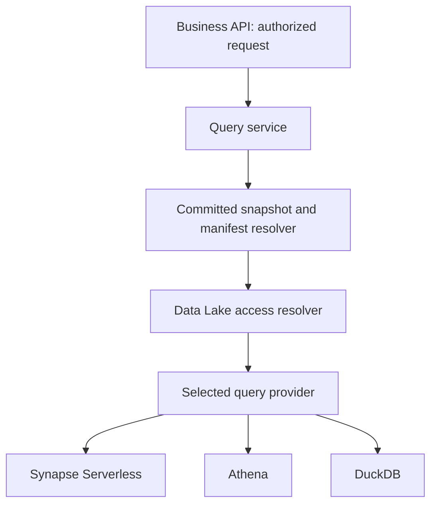

# ADR-0005 — Query providers and Data Lake integration

**Recorded:** 2026-10-11 (Asia/Kuala_Lumpur). **Evidence:** user-confirmed company constraints plus saved platform specifications; public technical references checked on this date. No live repository, service catalogue, company Kafka configuration or deployed infrastructure was inspected. Proposed rationale is not company approval or performance evidence.

## Status

**Proposed contract/rationale.** Provider abstraction is a discussed direction; specific engine selection, Data Lake query capability and cross-provider equivalence are not verified. Synapse Serverless is a transitional candidate, Athena an AWS candidate, and DuckDB an application-owned candidate—not three deployed providers or a chosen migration sequence.

## Context and decision boundary

Current/latest business requests use PostgreSQL serving per DL-008. Historical and analytical requests over committed lake artifacts may need file scans, joins and aggregation. The Data Lake service moves its backing storage from Azure to AWS in 2027 and should shield customer business code from its migration. It may or may not provide its own supported query API; that contract is unknown.

Keep business query requests/results independent of provider-specific SQL, credentials and physical storage paths. Select committed revisions before execution. Separate data location/access resolution from query compilation and engine execution.

## Proposed architecture



Only one applicable provider executes a request unless a separately designed validation/fallback workflow says otherwise. This diagram is a proposed code boundary, not a new deployable component per box. If the Data Lake supplies a sufficient query contract, the provider can call that contract without exposing an engine choice to the API.

## Responsibility mapping

| Boundary | Responsibility |
|---|---|
| API/application query service | Authorize farm/WTG/source scope, validate limits, preserve business result shape |
| Historical resolver | Resolve requested time to committed artifact/revision set with publication evidence |
| Data Lake access resolver | Obtain supported physical engine-readable locations or service query bindings under approved credentials |
| Provider selection | Reject unsupported storage/query capabilities; choose configured approved implementation |
| Provider implementation | Own SQL dialect, table/file binding, credentials, execution/cancellation/paging and result conversion |
| Shared result | Typed business columns, UTC/decimal/null semantics, ordering and provenance where required |

Keep cloud SDK/path handling out of controllers/formulas. Keep specific interfaces few and aligned to real contracts; do not build a universal SQL compiler for every hypothetical query.

### Illustrative application contract

```csharp
// Conceptual design only; not compiled implementation.
public interface ILossQueryProvider
{
    Task<LossQueryResult> ExecuteAsync(
        LossQueryRequest request,
        ResolvedCommittedInputs inputs,
        CancellationToken cancellationToken);
}
```

LossQueryRequest expresses supported business filters/aggregations and result shape, not arbitrary user-supplied SQL. ResolvedCommittedInputs identifies exact committed source/date revisions and a supported access binding. Provider-specific physical locations remain inside infrastructure implementation. DTO definitions/capability rules require actual API design.

## How providers integrate

| Provider | Documented integration and proposed adapter work |
|---|---|
| Synapse Serverless | Uses OPENROWSET/Parquet over supported Azure storage; adapter owns T-SQL/data-source/credential binding and normalization. Transitional use needs an explicit service exit/access plan |
| Athena | Queries S3 in place with supported catalogues/metastores; adapter owns query submission/result retrieval, permissions and bindings selecting committed inputs. Not a drop-in Blob URL scanner |
| DuckDB | Reads Parquet through read_parquet; supported S3/Azure extensions provide storage access. Adapter owns exact file set, native runtime/extensions, memory/temp-space limits and bounded query concurrency |
| Company Data Lake query service | If offered, adapter translates the business request to its supported query interface. Do not assume it exists |

Exact physical accessibility is mandatory for engine execution. Passing the same SQL string or changing one endpoint cannot bridge these storage/execution differences. Avoid promising that Synapse can keep scanning the new AWS lake, that Athena can directly scan the current Azure files, or that every provider accepts a customer service URI.

## Snapshot selection and table binding

Resolve manifest-selected artifacts, not every revision under a partition root. DuckDB can bind an explicit approved file list. Synapse/Athena need a supported file/table/view or equivalent binding that restricts execution to the committed selection. Mixed monthly/day revisions must not accidentally combine stale candidates.

Exact Athena/Synapse binding strategy is still to design: an approved revision-specific relation, service-provided snapshot dataset, or validated table/path filtering may fit. Do not assume Glue crawler discovery or wildcard OPENROWSET understands application manifests. Retain input-set/provenance identity for reproducibility, and bound oversized file lists/SQL/table metadata updates.

## Alternatives and consequences

| Alternative | Trade-off |
|---|---|
| SQL/provider details in controllers | Fast initial integration but propagates migration changes into business/API code |
| One engine hard-coded behind a narrow provider | Lowest initial scope; still allows a proven second implementation later |
| Generic arbitrary SQL translation across all engines | Expands complexity/semantic risk; not needed for known business queries |
| Company Data Lake query API | Preferred if it supplies required semantics/performance and customer migration boundary |
| Shared business contract with provider-owned execution | Proposed boundary; additional providers only when migration or measured need requires |

Portability covers business contracts and selected supported operations, not engine feature/performance equality. Validate decimal precision, UTC boundaries, nulls, sorting/pagination, aggregation semantics, join grain and cancellation. Parameterize data values and allowlist physical identifiers/paths; never pass unrestricted caller SQL to the provider.

A wrapper does not remove cross-cloud scan cost, network latency or DuckDB pod memory pressure. Measure and constrain workloads. Avoid automatic fallback that repeats large scans or changes historical results silently.

## Migration and acceptance

Ask Data Lake whether it exposes stable artifact refs, direct locations or query bindings before implementing an AWS provider. Run equivalent representative queries over the same frozen committed revision set before/after migration, compare deterministic expected results, measure cost/latency and verify permissions. Test that uncommitted attempts and wrong revisions are excluded.

Only then change provider/configuration and retire transitional Azure dependency. Latest SQL serving behavior should stay separately validated; this ADR does not require all latest reads to move into file queries.

## References

- [Synapse Serverless Parquet query integration](https://learn.microsoft.com/en-us/azure/synapse-analytics/sql/query-parquet-files)
- [Athena SQL and catalogue integration](https://docs.aws.amazon.com/athena/latest/ug/using-athena-sql.html)
- [DuckDB Parquet](https://duckdb.org/docs/current/data/parquet/overview)
- [DuckDB S3 access](https://duckdb.org/docs/current/core_extensions/httpfs/s3api)
- [DuckDB Azure access](https://duckdb.org/docs/current/core_extensions/azure)

Related: ADR-0001/0004/0006, DL-008/DL-018/DL-026, Q-010/Q-017/Q-018.
